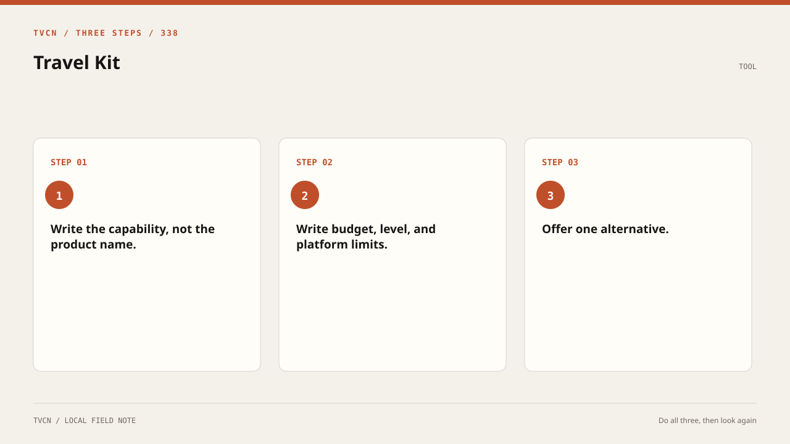

Travel light: one body, one lens, small stabilizer, two batteries, one ND, one pouch.

<!-- DIAGRAM_START -->
<h2>Diagram</h2>
<figure>
  
  <figcaption>Do the three steps in order, then look again at the image or file.</figcaption>
</figure>
<!-- DIAGRAM_END -->
<h2>On set</h2>

One body, one lens, a small gimbal, two batteries, ND, and a waist bag. Weigh it and walk a day before going.

<h2>Do this</h2>

Travel light: one body, one lens, a small gimbal, two batteries, one ND, a waist bag; first survive a full day.
<ol><li>One body and one lens, no second lens.</li><li>Small gimbal, two batteries, one ND in the waist bag.</li><li>Weigh the total and walk a full day before departure.</ol>
<h2>Avoid</h2>

Do not carry three lenses “just in case”; after half a day you cannot shoot anything.

<h2>Check</h2>
<ul><li>Total weight is measured and survives a full-day walk.</li><li>One body and one lens only, no extra optics.</li><li>Batteries, ND, and gimbal sit in the waist bag for one-hand access.</li></ul>
