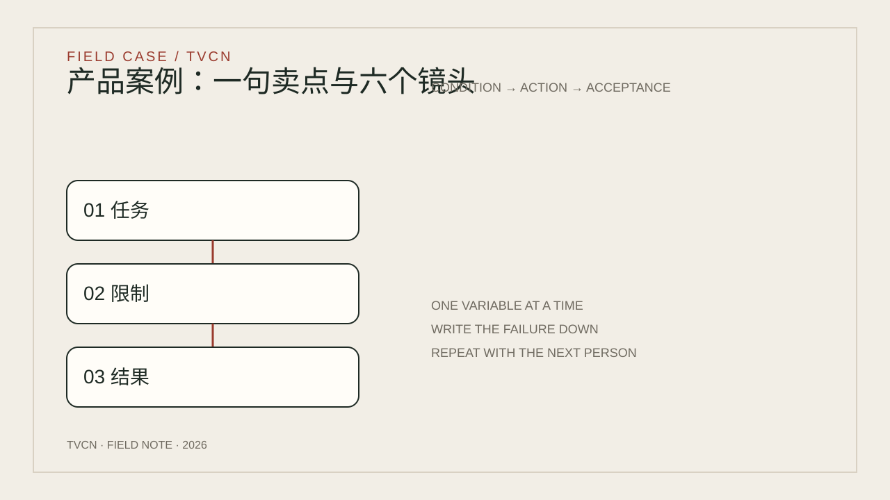

匿名复合复盘：一款便携咖啡机，目标人群是通勤者；客户给了一句卖点“到公司也能喝到 92 度的咖啡”，要求 30 秒内证明。 这不是某一位客户的真实项目，而是把多次现场里反复出现的约束、决定和翻车压成一个可复用的案例。

<!-- DIAGRAM_START -->
<h2>图解</h2>
<figure>
  
  <figcaption>看“不能拍办公室全景，只有一个工位和一张桌子”和“第一个镜头不拍产品外观，拍通勤者进办公室时手里的冷咖啡；先建立“为什么需要””两处，判断这个案例的限制有没有落到动作上。</figcaption>
</figure>
<!-- DIAGRAM_END -->

<section><h2 id="section-1">任务与限制</h2>
一个 30 秒产品广告的复合复盘：六个镜头、一个卖点、一次真实使用，不拍参数堆叠。
<ul><li>不能拍办公室全景，只有一个工位和一张桌子。</li><li>产品不能插电，只能用现场电池。</li><li>演员不是咖啡师，动作必须一次学会。</li></ul></section>
<section><h2 id="section-2">排期</h2>
半天预演产品动作，半天拍摄六个镜头；每个镜头只回答一个问题：能不能、快不快、烫不烫、香不香、干不干净、愿不愿意每天用。

排期不是把工时排满，而是把最不可逆的动作放在体力和光都最可靠的时候；补拍窗口只留给钩子和连续性。
</section>
<section><h2 id="section-3">预算</h2>
总预算 ¥18,000：产品与道具 3,000、场地 4,000、摄影灯光 8,000、后期 3,000；不租咖啡店，用一间真实办公室。

预算先保三件事：不可重来的现场、声音备份和后期返工；设备升级放在这三件之后。
</section>
<section><h2 id="section-4">三个决定</h2>
第一个镜头不拍产品外观，拍通勤者进办公室时手里的冷咖啡；先建立“为什么需要”。

第二个镜头只拍一个动作：加水、按键、等 90 秒；用计时器屏幕做时间证据。

最后一个镜头不拍参数，拍他把杯子递给同事；用分享动作替代“好用”形容词。
</section>
<section><h2 id="section-5">三次翻车</h2>
一开始想拍六个产品角度，剪出来像电商详情页；删到两个角度才像广告。

演员第一次按键按错，产品灯没亮；预演时加了一个明显的手指位置标记。

办公室自然光太绿，白平衡跟着窗光跑；最后关掉顶灯，用一块反光板补脸。
</section>
<section><h2 id="section-6">结果</h2>
30 秒成片，六个镜头各承担一个问题；客户只改了一句 end card。复盘结论：产品广告的“证明”比“好看”更难，先把使用动作拍对。
</section>
<section><h2 id="section-7">可复用清单</h2><ul><li>先写六个问题，再写六个镜头。</li><li>产品动作预演至少十遍，标记手指位置。</li><li>自然光先测白平衡，再决定要不要补光。</li><li>最后用一个人与人的动作收尾，不用参数。</li></ul></section>
<section><h2 id="section-8">现场拆解</h2>
画面：不能拍办公室全景，只有一个工位和一张桌子。 这件事决定了第一个机位怎么放，而不是先决定镜头语言。第一个镜头不拍产品外观，拍通勤者进办公室时手里的冷咖啡；先建立“为什么需要”。

声音：第二个镜头只拍一个动作：加水、按键、等 90 秒；用计时器屏幕做时间证据。 现场先录一条干净的声音，再让画面去对；不要等后期用音乐盖住问题。

交付：30 秒成片，六个镜头各承担一个问题；客户只改了一句 end card。复盘结论：产品广告的“证明”比“好看”更难，先把使用动作拍对。 交付前把文件命名、时长和平台规格各查一遍，避免内容对了、格式又退回来。
</section><section><h2 id="section-9">被否决的方案</h2>
另一个看似更快的方案，是把 产品不能插电，只能用现场电池。 直接交给常规流程，先拍“好看”的画面，再补故事。否决原因很具体：演员第一次按键按错，产品灯没亮；预演时加了一个明显的手指位置标记。 这说明省掉的不是时间，而是可复现的条件。
</section><section><h2 id="section-10">如果重做</h2>
下一次会先处理“先写六个问题，再写六个镜头。”，并把“一开始想拍六个产品角度，剪出来像电商详情页；删到两个角度才像广告。”写进拍摄前检查表；预算不先加设备，而是先加一个能复核的人时。只有把失败条件提前，案例才不是故事，而是方法。
</section><!-- SOURCES_START -->
