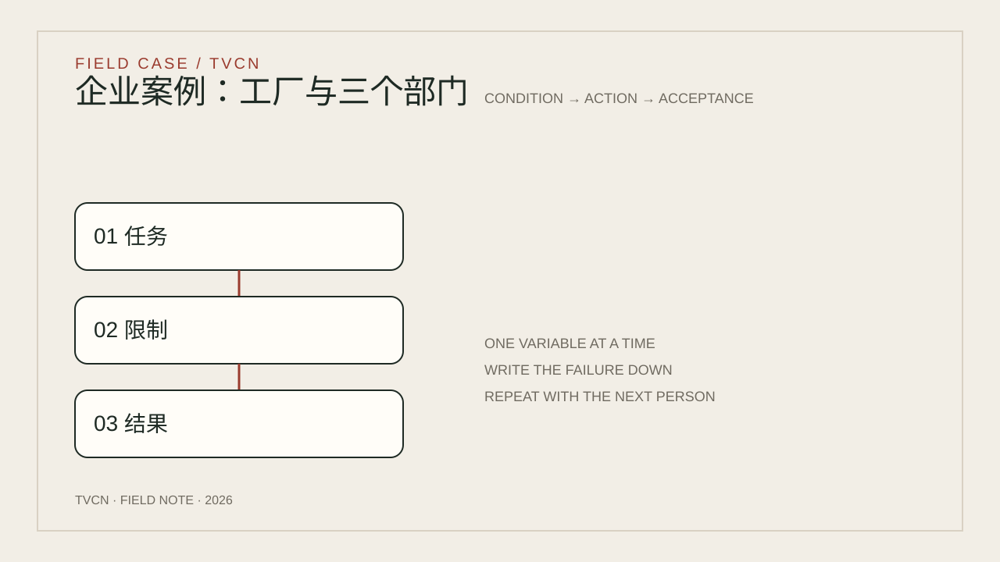

匿名复合复盘：一家制造企业 3 分钟宣传片，要求拍到工厂、研发、质检和售后；预算有限，只有两天。 这不是某一位客户的真实项目，而是把多次现场里反复出现的约束、决定和翻车压成一个可复用的案例。

案例说明：匿名复合复盘，无现场照片；下方图示为结构示意，不对应单一客户。

<figure class="article-media case-path"><table><caption>复盘路径：四道门</caption><thead><tr><th>阶段</th><th>要回答的问题</th><th>失败信号</th></tr></thead><tbody><tr><td>任务</td><td>一句话卖点能不能被画面证明</td><td>卖点靠旁白解释</td></tr><tr><td>预演</td><td>产品动作能不能一次做对</td><td>演员看提示才敢动</td></tr><tr><td>拍摄</td><td>六个镜头是否各自回答一个问题</td><td>镜头重复同一信息</td></tr><tr><td>复盘</td><td>哪一步最不可逆</td><td>只在后期补救</td></tr></tbody></table><figcaption>结构示意，不是现场截图；用来检查复盘顺序。TVCN 图解</figcaption></figure>
<!-- DIAGRAM_START -->
<h2>图解</h2>
<figure>
  
  <figcaption>看“工厂不能停线，拍摄不能影响生产”和“全片只跟一个订单：从研发打样、工厂生产、质检到售后，观众跟着一件产品走”两处，判断这个案例的限制有没有落到动作上。</figcaption>
</figure>
<!-- DIAGRAM_END -->

<section><h2 id="section-1">任务与限制</h2>
一个企业宣传片的复合复盘：工厂、三个部门、一个真实动作，拒绝把宣传片拍成部门汇报。
<ul><li>工厂不能停线，拍摄不能影响生产。</li><li>四个部门都想出镜，片长只有 3 分钟。</li><li>没有演员，员工只能做本职工作。</li></ul></section>
<section><h2 id="section-2">排期</h2>
D1 工厂与研发，D2 质检与售后；每个部门只拍一个真实动作，不拍部门合影；第三天补空镜与访谈。

排期不是把工时排满，而是把最不可逆的动作放在体力和光都最可靠的时候；补拍窗口只留给钩子和连续性。
</section>
<section><h2 id="section-3">预算</h2>
总预算 ¥32,000：两天人力 12,000、器材 10,000、工厂协调 5,000、后期 5,000。

预算先保三件事：不可重来的现场、声音备份和后期返工；设备升级放在这三件之后。
</section>
<section><h2 id="section-4">三个决定</h2>
全片只跟一个订单：从研发打样、工厂生产、质检到售后，观众跟着一件产品走。

部门介绍不拍坐办公室，拍他们与产品发生关系的手和动作；谁做什么，一眼能看懂。

结尾不喊口号，拍产品被装车、客户签收；用交付动作收束。
</section>
<section><h2 id="section-5">三次翻车</h2>
第一版按部门顺序剪，像汇报片；改成按订单顺序。

工厂拍摄时停线 10 分钟，车间主任不满；后来只用真实换班间隙拍。

售后部门坚持拍客服坐席，画面全是屏幕；改成拍上门维修的手。
</section>
<figure class="article-media case-failures" data-case-failure-table="1"><table><caption>三次翻车与补救</caption><thead><tr><th>翻车现场</th><th>当时的补救</th></tr></thead><tbody><tr><td>第一版按部门顺序剪，像汇报片</td><td>改成按订单顺序。</td></tr><tr><td>工厂拍摄时停线 10 分钟，车间主任不满</td><td>后来只用真实换班间隙拍。</td></tr><tr><td>售后部门坚持拍客服坐席，画面全是屏幕</td><td>改成拍上门维修的手。</td></tr></tbody></table><figcaption>结构表，不是现场截图；三次返工来自同一复合复盘。TVCN 图解</figcaption></figure>
<section><h2 id="section-6">结果</h2>
3 分钟成片，一件产品贯穿四个部门；员工没有表演，客户只改了一处字幕。复盘结论：企业片不是拍完所有部门，而是让一个动作穿过所有部门。
</section>
<section><h2 id="section-7">可复用清单</h2><ul><li>先选一个订单或产品做主线。</li><li>每个部门只拍一个真实动作。</li><li>不要求工厂停线。</li><li>结尾用交付动作，不用口号。</li></ul></section>
<section><h2 id="section-8">现场拆解</h2>
画面：工厂不能停线，拍摄不能影响生产。 这件事决定了第一个机位怎么放，而不是先决定镜头语言。全片只跟一个订单：从研发打样、工厂生产、质检到售后，观众跟着一件产品走。

声音：部门介绍不拍坐办公室，拍他们与产品发生关系的手和动作；谁做什么，一眼能看懂。 现场先录一条干净的声音，再让画面去对；不要等后期用音乐盖住问题。

交付：3 分钟成片，一件产品贯穿四个部门；员工没有表演，客户只改了一处字幕。复盘结论：企业片不是拍完所有部门，而是让一个动作穿过所有部门。 交付前把文件命名、时长和平台规格各查一遍，避免内容对了、格式又退回来。
</section><section><h2 id="section-9">被否决的方案</h2>
另一个看似更快的方案，是把 四个部门都想出镜，片长只有 3 分钟。 直接交给常规流程，先拍“好看”的画面，再补故事。否决原因很具体：工厂拍摄时停线 10 分钟，车间主任不满；后来只用真实换班间隙拍。 这说明省掉的不是时间，而是可复现的条件。
</section><section><h2 id="section-10">如果重做</h2>
下一次会先处理“先选一个订单或产品做主线。”，并把“第一版按部门顺序剪，像汇报片；改成按订单顺序。”写进拍摄前检查表；预算不先加设备，而是先加一个能复核的人时。只有把失败条件提前，案例才不是故事，而是方法。
</section>

<!-- SOURCES_START -->
## 经验说明

经验说明：本页来自 6 个企业宣传片项目的合并复盘，现场为工厂与办公区各一天；金额与周期为区间，人物、地点与客户信息已匿名化，不对应单一客户；不含外部实验室测试。
<!-- SOURCES_END -->

