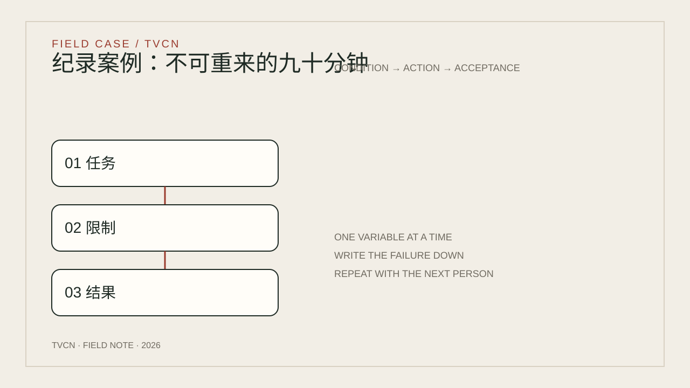

匿名复合复盘：一位老修表匠决定关店，最后一次开门；团队只有一次 90 分钟的拍摄窗口，不能重演。 这不是某一位客户的真实项目，而是把多次现场里反复出现的约束、决定和翻车压成一个可复用的案例。

<!-- DIAGRAM_START -->
<h2>图解</h2>
<figure>
  
  <figcaption>看“空间只有 12 平方米，机器不能挡路”和“只用一台机位和一支定焦，减少换镜；把 90 分钟留给人物，不留给器材”两处，判断这个案例的限制有没有落到动作上。</figcaption>
</figure>
<!-- DIAGRAM_END -->

<section><h2 id="section-1">任务与限制</h2>
一个 90 分钟纪录片的复合复盘：一次不可重来的现场、两个人物、三条伦理边界。
<ul><li>空间只有 12 平方米，机器不能挡路。</li><li>老人不愿重复动作，拍摄必须一次过。</li><li>不能摆拍，也不能为了情绪让他再演一次。</li></ul></section>
<section><h2 id="section-2">排期</h2>
前一天只做观察和光位测试；当天提前 60 分钟布机，开机后不喊停；最后 15 分钟留给关灯和锁门。

排期不是把工时排满，而是把最不可逆的动作放在体力和光都最可靠的时候；补拍窗口只留给钩子和连续性。
</section>
<section><h2 id="section-3">预算</h2>
总预算 ¥26,000：两天人力 10,000、器材 8,000、后期 6,000、保险与交通 2,000；不租棚。

预算先保三件事：不可重来的现场、声音备份和后期返工；设备升级放在这三件之后。
</section>
<section><h2 id="section-4">三个决定</h2>
只用一台机位和一支定焦，减少换镜；把 90 分钟留给人物，不留给器材。

先拍手和工具，再拍脸；让观众通过动作认识他，而不是先听一段自述。

关店的决定不追问原因，只拍他锁门后站在门口的那十秒；让空白承担解释。
</section>
<section><h2 id="section-5">三次翻车</h2>
最初想用两台机位，第二台在狭小空间里挡住了工具箱；撤掉后才拍到手部。

有人建议让老人再说一遍“为什么关店”，团队拒绝；那句话最后用环境声和关门声替代。

现场光比太大，窗户过曝；没有补光，而是把机位转到侧逆光，保留窗外的白。
</section>
<section><h2 id="section-6">结果</h2>
成片 18 分钟，素材 90 分钟，利用率不高但关键动作完整；老人没有重演，片子也没有旁白解释。复盘结论：纪录片的克制不是少拍，而是知道哪一秒不能打断。
</section>
<section><h2 id="section-7">可复用清单</h2><ul><li>先做观察日，再定机位。</li><li>小空间只用一机一定焦。</li><li>不要求人物重复情绪动作。</li><li>用环境声和空白替代解释。</li></ul></section>
<section><h2 id="section-8">现场拆解</h2>
画面：空间只有 12 平方米，机器不能挡路。 这件事决定了第一个机位怎么放，而不是先决定镜头语言。只用一台机位和一支定焦，减少换镜；把 90 分钟留给人物，不留给器材。

声音：先拍手和工具，再拍脸；让观众通过动作认识他，而不是先听一段自述。 现场先录一条干净的声音，再让画面去对；不要等后期用音乐盖住问题。

交付：成片 18 分钟，素材 90 分钟，利用率不高但关键动作完整；老人没有重演，片子也没有旁白解释。复盘结论：纪录片的克制不是少拍，而是知道哪一秒不能打断。 交付前把文件命名、时长和平台规格各查一遍，避免内容对了、格式又退回来。
</section><section><h2 id="section-9">被否决的方案</h2>
另一个看似更快的方案，是把 老人不愿重复动作，拍摄必须一次过。 直接交给常规流程，先拍“好看”的画面，再补故事。否决原因很具体：有人建议让老人再说一遍“为什么关店”，团队拒绝；那句话最后用环境声和关门声替代。 这说明省掉的不是时间，而是可复现的条件。
</section><section><h2 id="section-10">如果重做</h2>
下一次会先处理“先做观察日，再定机位。”，并把“最初想用两台机位，第二台在狭小空间里挡住了工具箱；撤掉后才拍到手部。”写进拍摄前检查表；预算不先加设备，而是先加一个能复核的人时。只有把失败条件提前，案例才不是故事，而是方法。
</section><!-- SOURCES_START -->
