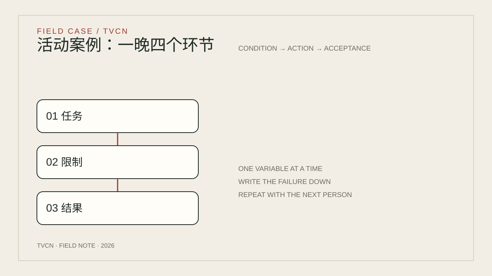

匿名复合复盘：一场 300 人行业晚宴，四个环节：致辞、颁奖、表演、自由交流；团队 3 台机位、2 名声音、1 名现场剪辑。 这不是某一位客户的真实项目，而是把多次现场里反复出现的约束、决定和翻车压成一个可复用的案例。

案例说明：匿名复合复盘，无现场照片；下方图示为结构示意，不对应单一客户。

<figure class="article-media case-path"><table><caption>复盘路径：四道门</caption><thead><tr><th>阶段</th><th>要回答的问题</th><th>失败信号</th></tr></thead><tbody><tr><td>任务</td><td>一句话卖点能不能被画面证明</td><td>卖点靠旁白解释</td></tr><tr><td>预演</td><td>产品动作能不能一次做对</td><td>演员看提示才敢动</td></tr><tr><td>拍摄</td><td>六个镜头是否各自回答一个问题</td><td>镜头重复同一信息</td></tr><tr><td>复盘</td><td>哪一步最不可逆</td><td>只在后期补救</td></tr></tbody></table><figcaption>结构示意，不是现场截图；用来检查复盘顺序。TVCN 图解</figcaption></figure>
<!-- DIAGRAM_START -->
<h2>图解</h2>
<figure>
  
  <figcaption>看“不能挡住观众视线，机位只能放在侧后方”和“三台机位固定分工：A 全景、B 中景跟主宾、C 侧机位拍反应；不互相追同一个动作”两处，判断这个案例的限制有没有落到动作上。</figcaption>
</figure>
<!-- DIAGRAM_END -->

<section><h2 id="section-1">任务与限制</h2>
一个单晚活动的复合复盘：四个环节、三台机位、一条时码，先保证每个环节都有完整记录。
<ul><li>不能挡住观众视线，机位只能放在侧后方。</li><li>颁奖名单临时变动，不能提前拍特写。</li><li>现场灯光快速变色，白平衡不能锁死。</li></ul></section>
<section><h2 id="section-2">排期</h2>
16:00 进场，17:00 三机位时码同步，18:00 拍空镜与场地，19:00 致辞，19:40 颁奖，20:20 表演，21:00 自由交流，22:00 备份并离场。

排期不是把工时排满，而是把最不可逆的动作放在体力和光都最可靠的时候；补拍窗口只留给钩子和连续性。
</section>
<section><h2 id="section-3">预算</h2>
总预算 ¥16,000：三机位 6,000、声音 3,000、灯光 2,000、现场剪辑 3,000、备份介质 2,000。

预算先保三件事：不可重来的现场、声音备份和后期返工；设备升级放在这三件之后。
</section>
<section><h2 id="section-4">三个决定</h2>
三台机位固定分工：A 全景、B 中景跟主宾、C 侧机位拍反应；不互相追同一个动作。

颁奖环节不预拍特写，先用 B 机位跟名单，C 机位抓上台动作；名字确认后再补特写。

现场剪辑只做备份和标记，不追求当晚出片；先把四个环节各做一条完整时间线。
</section>
<section><h2 id="section-5">三次翻车</h2>
B、C 同时追主宾，结果没有反应镜头；第二天重设机位分工。

颁奖名单临时加人，C 机位没跟上；后来安排一个人专门盯名单变更。

现场灯变紫，A 机位白平衡锁死；改成自动白平衡加后期统一。
</section>
<figure class="article-media case-failures" data-case-failure-table="1"><table><caption>三次翻车与补救</caption><thead><tr><th>翻车现场</th><th>当时的补救</th></tr></thead><tbody><tr><td>B、C 同时追主宾，结果没有反应镜头</td><td>第二天重设机位分工。</td></tr><tr><td>颁奖名单临时加人，C 机位没跟上</td><td>后来安排一个人专门盯名单变更。</td></tr><tr><td>现场灯变紫，A 机位白平衡锁死</td><td>改成自动白平衡加后期统一。</td></tr></tbody></table><figcaption>结构表，不是现场截图；三次返工来自同一复合复盘。TVCN 图解</figcaption></figure>
<section><h2 id="section-6">结果</h2>
四个环节各有完整时间线，颁奖特写第二天补剪；客户拿到 1 条 3 分钟回顾和 4 条环节片。复盘结论：活动拍摄先保完整，再保精彩。
</section>
<section><h2 id="section-7">可复用清单</h2><ul><li>三机位先写分工，不写位置。</li><li>名单变更安排专人盯。</li><li>现场剪辑先做备份和标记。</li><li>灯光变色时不要锁死白平衡。</li></ul></section>
<section><h2 id="section-8">现场拆解</h2>
画面：不能挡住观众视线，机位只能放在侧后方。 这件事决定了第一个机位怎么放，而不是先决定镜头语言。三台机位固定分工：A 全景、B 中景跟主宾、C 侧机位拍反应；不互相追同一个动作。

声音：颁奖环节不预拍特写，先用 B 机位跟名单，C 机位抓上台动作；名字确认后再补特写。 现场先录一条干净的声音，再让画面去对；不要等后期用音乐盖住问题。

交付：四个环节各有完整时间线，颁奖特写第二天补剪；客户拿到 1 条 3 分钟回顾和 4 条环节片。复盘结论：活动拍摄先保完整，再保精彩。 交付前把文件命名、时长和平台规格各查一遍，避免内容对了、格式又退回来。
</section><section><h2 id="section-9">被否决的方案</h2>
另一个看似更快的方案，是把 颁奖名单临时变动，不能提前拍特写。 直接交给常规流程，先拍“好看”的画面，再补故事。否决原因很具体：颁奖名单临时加人，C 机位没跟上；后来安排一个人专门盯名单变更。 这说明省掉的不是时间，而是可复现的条件。
</section><section><h2 id="section-10">如果重做</h2>
下一次会先处理“三机位先写分工，不写位置。”，并把“B、C 同时追主宾，结果没有反应镜头；第二天重设机位分工。”写进拍摄前检查表；预算不先加设备，而是先加一个能复核的人时。只有把失败条件提前，案例才不是故事，而是方法。
</section>

<!-- SOURCES_START -->
## 经验说明

经验说明：本页来自 7 场线下活动的合并复盘，单机位与双机位各半；金额与周期为区间，人物、地点与客户信息已匿名化，不对应单一客户；不含外部实验室测试。
<!-- SOURCES_END -->

