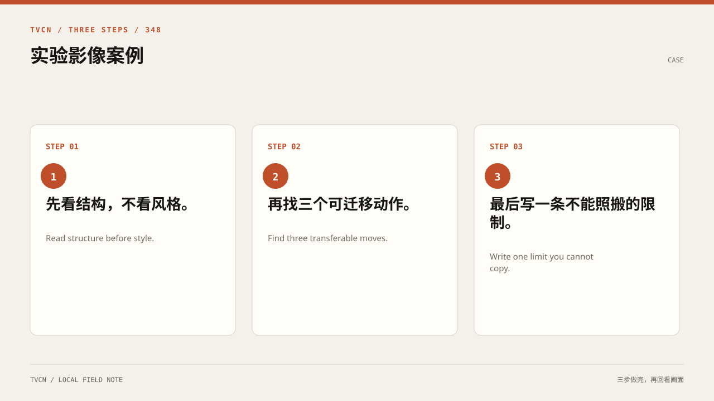

这是一份匿名复合复盘。 把三次同类项目中反复出现的约束、决定和后果合并成一条可核对的时间线；金额与工期用区间，不对应单一客户，也不虚构客户名。它能用来对照你的项目，但不能当成某一单的流水账。

<!-- DIAGRAM_START -->
<h2>图解</h2>
<figure>
  
  <figcaption>看“片型：4 分钟实验短片”和“团队：2 人（导演/摄影 + 声音）”两处，判断症状能不能被复述成一句可观察的话。</figcaption>
</figure>
<!-- DIAGRAM_END -->
<section><h2 id="section-1">这份复盘怎么读</h2>
<strong>这是一份匿名复合复盘。</strong> 把三次同类项目中反复出现的约束、决定和后果合并成一条可核对的时间线；金额与工期用区间，不对应单一客户，也不虚构客户名。它能用来对照你的项目，但不能当成某一单的流水账。
</section><section><h2 id="section-2">项目卡</h2><ul><li>片型：4 分钟实验短片</li><li>团队：2 人（导演/摄影 + 声音）</li><li>周期：1 个拍摄日 + 2 个后期日</li><li>预算区间：¥2,000–5,000</li><li>平台：影展 / 艺术平台</li><li>约束：固定机位、无对白、一个动作、一个地点</li></ul></section><section><h2 id="section-3">时间线</h2><ol><li><strong>13:00</strong>：布光；固定机位，先拍空桌建立规则。</li><li><strong>14:00</strong>：第一条：轻箱子，脚步轻，环境声宽。</li><li><strong>15:00</strong>：云遮住窗光；不补灯，等 20 分钟。</li><li><strong>16:00</strong>：第二条：重箱子，脚步沉，落地声响。</li><li><strong>17:00</strong>：第三条：人物不放下箱子，呼吸变近。</li><li><strong>17:30</strong>：打破：人物出画，机位不动，声音留在空桌。</li><li><strong>后期</strong>：删开头字幕；不配音乐；把打破放到第三次重复之后。</li></ol></section><section><h2 id="section-4">约束</h2>
全片只有一条规则：机位不动，人物从画面左边走到右边，把一只箱子放到桌上。没有对白，没有音乐预算，只有一个下午的光。
</section><section><h2 id="section-5">前期决定</h2><ol><li>把规则写进第一镜：观众在前 15 秒就知道“机位不会动、动作会重复”。</li><li>三次重复只改一个变量：第一次箱子轻，第二次箱子重，第三次人物不放下箱子。</li><li>声音做结构：脚步声、箱子落地声、呼吸声各负责一个段落；不用旁白解释“这是什么意思”。</li></ol></section><section><h2 id="section-6">现场变故</h2>
拍到第三条时，云层遮住窗光，画面暗了一档。团队没有补灯，等云过去再拍；等待的 20 分钟被剪进片头，成为“时间”的一部分。
</section><section><h2 id="section-7">后期取舍</h2><ol><li>不用音乐：现场声已经有三段结构，音乐会让它变成“配乐短片”。</li><li>删掉开头字幕：原本想用一句概念解释，后来发现规则本身已经说清。</li><li>把打破放在第 3 次重复之后：第一次剪得太早，观众还没建立预期，打破就不成立。</li></ol></section><section><h2 id="section-8">结果</h2>
试看观众能说出规则和打破的那一下，不需要导演解释。片子没有剧情，也没有旁白，但“箱子越来越重”让重复有了方向。
</section><section><h2 id="section-9">三条可复用经验</h2><ol><li>实验片先写规则：规则越清楚，重复越有张力；规则越多，观众越不知道看什么。</li><li>重复只改一个变量：重量、速度、光线、声音，一次只改一个。</li><li>声音可以承担结构：不用旁白，脚步声和落地声就能分段。</li></ol></section><section><h2 id="section-10">一条失败教训</h2>
第一次剪把打破放在第 2 次重复后，观众还没建立预期，打破像事故。重剪回到第 3 次之后，规则才成立。
</section>
<h2>验收</h2><ul><li>前 15 秒有没有建立规则？</li><li>重复是不是只改一个变量？</li><li>打破之前有没有建立预期？</li><li>声音有没有分段？</li><li>有没有用旁白解释？</li><li>结尾有没有留在后果里？</li><li>片长是否超过规则需要的长度？</li></ul>
