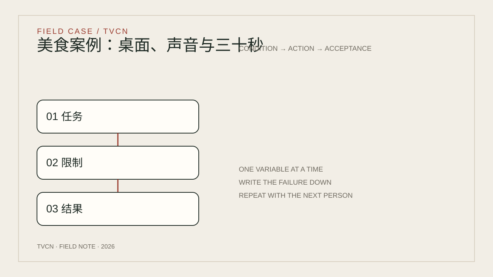

匿名复合复盘：一款手工酱料的 30 秒短片，拍桌面制作过程；场地是真实厨房，只有一扇窗。 这不是某一位客户的真实项目，而是把多次现场里反复出现的约束、决定和翻车压成一个可复用的案例。

案例说明：匿名复合复盘，无现场照片；下方图示为结构示意，不对应单一客户。

<figure class="article-media case-path"><table><caption>复盘路径：四道门</caption><thead><tr><th>阶段</th><th>要回答的问题</th><th>失败信号</th></tr></thead><tbody><tr><td>任务</td><td>一句话卖点能不能被画面证明</td><td>卖点靠旁白解释</td></tr><tr><td>预演</td><td>产品动作能不能一次做对</td><td>演员看提示才敢动</td></tr><tr><td>拍摄</td><td>六个镜头是否各自回答一个问题</td><td>镜头重复同一信息</td></tr><tr><td>复盘</td><td>哪一步最不可逆</td><td>只在后期补救</td></tr></tbody></table><figcaption>结构示意，不是现场截图；用来检查复盘顺序。TVCN 图解</figcaption></figure>
<!-- DIAGRAM_START -->
<h2>图解</h2>
<figure>
  
  <figcaption>看“厨房不能关窗，窗光会移动”和“只拍三个动作：倒入、搅拌、装盘；每个动作一个机位，不做无意义环绕”两处，判断这个案例的限制有没有落到动作上。</figcaption>
</figure>
<!-- DIAGRAM_END -->

<section><h2 id="section-1">任务与限制</h2>
一个 30 秒美食桌面的复合复盘：一盏窗光、两支麦克风、三个动作，不靠升格堆食欲。
<ul><li>厨房不能关窗，窗光会移动。</li><li>酱料颜色深，容易拍成黑块。</li><li>没有食品造型师，食材只能准备一次。</li></ul></section>
<section><h2 id="section-2">排期</h2>
09:00 窗光测试，10:00 拍三个动作，11:00 拍成品与包装，11:30 收工；不等正午硬光。

排期不是把工时排满，而是把最不可逆的动作放在体力和光都最可靠的时候；补拍窗口只留给钩子和连续性。
</section>
<section><h2 id="section-3">预算</h2>
总预算 ¥6,000：食材 1,000、场地 1,000、器材 2,000、后期 2,000。

预算先保三件事：不可重来的现场、声音备份和后期返工；设备升级放在这三件之后。
</section>
<section><h2 id="section-4">三个决定</h2>
只拍三个动作：倒入、搅拌、装盘；每个动作一个机位，不做无意义环绕。

深色酱料用侧逆光加一块白卡补暗部，不靠提高曝光；背景用浅色木板托住颜色。

声音先录：搅拌的黏稠声、勺子碰碗声、倒酱声；画面后期再对，不靠音乐盖。
</section>
<section><h2 id="section-5">三次翻车</h2>
第一版用顶光，酱料反光成一片白；改成侧逆光。

搅拌动作重复五次，食材出水；只保留一次完整动作。

现场收音只用了机头麦，搅拌声太远；补了一支贴近的麦克风。
</section>
<figure class="article-media case-failures" data-case-failure-table="1"><table><caption>三次翻车与补救</caption><thead><tr><th>翻车现场</th><th>当时的补救</th></tr></thead><tbody><tr><td>第一版用顶光，酱料反光成一片白</td><td>改成侧逆光。</td></tr><tr><td>搅拌动作重复五次，食材出水</td><td>只保留一次完整动作。</td></tr><tr><td>现场收音只用了机头麦，搅拌声太远</td><td>补了一支贴近的麦克风。</td></tr></tbody></table><figcaption>结构表，不是现场截图；三次返工来自同一复合复盘。TVCN 图解</figcaption></figure>
<section><h2 id="section-6">结果</h2>
30 秒成片，三个动作、一条完整声音；酱料颜色和质感都保留。复盘结论：美食片的食欲来自动作和声音，不是升格数量。
</section>
<section><h2 id="section-7">可复用清单</h2><ul><li>先测窗光，再准备食材。</li><li>深色食物用侧逆光，不用顶光。</li><li>每个动作只拍一次完整的。</li><li>声音和画面分开录，后期对。</li></ul></section>
<section><h2 id="section-8">现场拆解</h2>
画面：厨房不能关窗，窗光会移动。 这件事决定了第一个机位怎么放，而不是先决定镜头语言。只拍三个动作：倒入、搅拌、装盘；每个动作一个机位，不做无意义环绕。

声音：深色酱料用侧逆光加一块白卡补暗部，不靠提高曝光；背景用浅色木板托住颜色。 现场先录一条干净的声音，再让画面去对；不要等后期用音乐盖住问题。

交付：30 秒成片，三个动作、一条完整声音；酱料颜色和质感都保留。复盘结论：美食片的食欲来自动作和声音，不是升格数量。 交付前把文件命名、时长和平台规格各查一遍，避免内容对了、格式又退回来。
</section><section><h2 id="section-9">被否决的方案</h2>
另一个看似更快的方案，是把 酱料颜色深，容易拍成黑块。 直接交给常规流程，先拍“好看”的画面，再补故事。否决原因很具体：搅拌动作重复五次，食材出水；只保留一次完整动作。 这说明省掉的不是时间，而是可复现的条件。
</section><section><h2 id="section-10">如果重做</h2>
下一次会先处理“先测窗光，再准备食材。”，并把“第一版用顶光，酱料反光成一片白；改成侧逆光。”写进拍摄前检查表；预算不先加设备，而是先加一个能复核的人时。只有把失败条件提前，案例才不是故事，而是方法。
</section>

<!-- SOURCES_START -->
## 经验说明

经验说明：本页来自 9 个美食短片项目的合并复盘，桌面拍摄与现场同期声；金额与周期为区间，人物、地点与客户信息已匿名化，不对应单一客户；不含外部实验室测试。
<!-- SOURCES_END -->

