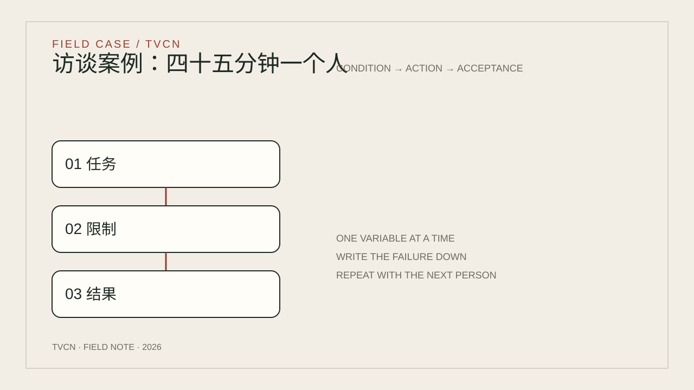

匿名复合复盘：一位独立设计师的 45 分钟访谈，空间是他的工作室；团队两人，一台主机位、一台侧机位。 这不是某一位客户的真实项目，而是把多次现场里反复出现的约束、决定和翻车压成一个可复用的案例。

案例说明：匿名复合复盘，无现场照片；下方图示为结构示意，不对应单一客户。

<figure class="article-media case-path"><table><caption>复盘路径：四道门</caption><thead><tr><th>阶段</th><th>要回答的问题</th><th>失败信号</th></tr></thead><tbody><tr><td>任务</td><td>一句话卖点能不能被画面证明</td><td>卖点靠旁白解释</td></tr><tr><td>预演</td><td>产品动作能不能一次做对</td><td>演员看提示才敢动</td></tr><tr><td>拍摄</td><td>六个镜头是否各自回答一个问题</td><td>镜头重复同一信息</td></tr><tr><td>复盘</td><td>哪一步最不可逆</td><td>只在后期补救</td></tr></tbody></table><figcaption>结构示意，不是现场截图；用来检查复盘顺序。TVCN 图解</figcaption></figure>
<!-- DIAGRAM_START -->
<h2>图解</h2>
<figure>
  
  <figcaption>看“工作室窗户多，白天光比大”和“主光用大柔光从窗侧补，不压掉窗外；背景保留工作室的杂物，让人物有地方”两处，判断这个案例的限制有没有落到动作上。</figcaption>
</figure>
<!-- DIAGRAM_END -->

<section><h2 id="section-1">任务与限制</h2>
一个 45 分钟访谈的复合复盘：两个人、三盏灯、一条备份，先把被访者拍舒服。
<ul><li>工作室窗户多，白天光比大。</li><li>被访者不愿重复回答，不能喊停重来。</li><li>只有一个 45 分钟窗口，设备不能出故障。</li></ul></section>
<section><h2 id="section-2">排期</h2>
提前 90 分钟布光与测试，访谈 45 分钟不打断；最后 10 分钟拍手部、工作台和空镜；当天备份两份。

排期不是把工时排满，而是把最不可逆的动作放在体力和光都最可靠的时候；补拍窗口只留给钩子和连续性。
</section>
<section><h2 id="section-3">预算</h2>
总预算 ¥8,000：人力 3,000、器材 3,000、场地 1,000、后期 1,000。

预算先保三件事：不可重来的现场、声音备份和后期返工；设备升级放在这三件之后。
</section>
<section><h2 id="section-4">三个决定</h2>
主光用大柔光从窗侧补，不压掉窗外；背景保留工作室的杂物，让人物有地方。

主机位 35mm 中景，侧机位 50mm 特写；不换镜头，避免打断谈话。

问题按“最近在做什么—为什么这样做—哪一次失败”顺序，不按履历问。
</section>
<section><h2 id="section-5">三次翻车</h2>
第一版把窗外压成死白，人物像在棚里；第二次保留窗光，只补脸。

侧机位一开始用 85mm，特写太紧，被访者紧张；换成 50mm。

访谈中空调声进入，后期降噪过度，声音变薄；最后保留环境声，只压低频。
</section>
<figure class="article-media case-failures" data-case-failure-table="1"><table><caption>三次翻车与补救</caption><thead><tr><th>翻车现场</th><th>当时的补救</th></tr></thead><tbody><tr><td>第一版把窗外压成死白，人物像在棚里</td><td>第二次保留窗光，只补脸。</td></tr><tr><td>侧机位一开始用 85mm，特写太紧，被访者紧张</td><td>换成 50mm。</td></tr><tr><td>访谈中空调声进入，后期降噪过度，声音变薄</td><td>最后保留环境声，只压低频。</td></tr></tbody></table><figcaption>结构表，不是现场截图；三次返工来自同一复合复盘。TVCN 图解</figcaption></figure>
<section><h2 id="section-6">结果</h2>
45 分钟访谈一次完成，成片 8 分钟；被访者没有重答，窗光和工作室环境都保留。复盘结论：访谈的技术目标是“不打断”，不是“最干净”。
</section>
<section><h2 id="section-7">可复用清单</h2><ul><li>先布光测试，再请被访者进场。</li><li>主机位中景、侧机位特写，不换镜头。</li><li>问题按现在、原因、失败顺序。</li><li>保留环境声，不要过度降噪。</li></ul></section>
<section><h2 id="section-8">现场拆解</h2>
画面：工作室窗户多，白天光比大。 这件事决定了第一个机位怎么放，而不是先决定镜头语言。主光用大柔光从窗侧补，不压掉窗外；背景保留工作室的杂物，让人物有地方。

声音：主机位 35mm 中景，侧机位 50mm 特写；不换镜头，避免打断谈话。 现场先录一条干净的声音，再让画面去对；不要等后期用音乐盖住问题。

交付：45 分钟访谈一次完成，成片 8 分钟；被访者没有重答，窗光和工作室环境都保留。复盘结论：访谈的技术目标是“不打断”，不是“最干净”。 交付前把文件命名、时长和平台规格各查一遍，避免内容对了、格式又退回来。
</section><section><h2 id="section-9">被否决的方案</h2>
另一个看似更快的方案，是把 被访者不愿重复回答，不能喊停重来。 直接交给常规流程，先拍“好看”的画面，再补故事。否决原因很具体：侧机位一开始用 85mm，特写太紧，被访者紧张；换成 50mm。 这说明省掉的不是时间，而是可复现的条件。
</section><section><h2 id="section-10">如果重做</h2>
下一次会先处理“先布光测试，再请被访者进场。”，并把“第一版把窗外压成死白，人物像在棚里；第二次保留窗光，只补脸。”写进拍摄前检查表；预算不先加设备，而是先加一个能复核的人时。只有把失败条件提前，案例才不是故事，而是方法。
</section>

<!-- SOURCES_START -->
## 经验说明

经验说明：本页来自 6 个访谈项目的合并复盘，单人或双人、45 分钟素材；金额与周期为区间，人物、地点与客户信息已匿名化，不对应单一客户；不含外部实验室测试。
<!-- SOURCES_END -->

