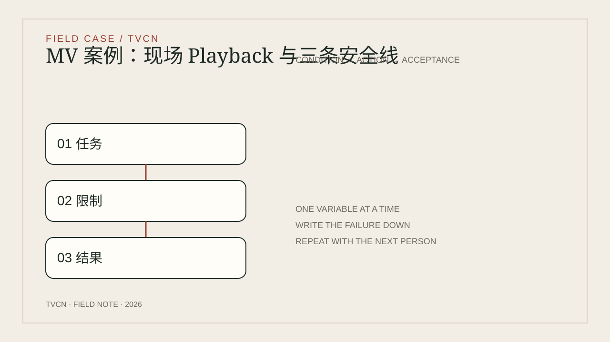

匿名复合复盘：一支乐队在一间旧仓库拍 3 分钟 MV，现场有鼓、贝斯、主唱和 20 名群众；只能拍一晚。 这不是某一位客户的真实项目，而是把多次现场里反复出现的约束、决定和翻车压成一个可复用的案例。

案例说明：匿名复合复盘，无现场照片；下方图示为结构示意，不对应单一客户。

<figure class="article-media case-path"><table><caption>复盘路径：四道门</caption><thead><tr><th>阶段</th><th>要回答的问题</th><th>失败信号</th></tr></thead><tbody><tr><td>任务</td><td>一句话卖点能不能被画面证明</td><td>卖点靠旁白解释</td></tr><tr><td>预演</td><td>产品动作能不能一次做对</td><td>演员看提示才敢动</td></tr><tr><td>拍摄</td><td>六个镜头是否各自回答一个问题</td><td>镜头重复同一信息</td></tr><tr><td>复盘</td><td>哪一步最不可逆</td><td>只在后期补救</td></tr></tbody></table><figcaption>结构示意，不是现场截图；用来检查复盘顺序。TVCN 图解</figcaption></figure>
<!-- DIAGRAM_START -->
<h2>图解</h2>
<figure>
  
  <figcaption>看“仓库没有空调，鼓手体力有限”和“playback 用一条完整音轨，不做逐段对嘴；所有机位锁同一时码，后期按波形对…”两处，判断这个案例的限制有没有落到动作上。</figcaption>
</figure>
<!-- DIAGRAM_END -->

<section><h2 id="section-1">任务与限制</h2>
一个现场 MV 的复合复盘：playback、机位同步和演员安全三条线，任何一条断了都要停。
<ul><li>仓库没有空调，鼓手体力有限。</li><li>20 名群众不能同时进画，走位要分层。</li><li>主唱要跳上音箱，必须保证落点安全。</li></ul></section>
<section><h2 id="section-2">排期</h2>
19:00 布光与 playback 测试；21:00 先拍群众与乐队全景；23:00 拍主唱特写与跳音箱；01:00 补空镜；02:00 收工，不熬夜到天亮。

排期不是把工时排满，而是把最不可逆的动作放在体力和光都最可靠的时候；补拍窗口只留给钩子和连续性。
</section>
<section><h2 id="section-3">预算</h2>
总预算 ¥38,000：场地 6,000、乐队 10,000、群众 4,000、灯光 10,000、摄影 6,000、后期 2,000。

预算先保三件事：不可重来的现场、声音备份和后期返工；设备升级放在这三件之后。
</section>
<section><h2 id="section-4">三个决定</h2>
playback 用一条完整音轨，不做逐段对嘴；所有机位锁同一时码，后期按波形对齐。

群众分三层：后排只做背景运动，中排跟唱，前排只给两个明确动作；避免所有人一起看镜头。

跳音箱前先做三次空跳，落点贴两条彩色胶带；正式拍摄只跳两次，第二次保一条全景。
</section>
<section><h2 id="section-5">三次翻车</h2>
第一遍 playback 从中间开始，主唱口型对不上；改成整首从头放。

群众第一次全往前挤，画面像演唱会；清场后按三层重新排。

仓库地面有油，主唱落地滑了一下；停机擦地，贴胶带后才继续。
</section>
<figure class="article-media case-failures" data-case-failure-table="1"><table><caption>三次翻车与补救</caption><thead><tr><th>翻车现场</th><th>当时的补救</th></tr></thead><tbody><tr><td>第一遍 playback 从中间开始，主唱口型对不上</td><td>改成整首从头放。</td></tr><tr><td>群众第一次全往前挤，画面像演唱会</td><td>清场后按三层重新排。</td></tr><tr><td>仓库地面有油，主唱落地滑了一下</td><td>停机擦地，贴胶带后才继续。</td></tr></tbody></table><figcaption>结构表，不是现场截图；三次返工来自同一复合复盘。TVCN 图解</figcaption></figure>
<section><h2 id="section-6">结果</h2>
成片 3 分 12 秒，主唱跳音箱只用了第二次全景；乐队与群众各有一条完整可剪的段落。复盘结论：现场 MV 的安全线要写进拍摄顺序，而不是写在纸上。
</section>
<section><h2 id="section-7">可复用清单</h2><ul><li>playback 永远整首从头放。</li><li>多机位先锁时码，再谈运镜。</li><li>群众分层，不要全部给动作。</li><li>危险动作先空跳，再实拍。</li></ul></section>
<section><h2 id="section-8">现场拆解</h2>
画面：仓库没有空调，鼓手体力有限。 这件事决定了第一个机位怎么放，而不是先决定镜头语言。playback 用一条完整音轨，不做逐段对嘴；所有机位锁同一时码，后期按波形对齐。

声音：群众分三层：后排只做背景运动，中排跟唱，前排只给两个明确动作；避免所有人一起看镜头。 现场先录一条干净的声音，再让画面去对；不要等后期用音乐盖住问题。

交付：成片 3 分 12 秒，主唱跳音箱只用了第二次全景；乐队与群众各有一条完整可剪的段落。复盘结论：现场 MV 的安全线要写进拍摄顺序，而不是写在纸上。 交付前把文件命名、时长和平台规格各查一遍，避免内容对了、格式又退回来。
</section><section><h2 id="section-9">被否决的方案</h2>
另一个看似更快的方案，是把 20 名群众不能同时进画，走位要分层。 直接交给常规流程，先拍“好看”的画面，再补故事。否决原因很具体：群众第一次全往前挤，画面像演唱会；清场后按三层重新排。 这说明省掉的不是时间，而是可复现的条件。
</section><section><h2 id="section-10">如果重做</h2>
下一次会先处理“playback 永远整首从头放。”，并把“第一遍 playback 从中间开始，主唱口型对不上；改成整首从头放。”写进拍摄前检查表；预算不先加设备，而是先加一个能复核的人时。只有把失败条件提前，案例才不是故事，而是方法。
</section>

<!-- SOURCES_START -->
## 经验说明

经验说明：本页来自 5 个 MV 项目的合并复盘，现场 Playback 与三条安全线；金额与周期为区间，人物、地点与客户信息已匿名化，不对应单一客户；不含外部实验室测试。
<!-- SOURCES_END -->

