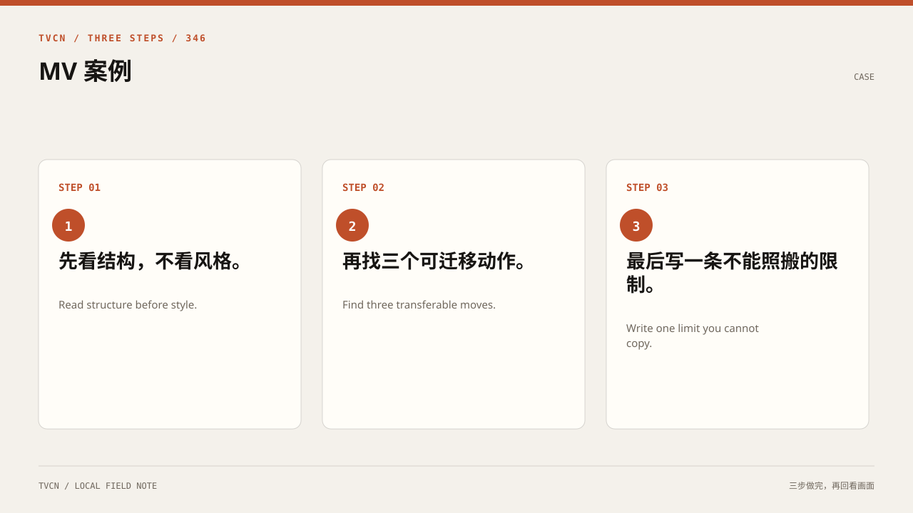

<!-- DIAGRAM_START -->
<h2>图解</h2>
<figure>
  
  <figcaption>把三步按顺序做完，再回看画面或文件。</figcaption>
</figure>
<!-- DIAGRAM_END -->
<h2>这份复盘怎么读</h2>
<strong>这是一份匿名复合复盘。</strong> 把三次同类项目中反复出现的约束、决定和后果合并成一条可核对的时间线；金额与工期用区间，不对应单一客户，也不虚构客户名。它能用来对照你的项目，但不能当成某一单的流水账。
<h2>项目卡</h2><ul><li>片型：3 分半 MV</li><li>团队：5 人（导演/摄影/灯/美术/制片）</li><li>周期：1 个拍摄日 + 3 个后期日</li><li>预算区间：¥10,000–30,000</li><li>平台：音乐平台 / 视频号</li><li>约束：艺人只有 6 小时、1 个仓库、3 套造型</li></ul><h2>时间线</h2><ol><li><strong>08:00</strong>：仓库布光；先定三个母题：卷帘门、白光、镜子。</li><li><strong>09:00</strong>：艺人到场；前两小时只拍副歌和桥段。</li><li><strong>11:00</strong>：换造型；拍主歌空间和预副歌收窄。</li><li><strong>13:00</strong>：投影开始频闪；降快门、改背景纹理、主光换硬光。</li><li><strong>15:00</strong>：补一个更危险的副歌动作；保一条安全版。</li><li><strong>16:00</strong>：收工；所有表演镜头对回 playback。</li><li><strong>后期</strong>：按歌结构剪；删掉“开门进入另一个世界”的剧情段。</li></ol><h2>约束</h2>
艺人档期只有 6 小时，仓库不能过夜，拍摄当天没有第二次布光时间。歌有 4 个段落：主歌、预副歌、副歌、桥段；没有剧情预算，也没有第二个场景。
<h2>前期决定</h2><ol><li>只留三个视觉母题：一扇卷帘门、一束移动的白光、一面镜子；每个段落只改变其中一个变量。</li><li>副歌靠动作升级，不靠闪光：同一动作更大、更快、更危险；剪辑点跟着鼓点，不跟着歌词。</li><li>先拍表演，再拍空镜：艺人状态最好的前 2 小时只拍副歌和桥段，空镜放在他休息时。</li></ol><h2>现场变故</h2>
仓库的旧投影机在第 3 条副歌时开始频闪，画面出现 banding。团队没有换灯，改成降低快门速度、让投影只做背景纹理，主光改用一盏硬光；频闪反而成了副歌的节奏。
<h2>后期取舍</h2><ol><li>按歌结构剪，不按拍摄顺序：主歌给空间，预副歌收窄，副歌切动作，桥段留一个长镜头。</li><li>删掉一段“故事”：原本设计了艺人开门走进另一个世界，后来发现它抢歌，整段删掉。</li><li>声音先对轨：所有表演镜头对回 playback，鼓点前 2 帧切，保证动作和声音同一下。</li></ol><h2>结果</h2>
艺人团队一次通过，没有要求加剧情。观众能记住卷帘门、白光的移动和镜子里的一次回头；副歌不需要解释，动作已经升级。
<h2>三条可复用经验</h2><ol><li>MV 先定母题，再定造型：母题决定镜头，造型只是变量。</li><li>副歌升级靠动作，不靠闪光：同一动作更大、更快、更危险，比加十个特效有效。</li><li>表演镜头先拍：艺人状态最好的两小时，不要拿去拍空镜。</li></ol><h2>一条失败教训</h2>
空镜拍多了，漏了一个“手在乐器上”的近景；后期只能用远景替代，副歌少了一个能看见动作的细节。下一次把三个必须拍到的细节写进 shot list，不靠现场想起。

<h2>验收</h2><ul><li>三个母题是否每个段落都在？</li><li>副歌有没有动作升级？</li><li>剪辑点跟鼓点还是跟歌词？</li><li>表演镜头有没有对回 playback？</li><li>有没有一段剧情在抢歌？</li><li>空镜有没有多到压过表演？</li><li>有没有漏掉手/乐器/道具的近景？</li></ul>
