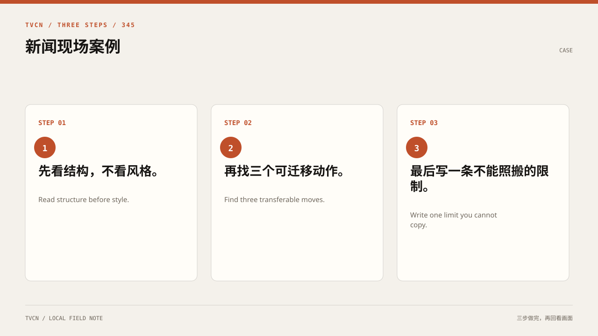

新闻现场案例先看信源和核实；镜头越刺激，越要问谁拍的、什么时候拍的。

<!-- DIAGRAM_START -->
<h2>图解</h2>
<figure>
  
  <figcaption>把三步按顺序做完，再回看画面或文件。</figcaption>
</figure>
<!-- DIAGRAM_END -->
<h2>现场</h2>

看信源和核实：谁拍的、什么时候、有没有二手；镜头越刺激越要问。

<h2>怎么做</h2>

新闻现场案例先看信源和核实；镜头越刺激，越要问谁拍的、什么时候拍的。
<ol><li>查每个关键镜头的拍摄者和时间。</li><li>查有没有二手画面，是否角标。</li><li>把已知与未知分两列，各自配来源。</li></ol>
<h2>别踩</h2>

别被刺激镜头带走；不问来源，画面越强越可疑。

<h2>验收</h2>
<ul><li>每个关键镜头都有拍摄者和时间，或明确标为未知。</li><li>二手画面有角标，没有混成一手。</li><li>已知与未知两列分开，每条都有来源。</li></ul>
