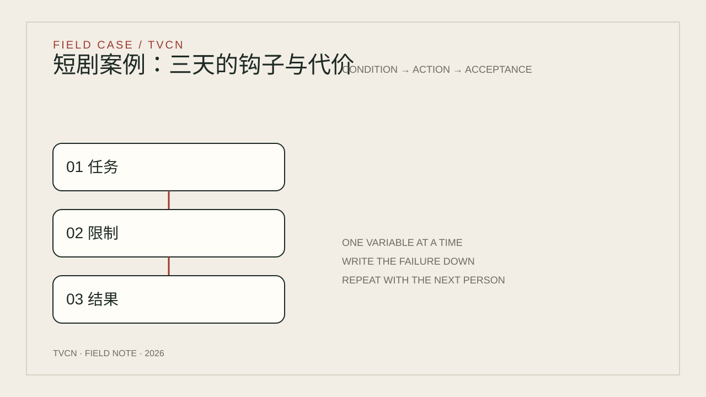

匿名复合复盘：12 集竖屏短剧，单集 90 秒，同一栋旧公寓、两位演员、一个雨夜；客户要求前三集必须让人追下去。 这不是某一位客户的真实项目，而是把多次现场里反复出现的约束、决定和翻车压成一个可复用的案例。

案例说明：匿名复合复盘，无现场照片；下方图示为结构示意，不对应单一客户。

<figure class="article-media case-path"><table><caption>复盘路径：四道门</caption><thead><tr><th>阶段</th><th>要回答的问题</th><th>失败信号</th></tr></thead><tbody><tr><td>任务</td><td>一句话卖点能不能被画面证明</td><td>卖点靠旁白解释</td></tr><tr><td>预演</td><td>产品动作能不能一次做对</td><td>演员看提示才敢动</td></tr><tr><td>拍摄</td><td>六个镜头是否各自回答一个问题</td><td>镜头重复同一信息</td></tr><tr><td>复盘</td><td>哪一步最不可逆</td><td>只在后期补救</td></tr></tbody></table><figcaption>结构示意，不是现场截图；用来检查复盘顺序。TVCN 图解</figcaption></figure>
<!-- DIAGRAM_START -->
<h2>图解</h2>
<figure>
  
  <figcaption>看“同一场景拍 12 集，换装和道具连续性不能断”和“先把每一集的第一个镜头拍成“有人正在失去东西”，而不是先拍环境建立；环境信息放到…”两处，判断这个案例的限制有没有落到动作上。</figcaption>
</figure>
<!-- DIAGRAM_END -->

<section><h2 id="section-1">任务与限制</h2>
一个 3 人组、3 天拍摄、5 天后期的竖屏短剧复合复盘：先把 30 秒钩子拍对，再谈反转。
<ul><li>同一场景拍 12 集，换装和道具连续性不能断。</li><li>两位演员只有 3 天档期，雨夜戏不能等真雨。</li><li>平台首屏只给 3 秒，30 秒内必须出现第一个代价。</li></ul></section>
<section><h2 id="section-2">排期</h2>
D1 只拍跨集复用的主场景和所有钩子；D2 拍雨夜与反转；D3 补插入镜头、空镜和海报帧；后期 5 天，前 3 天只做前三集。

排期不是把工时排满，而是把最不可逆的动作放在体力和光都最可靠的时候；补拍窗口只留给钩子和连续性。
</section>
<section><h2 id="section-3">预算</h2>
总预算 ¥45,000：演员 12,000、场景 8,000、器材 9,000、雨效与道具 6,000、后期 10,000。预留 10% 只用于补拍钩子。

预算先保三件事：不可重来的现场、声音备份和后期返工；设备升级放在这三件之后。
</section>
<section><h2 id="section-4">三个决定</h2>
先把每一集的第一个镜头拍成“有人正在失去东西”，而不是先拍环境建立；环境信息放到第二镜头。

雨夜不拍真雨，用背光喷壶加一条湿地面；演员只做一次湿发，连续戏靠服装和光位保持一致。

前三集先剪到 75 秒，留 15 秒给平台钩子；第 4 集开始才回到 90 秒正片节奏。
</section>
<section><h2 id="section-5">三次翻车</h2>
第一天先拍全景，结果每一集开头都像旅游片；重拍钩子花了半天。

雨夜戏用真水管，地面太湿，演员滑了一次；第二天改成局部湿。

前三集同时送后期，剪辑师没有时间比较钩子；改成先做一集再看数据。
</section>
<figure class="article-media case-failures" data-case-failure-table="1"><table><caption>三次翻车与补救</caption><thead><tr><th>翻车现场</th><th>当时的补救</th></tr></thead><tbody><tr><td>第一天先拍全景，结果每一集开头都像旅游片</td><td>重拍钩子花了半天。</td></tr><tr><td>雨夜戏用真水管，地面太湿，演员滑了一次</td><td>第二天改成局部湿。</td></tr><tr><td>前三集同时送后期，剪辑师没有时间比较钩子</td><td>改成先做一集再看数据。</td></tr></tbody></table><figcaption>结构表，不是现场截图；三次返工来自同一复合复盘。TVCN 图解</figcaption></figure>
<section><h2 id="section-6">结果</h2>
成片 12 集，前三集各 75 秒，后九集 90 秒；交付后客户只改了两处字幕和一处音效。复盘结论：短剧的预算应该先花在钩子和连续性上，而不是花在场景数量上。
</section>
<section><h2 id="section-7">可复用清单</h2><ul><li>每集先写一个“失去”动作，再写台词。</li><li>同一场景的连续性表贴在监视器旁，不放在车里。</li><li>前三集单独做后期，不要和整季一起排队。</li><li>雨效先做局部测试，再上演员。</li></ul></section>
<section><h2 id="section-8">现场拆解</h2>
画面：同一场景拍 12 集，换装和道具连续性不能断。 这件事决定了第一个机位怎么放，而不是先决定镜头语言。先把每一集的第一个镜头拍成“有人正在失去东西”，而不是先拍环境建立；环境信息放到第二镜头。

声音：雨夜不拍真雨，用背光喷壶加一条湿地面；演员只做一次湿发，连续戏靠服装和光位保持一致。 现场先录一条干净的声音，再让画面去对；不要等后期用音乐盖住问题。

交付：成片 12 集，前三集各 75 秒，后九集 90 秒；交付后客户只改了两处字幕和一处音效。复盘结论：短剧的预算应该先花在钩子和连续性上，而不是花在场景数量上。 交付前把文件命名、时长和平台规格各查一遍，避免内容对了、格式又退回来。
</section><section><h2 id="section-9">被否决的方案</h2>
另一个看似更快的方案，是把 两位演员只有 3 天档期，雨夜戏不能等真雨。 直接交给常规流程，先拍“好看”的画面，再补故事。否决原因很具体：雨夜戏用真水管，地面太湿，演员滑了一次；第二天改成局部湿。 这说明省掉的不是时间，而是可复现的条件。
</section><section><h2 id="section-10">如果重做</h2>
下一次会先处理“每集先写一个“失去”动作，再写台词。”，并把“第一天先拍全景，结果每一集开头都像旅游片；重拍钩子花了半天。”写进拍摄前检查表；预算不先加设备，而是先加一个能复核的人时。只有把失败条件提前，案例才不是故事，而是方法。
</section>

> 意图分工：本页负责「短剧案例：三天的钩子与代价」的可执行细节；同集群先读 <a href="https://formats.tvcn.org/article/vertical-drama/">竖屏短剧：前三秒先让人物要东西</a> 建立总判断，再回到本页。

<!-- INTENT_SCOPE -->

<!-- SOURCES_START -->
## 经验说明

经验说明：本页来自 4 部竖屏短剧的合并复盘，三天拍摄、单场景为主；金额与周期为区间，人物、地点与客户信息已匿名化，不对应单一客户；不含外部实验室测试。
<!-- SOURCES_END -->

