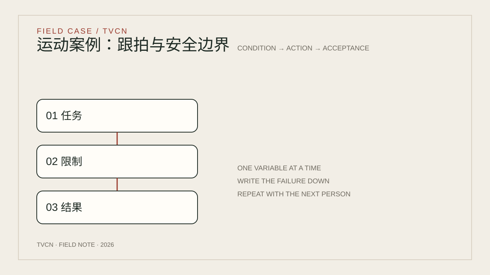

匿名复合复盘：一位越野跑者的 4 分钟短片，山地路线 8 公里，团队 3 人，只能用一台稳定器和一台无人机。 这不是某一位客户的真实项目，而是把多次现场里反复出现的约束、决定和翻车压成一个可复用的案例。

<!-- DIAGRAM_START -->
<h2>图解</h2>
<figure>
  
  <figcaption>看“山路狭窄，机位不能跟跑者并排”和“不在跑者旁边跟拍，改用三个固定机位：起点、山脊、转弯；跑者经过时只拍一次”两处，判断这个案例的限制有没有落到动作上。</figcaption>
</figure>
<!-- DIAGRAM_END -->

<section><h2 id="section-1">任务与限制</h2>
一个越野跑跟拍的复合复盘：跟拍、天气和收工边界，先保证人安全，再保证画面。
<ul><li>山路狭窄，机位不能跟跑者并排。</li><li>天气多变，无人机可能随时停飞。</li><li>跑者要按训练计划跑，不为镜头改节奏。</li></ul></section>
<section><h2 id="section-2">排期</h2>
05:30 上山踩点，06:30 拍起点与热身，07:00 三个固定机位拍经过，08:30 山顶收尾，09:00 下撤；不拍夜路。

排期不是把工时排满，而是把最不可逆的动作放在体力和光都最可靠的时候；补拍窗口只留给钩子和连续性。
</section>
<section><h2 id="section-3">预算</h2>
总预算 ¥14,000：人力 6,000、器材 4,000、交通与保险 3,000、后期 1,000。

预算先保三件事：不可重来的现场、声音备份和后期返工；设备升级放在这三件之后。
</section>
<section><h2 id="section-4">三个决定</h2>
不在跑者旁边跟拍，改用三个固定机位：起点、山脊、转弯；跑者经过时只拍一次。

无人机只在开阔段飞，风速超过 5 米/秒立刻收；不以航拍作为主叙事。

跑者按训练计划跑，团队用对讲机提前 30 秒报位置；不喊停，不追拍。
</section>
<section><h2 id="section-5">三次翻车</h2>
第一次跟跑，摄影师在窄道上差点绊倒跑者；改成固定机位。

无人机风大返航延迟，丢了一段山脊；后来用地面机位补。

跑者为了等镜头放慢，节奏乱了；团队决定不要求他配合。
</section>
<section><h2 id="section-6">结果</h2>
4 分钟成片，跑者按计划完成训练；航拍只占 20 秒，地面机位承担主要叙事。复盘结论：运动片的安全边界要写进拍摄计划，不能靠现场临时判断。
</section>
<section><h2 id="section-7">可复用清单</h2><ul><li>山路拍摄用固定机位，不跟跑。</li><li>无人机先看风速，再决定起飞。</li><li>不要求运动员为镜头改节奏。</li><li>提前 30 秒报位置。</li></ul></section>
<section><h2 id="section-8">现场拆解</h2>
画面：山路狭窄，机位不能跟跑者并排。 这件事决定了第一个机位怎么放，而不是先决定镜头语言。不在跑者旁边跟拍，改用三个固定机位：起点、山脊、转弯；跑者经过时只拍一次。

声音：无人机只在开阔段飞，风速超过 5 米/秒立刻收；不以航拍作为主叙事。 现场先录一条干净的声音，再让画面去对；不要等后期用音乐盖住问题。

交付：4 分钟成片，跑者按计划完成训练；航拍只占 20 秒，地面机位承担主要叙事。复盘结论：运动片的安全边界要写进拍摄计划，不能靠现场临时判断。 交付前把文件命名、时长和平台规格各查一遍，避免内容对了、格式又退回来。
</section><section><h2 id="section-9">被否决的方案</h2>
另一个看似更快的方案，是把 天气多变，无人机可能随时停飞。 直接交给常规流程，先拍“好看”的画面，再补故事。否决原因很具体：无人机风大返航延迟，丢了一段山脊；后来用地面机位补。 这说明省掉的不是时间，而是可复现的条件。
</section><section><h2 id="section-10">如果重做</h2>
下一次会先处理“山路拍摄用固定机位，不跟跑。”，并把“第一次跟跑，摄影师在窄道上差点绊倒跑者；改成固定机位。”写进拍摄前检查表；预算不先加设备，而是先加一个能复核的人时。只有把失败条件提前，案例才不是故事，而是方法。
</section><!-- SOURCES_START -->
