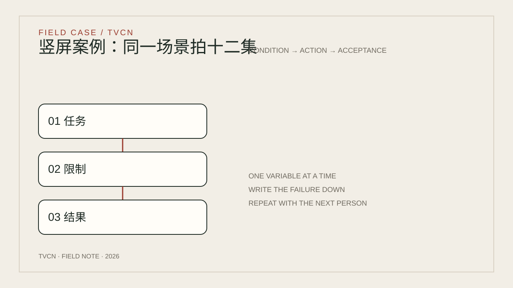

匿名复合复盘：一个情感竖屏系列，12 集、每集 2 分钟，全部发生在一间出租屋；演员两人，拍摄 4 天。 这不是某一位客户的真实项目，而是把多次现场里反复出现的约束、决定和翻车压成一个可复用的案例。

案例说明：匿名复合复盘，无现场照片；下方图示为结构示意，不对应单一客户。

<figure class="article-media case-path"><table><caption>复盘路径：四道门</caption><thead><tr><th>阶段</th><th>要回答的问题</th><th>失败信号</th></tr></thead><tbody><tr><td>任务</td><td>一句话卖点能不能被画面证明</td><td>卖点靠旁白解释</td></tr><tr><td>预演</td><td>产品动作能不能一次做对</td><td>演员看提示才敢动</td></tr><tr><td>拍摄</td><td>六个镜头是否各自回答一个问题</td><td>镜头重复同一信息</td></tr><tr><td>复盘</td><td>哪一步最不可逆</td><td>只在后期补救</td></tr></tbody></table><figcaption>结构示意，不是现场截图；用来检查复盘顺序。TVCN 图解</figcaption></figure>
<!-- DIAGRAM_START -->
<h2>图解</h2>
<figure>
  
  <figcaption>看“房间不能改结构，只能换软装”和“用三套软装区分三个阶段：暖色同居、冷色冷战、空房间；不靠台词说明时间”两处，判断这个案例的限制有没有落到动作上。</figcaption>
</figure>
<!-- DIAGRAM_END -->

<section><h2 id="section-1">任务与限制</h2>
一个单场景竖屏系列的复合复盘：用一个房间、两盏灯和三套衣服，拍出十二集的差异。
<ul><li>房间不能改结构，只能换软装。</li><li>每天只能拍 3 集，演员情绪不能透支。</li><li>每集开头必须在前 5 秒给出关系变化。</li></ul></section>
<section><h2 id="section-2">排期</h2>
D1 拍 1–3 集，先建立房间和人物；D2 拍 4–6 集，换软装和服装；D3 拍 7–9 集，加入夜戏；D4 拍 10–12 集与所有封面帧。

排期不是把工时排满，而是把最不可逆的动作放在体力和光都最可靠的时候；补拍窗口只留给钩子和连续性。
</section>
<section><h2 id="section-3">预算</h2>
总预算 ¥22,000：场地 6,000、演员 8,000、灯光器材 4,000、软装 2,000、后期 2,000。

预算先保三件事：不可重来的现场、声音备份和后期返工；设备升级放在这三件之后。
</section>
<section><h2 id="section-4">三个决定</h2>
用三套软装区分三个阶段：暖色同居、冷色冷战、空房间；不靠台词说明时间。

每集只用一个主光位，夜戏加一盏实用灯；换集先换灯位，不换整个布光。

每集开头拍一个关系动作：递钥匙、收衣服、关门；台词从第二秒才进。
</section>
<section><h2 id="section-5">三次翻车</h2>
第一版每集都从对白开始，观众不知道人物关系；改成动作先行。

换集时重新布光，第一天只拍了两集；后来固定主光位，只移一盏灯。

软装换得太干净，观众以为是不同房间；保留同一处墙纸破损做连续标记。
</section>
<figure class="article-media case-failures" data-case-failure-table="1"><table><caption>三次翻车与补救</caption><thead><tr><th>翻车现场</th><th>当时的补救</th></tr></thead><tbody><tr><td>第一版每集都从对白开始，观众不知道人物关系</td><td>改成动作先行。</td></tr><tr><td>换集时重新布光，第一天只拍了两集</td><td>后来固定主光位，只移一盏灯。</td></tr><tr><td>软装换得太干净，观众以为是不同房间</td><td>保留同一处墙纸破损做连续标记。</td></tr></tbody></table><figcaption>结构表，不是现场截图；三次返工来自同一复合复盘。TVCN 图解</figcaption></figure>
<section><h2 id="section-6">结果</h2>
12 集成片，单集 2 分钟；同一房间靠软装、灯位和关系动作分出三个阶段。复盘结论：单场景系列不是省钱，而是把变化集中到可控制的地方。
</section>
<section><h2 id="section-7">可复用清单</h2><ul><li>先定三个视觉阶段，再写十二集。</li><li>固定主光位，只移一盏灯。</li><li>每集第一个镜头拍关系动作。</li><li>保留一个连续破损或标记，证明是同一空间。</li></ul></section>
<section><h2 id="section-8">现场拆解</h2>
画面：房间不能改结构，只能换软装。 这件事决定了第一个机位怎么放，而不是先决定镜头语言。用三套软装区分三个阶段：暖色同居、冷色冷战、空房间；不靠台词说明时间。

声音：每集只用一个主光位，夜戏加一盏实用灯；换集先换灯位，不换整个布光。 现场先录一条干净的声音，再让画面去对；不要等后期用音乐盖住问题。

交付：12 集成片，单集 2 分钟；同一房间靠软装、灯位和关系动作分出三个阶段。复盘结论：单场景系列不是省钱，而是把变化集中到可控制的地方。 交付前把文件命名、时长和平台规格各查一遍，避免内容对了、格式又退回来。
</section><section><h2 id="section-9">被否决的方案</h2>
另一个看似更快的方案，是把 每天只能拍 3 集，演员情绪不能透支。 直接交给常规流程，先拍“好看”的画面，再补故事。否决原因很具体：换集时重新布光，第一天只拍了两集；后来固定主光位，只移一盏灯。 这说明省掉的不是时间，而是可复现的条件。
</section><section><h2 id="section-10">如果重做</h2>
下一次会先处理“先定三个视觉阶段，再写十二集。”，并把“第一版每集都从对白开始，观众不知道人物关系；改成动作先行。”写进拍摄前检查表；预算不先加设备，而是先加一个能复核的人时。只有把失败条件提前，案例才不是故事，而是方法。
</section>

<!-- SOURCES_START -->
## 经验说明

经验说明：本页来自 3 部竖屏系列的合并复盘，同一场景拍 12 集；金额与周期为区间，人物、地点与客户信息已匿名化，不对应单一客户；不含外部实验室测试。
<!-- SOURCES_END -->

