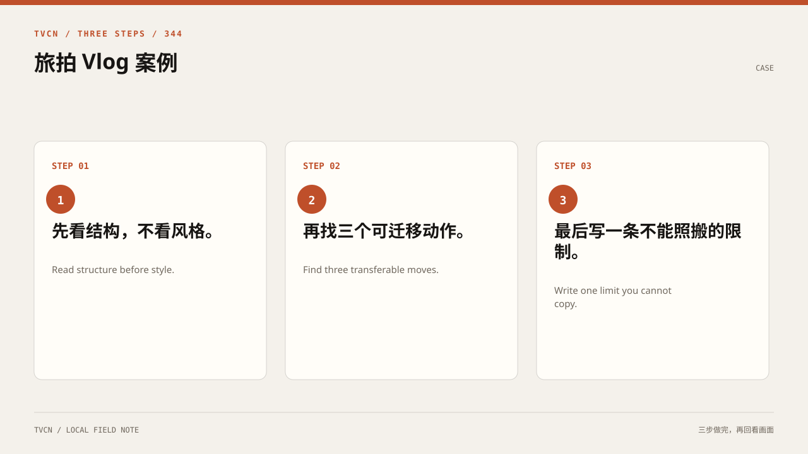

这是一份匿名复合复盘。 把三次同类项目中反复出现的约束、决定和后果合并成一条可核对的时间线；金额与工期用区间，不对应单一客户，也不虚构客户名。它能用来对照你的项目，但不能当成某一单的流水账。

<!-- DIAGRAM_START -->
<h2>图解</h2>
<figure>
  
  <figcaption>看“片型：90 秒旅拍 Vlog”和“团队：1 人（拍摄 + 出镜）”两处，判断症状能不能被复述成一句可观察的话。</figcaption>
</figure>
<!-- DIAGRAM_END -->
<section><h2 id="section-1">这份复盘怎么读</h2>
<strong>这是一份匿名复合复盘。</strong> 把三次同类项目中反复出现的约束、决定和后果合并成一条可核对的时间线；金额与工期用区间，不对应单一客户，也不虚构客户名。它能用来对照你的项目，但不能当成某一单的流水账。
</section><section><h2 id="section-2">项目卡</h2><ul><li>片型：90 秒旅拍 Vlog</li><li>团队：1 人（拍摄 + 出镜）</li><li>周期：2 个拍摄日 + 1 个后期日</li><li>预算区间：¥1,000–3,000</li><li>平台：小红书 / 抖音</li><li>约束：下雨、无无人机、只带一个背包</li></ul></section><section><h2 id="section-3">时间线</h2><ol><li><strong>第 1 天 07:30</strong>：到小镇；第一镜是人进入画面，不是航拍。</li><li><strong>第 1 天 09:00</strong>：第一家店；拍“怎么问路”，不拍招牌合集。</li><li><strong>第 1 天 11:00</strong>：下雨；改去菜市场，雨声成为主线。</li><li><strong>第 1 天 14:00</strong>：走错巷子；保留 8 秒失败。</li><li><strong>第 2 天 08:00</strong>：第二地点；店没开门，任务变难。</li><li><strong>第 2 天 11:00</strong>：找到或没找到；用一个表情/空镜收。</li><li><strong>后期</strong>：删 3 个漂亮空镜；音乐只进开头 3 秒和结尾 8 秒。</li></ol></section><section><h2 id="section-4">约束</h2>
天气预报两天都有雨，原定的日落和航拍全部作废。只有一个 35mm 定焦、一台手机、一个三脚架；没有第二个人帮忙拿包，也没有补拍预算。
</section><section><h2 id="section-5">前期决定</h2><ol><li>把“地点”换成“任务”：不拍“这个小镇多美”，拍“去找一家只卖一种面的老店”。每个地点只保留一个动作。</li><li>先拍人，再拍景：每个场景第一镜是人进入画面，第二镜才是环境；没有人物动作的风景，最多留 2 秒。</li><li>用环境声转场：雨声、伞骨声、锅铲声先切，音乐最后才进；不用音乐盖住地点。</li></ol></section><section><h2 id="section-6">现场变故</h2>
第一天下午的雨把计划中的河边镜头冲掉，伞也被风吹坏。团队没有等天晴，改去菜市场拍“找面店”的询问过程；雨声变成主线，反而让“找不到”更成立。
</section><section><h2 id="section-7">后期取舍</h2><ol><li>删掉 3 个漂亮空镜：它们不推动“找店”，只让片子变成风景合集。</li><li>保留一次失败：问错路、走错巷子的 8 秒留下，观众需要这次失败才相信后面的发现。</li><li>音乐只进两次：开头 3 秒和结尾 8 秒；中间靠雨声和对话。</li></ol></section><section><h2 id="section-8">结果</h2>
内部试看时，观众能复述“他去找一家面店，下雨，最后找到/没找到”，而不是只记得航拍。片子没有拍到日落，但“雨里找店”成了唯一的记忆点。
</section><section><h2 id="section-9">三条可复用经验</h2><ol><li>旅拍先给任务，再给地点：没有任务的旅行，只是移动的风景。</li><li>失败要留：问错路、走错巷、被雨困住，都是“发现”的成本。</li><li>环境声是转场：先让地点自己说话，音乐只做标点。</li></ol></section><section><h2 id="section-10">一条失败教训</h2>
第一天排了四个地点，实际只完成两个；转场耗时把“找店”的连续性打断。下一次一天只排两个地点，把移动时间写进计划。
</section>
<h2>验收</h2><ul><li>片子里有没有一个明确的“找”？</li><li>每个地点是不是只做一件事？</li><li>风景镜头有没有超过 2 秒而没有人物动作？</li><li>有没有保留一次失败？</li><li>环境声能不能独立撑住转场？</li><li>音乐有没有盖住地点？</li><li>一天排了几个地点，实际完成几个？</li></ul>

<!-- SOURCES_START -->
## 经验说明

经验说明：本页来自 5 次客户需求梳理与项目复盘，条件为单人或 2–3 人小组、预算与周期明确；页面讨论的具体对象是「旅拍 Vlog 案例：只拍一个发现」；不含外部实验室测试，条件变化时结论可能失效。
<!-- SOURCES_END -->

