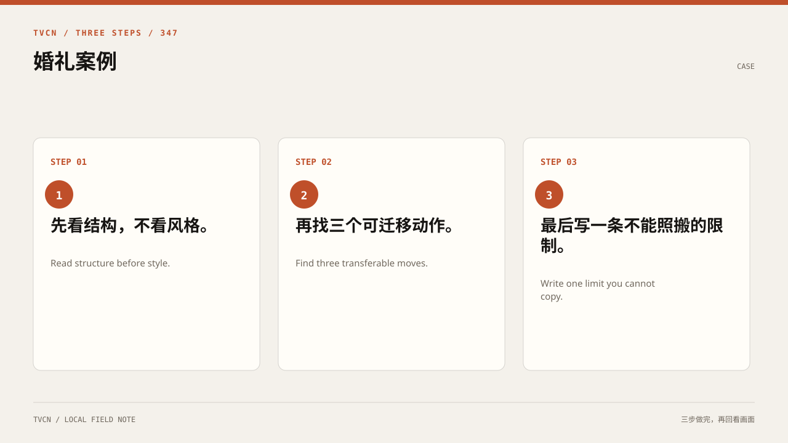

婚礼案例先看仪式有没有拍全，再看情绪；漏掉誓言，慢动作也补不回来。

<!-- DIAGRAM_START -->
<h2>图解</h2>
<figure>
  
  <figcaption>把三步按顺序做完，再回看画面或文件。</figcaption>
</figure>
<!-- DIAGRAM_END -->
<h2>现场</h2>

先看仪式是否完整：誓言、戒指、父母反应；再看风格。

<h2>怎么做</h2>

婚礼案例先看仪式有没有拍全，再看情绪；漏掉誓言，慢动作也补不回来。
<ol><li>查誓言、戒指、父母反应三样是否完整。</li><li>再看风格：慢动作、调色、音乐。</li><li>写清哪个镜头是流程，哪个是两个人的瞬间。</li></ol>
<h2>别踩</h2>

别先夸调色；誓言没拍全，风格再好也只是空壳。

<h2>验收</h2>
<ul><li>誓言、戒指、父母反应三样都能在片中找到。</li><li>风格分析放在仪式完整性之后。</li><li>能指出一个属于两个人而非流程的瞬间。</li></ul>
