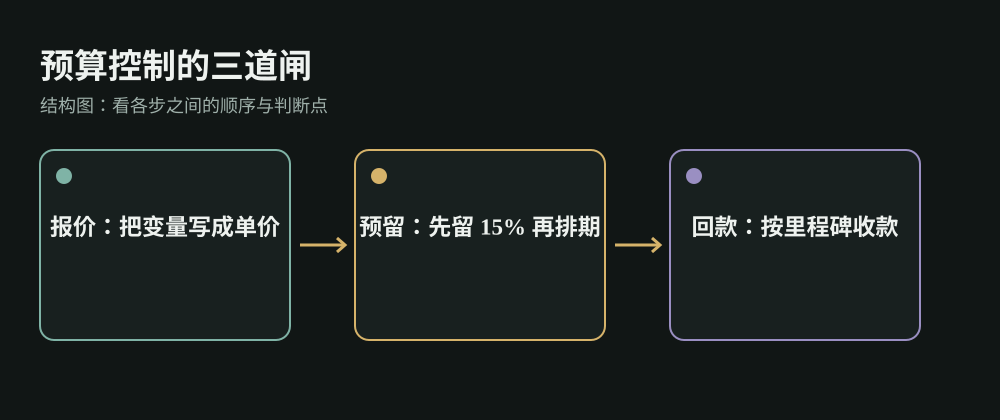

预算失控很少是因为某一项特别贵，而是因为报价时把变量写成了一个总价。拍摄第三天客户加一个外景，钱从后期挪；后期不够，再从利润里补。等发现时，已经没人记得最初那笔钱对应什么。

<!-- DIAGRAM_START -->
<h2 id="diagram">图解</h2>
<figure class="diagram">
  
  <figcaption>看“报价、预留、回款”三道闸是否分开；只要其中一道被总价吞掉，超支就会跑到看不见的地方。</figcaption>
</figure>
<!-- DIAGRAM_END -->

<section><h2 id="section-1">现场</h2>
小团队接一条 3 分钟品牌片：4 个交付版本、2 天拍摄、1 个演员、1 个外景。制片把报价压到 8 万，预留写 0；客户第三天加一个夜景，制片从后期挪了 1.2 万。片子交完，后期少做了一版调色，团队仍然觉得自己“没亏”。
</section>
<section><h2 id="section-2">判断</h2><ul><li><strong>变量没有单价：</strong>演员改期、加外景、加版本，报价单上没有对应数字，只能“到时候再说”。</li><li><strong>预留低于 10%：</strong>不是利润薄，是没有给变更留位置；第一次变更就会吃掉后期。</li><li><strong>收款节点和交付节点错位：</strong>片子交完才收 70%，客户改到第三版时，团队已经没有谈判筹码。</li></ul></section>
<section><h2 id="section-3">怎么做</h2><ol><li>把预算拆成四块：可控成本、变量单价、风险预留、管理费；四块分别列，不合成一个总价。</li><li>给每个变量写单价：加一个外景 8,000、加一个版本 2,000、演员改期 3,000；写“包含/不包含”。</li><li>预留先按 15% 算，再倒推能拍几天；预留不是利润，不到结束不动。</li><li>收款按里程碑：签约 30%、开机 30%、粗剪 25%、交付 15%；每个节点绑定一个可验收物。</li><li>任何新增都走一张变更单：改什么、加多少钱、延几天、谁批准；口头确认不算。</li></ol></section>
<section><h2 id="section-4">失败</h2><ul><li><strong>用总价包死：</strong>客户觉得省事，团队觉得专业；第一次变更就变成“帮个忙”，第二次就变成白做。</li><li><strong>把预留当利润：</strong>排期时把 15% 花掉，真正变更时只能借后期的时间。</li><li><strong>先拍后补合同：</strong>现场已经拍了，客户说“这个不包含”，团队没有证据，只能让。</li></ul></section>
<section><h2 id="section-5">边界</h2>
这套方法适合有变更、有多个交付物的定制项目，不适合平台比价的标准品，也不替代合同、税务和保险。客户预算完全固定时，先减范围，不要减预留；范围不能减，就明确写“变更另计”。
</section>
<section><h2 id="section-6">验收</h2><ul><li>报价单上每个变量都有单价，且写清包含/不包含。</li><li>风险预留不低于 15%，且在排期里没有被花掉。</li><li>至少有 3 个收款里程碑，每个都绑定一个可验收物。</li><li>最近一次变更有一张签过字的变更单。</li></ul></section>
<!-- DEEP_DIVE_START -->
## 深读

<strong>约 8 分钟。</strong> 下面把同一套判断放进两个不同条件，再看一个反例和一个可复用模型；不是重复前文，而是决定什么时候该换做法。

### 条件 A：客户预算固定

预算固定时，不要在同一张报价单上“挤”出预留，而是先把范围分三层：必须拍、可以减、可以加。必须拍的部分先锁成本；可以减的部分写成选项；可以加的部分单独报价。这样客户砍价时砍的是选项，不是团队的预留。

排期也要跟着分层：必须拍的部分先占满拍摄日，选项部分放在机动半天。机动半天不是空着，是用来接变更；没有变更就补 B-roll，不要提前塞满。

### 条件 B：开放式预算

预算开放时，风险不是钱不够，是范围无限扩张。报价单要加“范围上限”：多少个场景、多少个版本、多少拍摄日；超过上限自动触发变更单，而不是继续“做好一点”。同时把管理费单列，让客户看见协调本身也是成本。

开放式项目最容易在后期超支：每个部门都说“再加一点更好”。制片要设一个“停止点”：粗剪看完当天，所有人只能提三类问题——信息缺失、结构错误、技术故障；审美偏好进入下一版预算。

### 反例：预留 15% 仍然超支

一个项目留了 15%，还是超了 2 万。查下来不是预留太少，而是预留被当成“可花预算”：导演用 8,000 加了一个镜头，客户用 7,000 加了一个版本，两笔都从预留走，没人记录。到第三次变更时，预留已经空了。

修法不是把预留提到 25%，而是给预留加一道门：任何从预留支出的变更，都必须同时写“这笔钱原本留给什么风险”。如果写不出，就不批。预留不是池子，是保险；保险不能随便理赔。

### 可复用模型

<strong>报价 = 可控成本 + 变量单价 × 预估次数 + 风险预留 + 管理费。</strong> 可控成本是拍不拍都要花的钱；变量单价是客户一改就增加的钱；风险预留是给未知的；管理费是协调、排期、沟通和收尾。四块分开放，客户砍价时知道砍的是哪一块，团队也知道哪一块不能动。

每月复盘一次：实际变更次数、平均变更金额、预留使用率。连续两个项目预留使用率超过 80%，说明报价结构需要改，不是团队不够努力。

<!-- DEEP_DIVE_END -->
<!-- SOURCES_START -->
## 参考与延伸阅读

- [S38] [国家税务总局：官方网站](https://www.chinatax.gov.cn/) — 2026-11-26 访问。用于核对“判断”一节的术语、方法或规则；不核对本页由经验得出的数字、型号与现场结论，也不替代测试或合同。
- [S41] [美国编剧工会：WGA 合同与署名资源](https://www.wga.org/) — 2026-11-26 访问。用于核对“边界”一节的术语、方法或规则；不核对本页由经验得出的数字、型号与现场结论，也不替代测试或合同。
<!-- SOURCES_END -->
