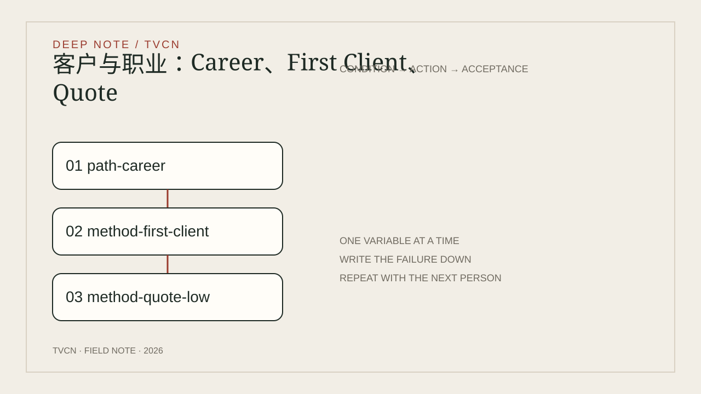

接客户不是报价越低越容易；范围、交付和修改次数决定这是不是一门能持续的生意。 单看《职业与接单》只能解决一个局部；把《职业与接单》《第一个客户怎么接》《报价太低》接成一条链，才会暴露“条件没写、变量太多、结果无法复现”的真问题。

<!-- DEEP_DIVE_START -->
<!-- DIAGRAM_START -->
<h2>图解</h2>
<figure>
  
  <figcaption>看“职业与接单”和“第一个客户怎么接”两处，先定条件，再看失败能不能被记录下来。</figcaption>
</figure>
<!-- DIAGRAM_END -->

<section><h2 id="section-1">问题</h2>
这一页的问题不是“方法不够多”，而是三个环节各自成立、合起来却不成立：条件没写、变量太多、结果不能复现。

本页按“先定条件—再做判断—只改一个变量—留下证据”的顺序；每一步都能被下一个人复述，才算完成。
</section>
<section><h2 id="section-2">判断</h2><ul><li>《职业与接单》的第一道门槛：客户画像具体到行业、预算带、交付频率</li><li>《第一个客户怎么接》的第二道门槛：作品集 30 秒能看懂你会做什么</li><li>《报价太低》的第三道门槛：showreel 只放你负责的镜头，角色不夸大</li></ul>
三条里有一条不成立，就先回到对应单页；不要用整条链掩盖一个没解决的单点。
</section>
<section><h2 id="section-3">做法</h2><ol><li>先写条件：把《职业与接单》里“列十个可能认识的人或店，选一个真有拍摄需求的”落到一张三行表：素材、环境、验收。</li><li>再做一次最小动作：只按《职业与接单》的步骤做 30 秒，不加入第二页的方法。</li><li>把《第一个客户怎么接》的步骤接上：给对方一页方案：拍什么、多久、交什么、多少钱。</li><li>用《报价太低》做对照：先做一个小单，按时交付，再要一句评价或转介绍。</li><li>每改一次只动一个变量；其他条件写进记录，不靠记忆。</li><li>把失败也拍下来：失败版本和成功版本并排，才知道哪一步不能省。</li><li>让下一个人按记录复现一次；他做不出来，说明记录还不够。</li></ol></section>
<section><h2 id="section-4">现场案例</h2>
可复现实验（不是客户案例）：拿 30 秒素材，先按《职业与接单》的“客户画像具体到行业、预算带、交付频率”做 A 版；再按《第一个客户怎么接》的“作品集 30 秒能看懂你会做什么”做 B 版；两版只允许一个变量不同。把两版并排看，记录《报价太低》里最先崩的是哪一项：条件、动作还是验收。如果一次就成功，说明变量还不够多，再加一个现实限制重做。
</section>
<section><h2 id="section-5">失败表</h2>
<table class="data-table"><thead><tr><th>现象</th><th>原因</th><th>替换动作</th></tr></thead><tbody><tr><td>别群发“我会拍视频”；具体方案比自我介绍有用</td><td>条件没写清</td><td>回到第一页重写三行表</td></tr><tr><td>别用“先接住再说”；低价会变成长期标准</td><td>条件没写清</td><td>回到第一页重写三行表</td></tr><tr><td>只看结果，不记条件</td><td>条件没写清</td><td>回到第一页重写三行表</td></tr></tbody></table>
</section>
<section><h2 id="section-6">验收</h2><ul><li>客户画像具体到行业、预算带、交付频率。</li><li>作品集 30 秒能看懂你会做什么。</li><li>showreel 只放你负责的镜头，角色不夸大。</li><li>报价四项拆开，修改次数是数字。</li><li>合同六项齐全，付款有日期。</li><li>交付表每一项打勾，超范围另报价。</li><li>回访问具体问题，下一次方案有时间和范围。</li><li>列了十个可能认识的人或店，选了一个真有需求的。</li><li>给了一页方案：拍什么、多久、交什么、多少钱。</li><li>小单按时交付，拿到一句评价或转介绍。</li></ul></section>
<section><h2 id="section-7">替代方案</h2><ul><li>只处理《职业与接单》里的单点问题：回到<a href="https://tvcn.org/article/path-career/">《职业与接单》</a>，不要用整条链。</li><li>只比较两个动作：看<a href="https://tvcn.org/article/method-first-client/">《第一个客户怎么接》</a>，先不改第三页。</li><li>只做验收：看<a href="https://tvcn.org/article/method-quote-low/">《报价太低》</a>，把判断表拿去做自测。</li></ul></section>
