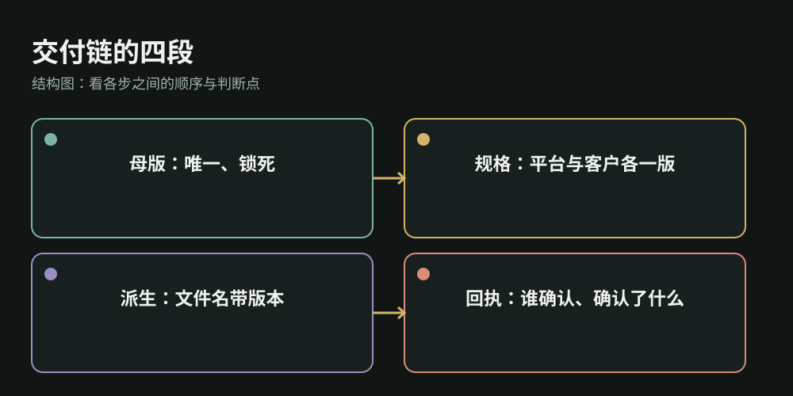

片子做完，团队最容易松一口气；风险恰好从这一刻开始。母版在谁手上、平台要哪一版、客户说的“收到”算不算确认，三件事只要有一件含糊，返工就会在最后一小时发生。

<!-- DIAGRAM_START -->
<h2 id="diagram">图解</h2>
<figure class="diagram">
  
  <figcaption>看母版、规格、派生和回执是否分开；任何一段靠聊天记录补，交付就没有真正完成。</figcaption>
</figure>
<!-- DIAGRAM_END -->

<section><h2 id="section-1">现场</h2>
一条 8 分钟短片要交 4 个版本：横版母版、竖版 60 秒、平台 4K、客户内部 1080p。剪辑把文件命名为 `final_v3_ok.mp4`，用微信发给客户；客户回“收到”。两周后平台说竖版安全区不对，客户说自己只确认了内容，没有确认尺寸。团队重新导出，发现母版已经被调色师改过。
</section>
<section><h2 id="section-2">判断</h2><ul><li><strong>母版不唯一：</strong>时间线上还有 `final_v4`、`final_v4_真的`，没人知道哪个是交付源。</li><li><strong>规格只写在聊天里：</strong>分辨率、码率、安全区、响度没有一张表，平台一退回就只能猜。</li><li><strong>回执没有范围：</strong>客户说“收到/OK”，但没有说确认了内容、尺寸、字幕和音乐中的哪几项。</li></ul></section>
<section><h2 id="section-3">怎么做</h2><ol><li>锁母版：给唯一通过 QC 的版本打 tag，写清日期、分辨率、色域、响度和文件名；其他版本标“派生”。</li><li>做一张规格表：平台、客户、内部各一行，列分辨率、帧率、码率、色域、安全区、响度、字幕格式。</li><li>从母版派生，不从旧工程导出；每个派生文件带版本、语言、平台、日期，例如 `film_v1_zh_4k_20261126.mp4`。</li><li>交付包附清单：文件、对应规格、校验值、观看链接和有效期；清单本身也要版本号。</li><li>回执写范围：请客户逐项回复“内容/尺寸/字幕/音乐/署名”确认或修改，不用一个“OK”代替。</li></ol></section>
<section><h2 id="section-4">失败</h2><ul><li><strong>只发链接：</strong>链接指向一个还会被覆盖的文件夹，客户昨天看的和今天下载的不是同一条。</li><li><strong>用聊天当确认：</strong>“收到”被当成“通过”，出问题时没有一条可引用的确认。</li><li><strong>平台退回后直接重传：</strong>没有先改规格表，同一个错误会在下一个平台再犯一次。</li></ul></section>
<section><h2 id="section-5">边界</h2>
这套流程适用于有平台、有客户、有多版本交付的项目；不替代合同里的验收条款，也不替代平台审核。客户坚持“先发再看”，可以发低分辨率审片版，但要明确它不是交付版，且带时间码和水印。
</section>
<section><h2 id="section-6">验收</h2><ul><li>只有一个母版 tag，其他文件都能追溯到它。</li><li>规格表覆盖每个交付对象，且和实际文件对得上。</li><li>客户回执逐项写了确认范围，不是一句“收到”。</li><li>交付包有清单、校验值和有效期。</li></ul></section>
<!-- DEEP_DIVE_START -->
## 深读

<strong>约 8 分钟。</strong> 下面把同一套判断放进两个不同条件，再看一个反例和一个可复用模型；不是重复前文，而是决定什么时候该换做法。

### 条件 A：平台直投

平台直投时，规格表就是硬门。先把平台的最新规格抄进自己的表，不凭上次经验；每个字段都要有来源和日期。导出后用工具核对，不靠肉眼：分辨率、帧率、码率、色域、响度、字幕、文件名。核对结果写进交付包，平台退回时能直接定位哪一项。

平台审核时间不可控，交付日要预留一个“退回窗口”。不是预留一天，而是预留一次修改和一次重传的时间；如果平台没有退回，这个窗口用来做内部归档。

### 条件 B：客户自投

客户自投时，团队交付的不是文件，是“客户能自己交出去”的能力。除了文件，还要给一页操作说明：上传到哪个后台、选哪个分类、封面尺寸、标题字数、是否需要字幕文件。最好让客户方的执行人当场做一次，团队在旁边看，确认他知道每一步。

客户自投最常见的失败不是文件错，是上传错版本。文件名要带平台和版本，邮件主题也写同一串；客户转发给平台时，转发记录本身就是回执的一部分。

### 反例：客户说“收到”之后

一个团队交片后收到客户两个字“收到”，就把项目关了。三个月后客户要改一个署名，团队打开旧链接，发现文件已经被新项目覆盖。没有母版 tag、没有校验值、没有回执范围，最后只能从平台下载一个有平台压缩的版本反推。

问题不在客户，而在团队把“收到”当成了“验收”。修法是把回执做成一张五项表：内容、尺寸、字幕、音乐、署名；每项都要客户回复“确认”或“修改”。五项都确认，交付才算完成；只确认内容，就只完成了内容。

### 可复用模型

<strong>母版 → 规格表 → 派生 → 清单 → 回执。</strong> 母版只一个；规格表按对象分行；派生从母版出发；清单让文件可验证；回执让确认有范围。五段任何一段缺失，交付都只是“发出”，不是“完成”。

项目结束后把清单、回执和母版 tag 放进归档包；下一次交付先打开归档包，不先打开聊天记录。归档包里最值钱的不是视频，是那张能复用的规格表和回执模板。

<!-- DEEP_DIVE_END -->
<!-- SOURCES_START -->
## 参考与延伸阅读

- [S28] [Netflix 制作与交付帮助：Netflix 制作与交付帮助](https://partnerhelp.netflixstudios.com/) — 2026-11-26 访问。用于核对“判断”一节的术语、方法或规则；不核对本页由经验得出的数字、型号与现场结论，也不替代测试或合同。
- [S29] [YouTube 上传规格：YouTube 上传规格](https://support.google.com/youtube/answer/1722171) — 2026-11-26 访问。用于核对“边界”一节的术语、方法或规则；不核对本页由经验得出的数字、型号与现场结论，也不替代测试或合同。
<!-- SOURCES_END -->
