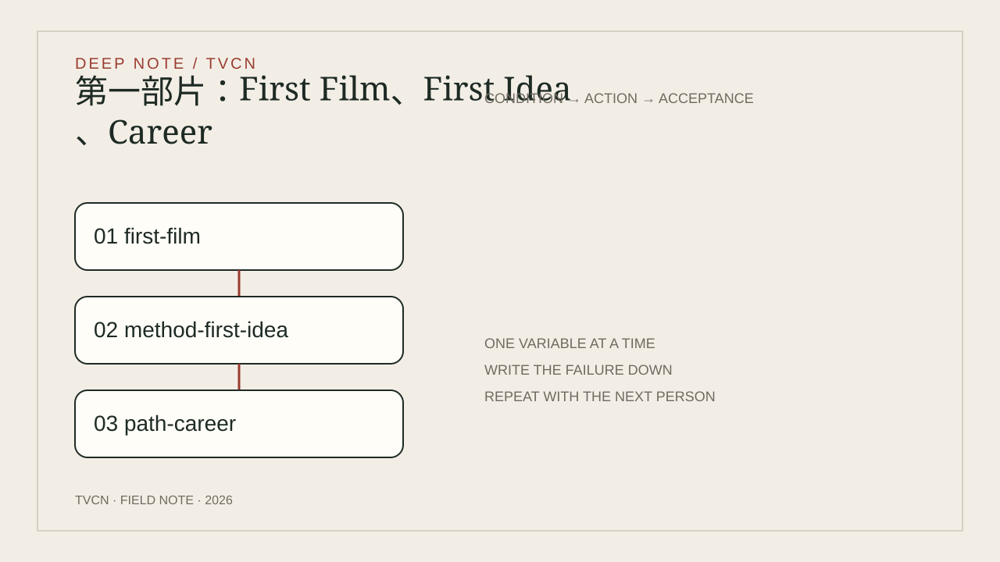

第一部片不是证明你会拍，而是用一个能完成的项目换到下一次机会。 单看《first-film》只能解决一个局部；把《first-film》《只有一个模糊想法》《职业与接单》接成一条链，才会暴露“条件没写、变量太多、结果无法复现”的真问题。

<!-- DEEP_DIVE_START -->
<!-- DIAGRAM_START -->
<h2>图解</h2>
<figure>
  
  <figcaption>看“first-film”和“只有一个模糊想法”两处，先定条件，再看失败能不能被记录下来。</figcaption>
</figure>
<!-- DIAGRAM_END -->

<section><h2 id="section-1">问题</h2>
这一页的问题不是“方法不够多”，而是三个环节各自成立、合起来却不成立：条件没写、变量太多、结果不能复现。

本页按“先定条件—再做判断—只改一个变量—留下证据”的顺序；每一步都能被下一个人复述，才算完成。
</section>
<section><h2 id="section-2">判断</h2><ul><li>《first-film》的第一道门槛：能用一句话说出谁想要什么、被什么挡住</li><li>《只有一个模糊想法》的第二道门槛：三个测试镜头能按顺序连起来，不需要旁白解释</li><li>《职业与接单》的第三道门槛：删掉了拍不出来的设定，剩下的能在一个地点完成</li></ul>
三条里有一条不成立，就先回到对应单页；不要用整条链掩盖一个没解决的单点。
</section>
<section><h2 id="section-3">做法</h2><ol><li>先写条件：把《first-film》里“写三句，每句不超过二十字，必须有一个动词和一个具体对象”落到一张三行表：素材、环境、验收。</li><li>再做一次最小动作：只按《first-film》的步骤做 30 秒，不加入第二页的方法。</li><li>把《只有一个模糊想法》的步骤接上：选能在一间房或一条街拍完的那句，删掉需要搭景的部分。</li><li>用《职业与接单》做对照：拍三镜测试：全景交代、近景动作、特写结果；能连起来，再写第二场。</li><li>每改一次只动一个变量；其他条件写进记录，不靠记忆。</li><li>把失败也拍下来：失败版本和成功版本并排，才知道哪一步不能省。</li><li>让下一个人按记录复现一次；他做不出来，说明记录还不够。</li></ol></section>
<section><h2 id="section-4">现场案例</h2>
可复现实验（不是客户案例）：拿 30 秒素材，先按《first-film》的“能用一句话说出谁想要什么、被什么挡住”做 A 版；再按《只有一个模糊想法》的“三个测试镜头能按顺序连起来，不需要旁白解释”做 B 版；两版只允许一个变量不同。把两版并排看，记录《职业与接单》里最先崩的是哪一项：条件、动作还是验收。如果一次就成功，说明变量还不够多，再加一个现实限制重做。
</section>
<section><h2 id="section-5">失败表</h2>
<table class="data-table"><thead><tr><th>现象</th><th>原因</th><th>替换动作</th></tr></thead><tbody><tr><td>别先写人物小传和世界观；拍不出来的设定不是故事</td><td>条件没写清</td><td>回到第一页重写三行表</td></tr><tr><td>只看结果，不记条件</td><td>条件没写清</td><td>回到第一页重写三行表</td></tr><tr><td>只看结果，不记条件</td><td>条件没写清</td><td>回到第一页重写三行表</td></tr></tbody></table>
</section>
<section><h2 id="section-6">验收</h2><ul><li>能用一句话说出谁想要什么、被什么挡住。</li><li>三个测试镜头能按顺序连起来，不需要旁白解释。</li><li>删掉了拍不出来的设定，剩下的能在一个地点完成。</li><li>客户画像具体到行业、预算带、交付频率。</li><li>作品集 30 秒能看懂你会做什么。</li><li>showreel 只放你负责的镜头，角色不夸大。</li><li>报价四项拆开，修改次数是数字。</li><li>合同六项齐全，付款有日期。</li><li>交付表每一项打勾，超范围另报价。</li><li>回访问具体问题，下一次方案有时间和范围。</li></ul></section>
<section><h2 id="section-7">替代方案</h2><ul><li>只处理《first-film》里的单点问题：回到<a href="https://tvcn.org/article/first-film/">《first-film》</a>，不要用整条链。</li><li>只比较两个动作：看<a href="https://tvcn.org/article/method-first-idea/">《只有一个模糊想法》</a>，先不改第三页。</li><li>只做验收：看<a href="https://tvcn.org/article/path-career/">《职业与接单》</a>，把判断表拿去做自测。</li></ul></section>

<!-- SOURCES_START -->
## 参考与延伸阅读

- [S12] [Britannica](https://www.britannica.com/art/animation) — 2026-11-26 访问。用于核对首段“第一部片不是证明你会拍，而是用一个能完成的项目换到下一次机会。”中的术语与公开背景（动画原理、技术与产业史的百科条目）；不替代现场测试。
- [S22] [全国人民代表大会：《民法典》](http://www.npc.gov.cn/npc/c2/c30834/202006/t20200602_306457.html) — 2026-11-26 访问。用于核对首段“第一部片不是证明你会拍，而是用一个能完成的项目换到下一次机会。”中的术语与公开背景（肖像、隐私、合同与场地权利的上位法文本）；不替代现场测试。
- [S23] [SMPTE 标准入口](https://www.smpte.org/standards) — 2026-11-26 访问。用于核对首段“第一部片不是证明你会拍，而是用一个能完成的项目换到下一次机会。”中的术语与公开背景（时间码、色彩、影院与信号链标准的机构入口）；不替代现场测试。
- [S02] [WIPO](https://www.wipo.int/en/web/copyright/faq-copyright) — 2026-11-26 访问。用于核对首段“第一部片不是证明你会拍，而是用一个能完成的项目换到下一次机会。”中的术语与公开背景（版权保护对象、经济权利与精神权利）；不替代现场测试。
- [S38] [国家税务总局：官方网站](https://www.chinatax.gov.cn/) — 2026-11-26 访问。用于核对首段“第一部片不是证明你会拍，而是用一个能完成的项目换到下一次机会。”中的术语与公开背景（增值税、跨境服务与代扣代缴的官方政策入口）；不替代现场测试。
<!-- SOURCES_END -->

