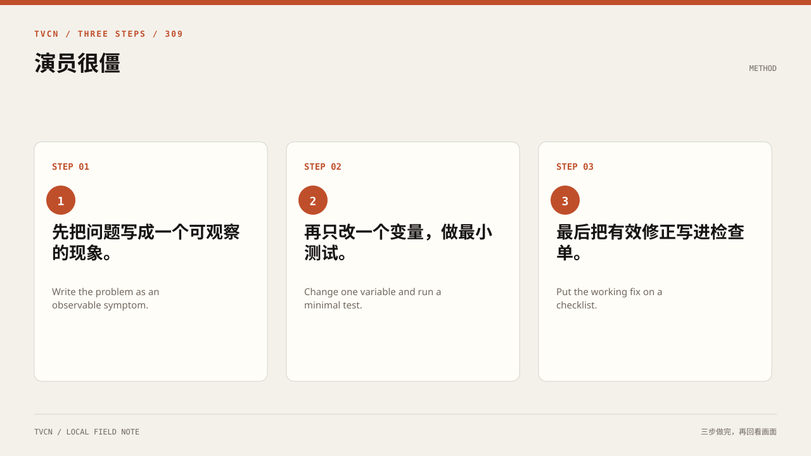

针对“演员很僵”，先按三个方向排查；每次只改一个变量，改完录 30 秒对比，看变化跟着哪个环节走。

<!-- DIAGRAM_START -->
<h2>图解</h2>
<figure>
  
  <figcaption>看“把台词改成动作：找人、开门、递东西”和“让他真的做这个动作，不要“演”这个动…”两处，判断症状能不能被复述成一句可观察的话。</figcaption>
</figure>
<!-- DIAGRAM_END -->
<section><h2 id="section-1">现场</h2>
给一个任务：把杯子放到桌上再转身；让他走一步，台词会松。
</section><section><h2 id="section-2">怎么做</h2><ol><li>把台词改成动作：找人、开门、递东西。</li><li>让他真的做这个动作，不要“演”这个动作。</li><li>开机前走两遍，找到最自然的节奏再拍。</li></ol></section><section><h2 id="section-3">别踩</h2>
别让他“放松点”；越说放松越僵。
</section><section><h2 id="section-4">三种原因</h2>
<table class="data-table"><thead><tr><th>原因</th><th>现场信号</th><th>5 分钟验证</th></tr></thead><tbody><tr><td>台词压在动作前</td><td>演员站着只动嘴，手不知道放哪</td><td>拿掉台词，让他完成一个动作</td></tr><tr><td>指令太抽象</td><td>说完“放松点”反而更僵</td><td>换成动词：开门、递杯、找钥匙</td></tr><tr><td>怕镜头</td><td>眼睛找镜头，动作慢半拍</td><td>让他背对镜头做一次，再转回来</td></tr></tbody></table>
</section><section><h2 id="section-5">现场诊断</h2><ol><li>先拍一条无台词动作，观察手和脚是否在完成同一件事。</li><li>再把台词接在动作之后，比较演员的呼吸和停顿是否变自然。</li><li>最后拍一条 wide、一条 close；如果只有 close 能用，说明动作没有建立空间。</li></ol></section><section><h2 id="section-6">修法</h2>
把“演情绪”换成“完成动作”。演员不需要先感到放松，他需要先有一件必须做完的事。
<ol><li>把台词改成动作：找人、开门、递东西、藏起一个物件。</li><li>给动作一个障碍：门卡住、杯子太满、钥匙找不到。</li><li>开机前走两遍，第一遍不拿台词，第二遍再把台词接上。</li><li>先拍 wide 保空间，再拍 close 保反应；不要一上来只拍脸。</li></ol></section><section><h2 id="section-7">失败案例</h2>
处理“演员很僵”时，下面三种做法会更糟；先选一个替换动作，别同时改三个变量。

<table class="data-table"><thead><tr><th>失败做法</th><th>为什么会更糟</th><th>替换动作</th></tr></thead><tbody><tr><td>一直说“放松”</td><td>演员开始表演“放松”，肩膀和手更假</td><td>改说具体动作和障碍</td></tr><tr><td>让他“演紧张”</td><td>抖手、抖肩变成套路，镜头里只剩技巧</td><td>给他一个真实的截止时间</td></tr><tr><td>一次拍十条</td><td>演员体力下降，后几条只剩重复</td><td>两条不同节奏就停，回放再决定</td></tr></tbody></table>
</section><section><h2 id="section-8">验收表</h2>
验收不是“感觉好了”，是这四项都能指认、能回放、能记录。

<table class="data-table"><thead><tr><th>验收项</th><th>通过线</th><th>记录</th></tr></thead><tbody><tr><td>身体动作</td><td>手和脚在完成同一件事，不是摆姿势</td><td>回放无台词版本</td></tr><tr><td>台词位置</td><td>台词出现在动作之后，不是替代动作</td><td>看第 2 条 take</td></tr><tr><td>空间</td><td>wide 能看懂谁在哪、在做什么</td><td>保留 wide 一条</td></tr><tr><td>节奏</td><td>两条 take 的停顿不同，能选</td><td>记录两条差异</td></tr></tbody></table>
</section><section><h2>边界</h2>
它不保证故事成立；模板只管结构顺序，人物、障碍和代价仍要单独写。
</section><section><h2>替代</h2>
如果“把台词改成动作：找人、开门、递东西”不是你的主问题，先用“让他真的做这个动作，不要“演”这个动…”对应的基础做法；两项都成立再考虑升级。
</section><section><h2>60 秒自测</h2>
用现有器材按“把台词改成动作：找人、开门、递东西”做一次 60 秒测试，记下一个数字；数字没有变化，就不要加预算。
</section><section><h2>什么时候不该用</h2>
当“把台词改成动作：找人、开门、递东西”还没写清，或“让他真的做这个动作，不要“演”这个动…”只是凑数时，不要套模板；先回到人物和问题。
</section><section><h2>三个失败</h2><ul><li>模板每段都有，但人物没有决定。</li><li>中段只换场景，没有新信息。</li><li>结尾靠旁白总结，画面没有变化。</li></ul></section>
<h2>验收</h2><ul><li>台词已改成具体动作。</li><li>演员真的在做动作，不是演动作。</li><li>开机前走过两遍，节奏自然。</li></ul>

> 意图分工：本页负责「演员很僵」的可执行细节；同集群先读 <a href="https://story.tvcn.org/article/rehearsal/">排练：先走位，再给台词</a> 建立总判断，再回到本页。

<!-- INTENT_SCOPE -->

<!-- SOURCES_START -->
## 经验说明

经验说明：本页来自 5 次客户需求梳理与项目复盘，条件为单人或 2–3 人小组、预算与周期明确；页面讨论的具体对象是「演员很僵」；不含外部实验室测试，条件变化时结论可能失效。
<!-- SOURCES_END -->

