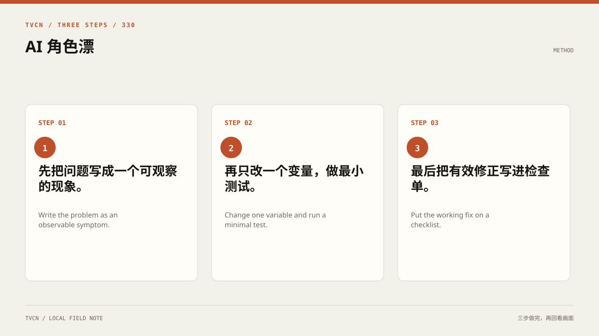

同一角色生成正面、侧面、低头三个角度，放在同一张图上比较。如果颧骨、鼻梁、发际线和服装细节不能对上，不要开始批量生成。先修参考图，再修提示词。

<!-- DIAGRAM_START -->
<h2>图解</h2>
<figure>
  
  <figcaption>看“写死十项特征：年龄、发型、脸型、眉、…”和“生成正面、侧面、背面三视图，选一张做…”两处，判断症状能不能被复述成一句可观察的话。</figcaption>
</figure>
<!-- DIAGRAM_END -->

<section><h2 id="section-1">先锁四件事</h2>
<ul><li><strong>脸：</strong>正面、侧面、3/4 角度各一张参考，固定发型和眉形。不要每次只用一句文字描述。</li><li><strong>服装：</strong>材质、颜色、领口、纽扣写进角色表；同一场不要换相近色。</li><li><strong>光：</strong>主光方向、色温、柔硬写进镜头卡；换镜头先换光，不要换脸。</li><li><strong>镜头：</strong>焦段和景别决定脸型。同一角色在广角和长焦下会像两个人，先固定焦段。</li></ul>
<h2 id="section-3">什么时候不要硬生成</h2>

角色需要长时间说话、复杂表情或与真人同框时，先用实拍定基准，再用生成补远景和插入。不要用“后期统一”掩盖角色漂移。
</section><section><h2 id="section-4">现场</h2>
角色卡、三视图、同一参考图；逐镜头比对脸、衣服、发型。
</section><section><h2 id="section-5">怎么做</h2><ol><li>写死十项特征：年龄、发型、脸型、眉、鼻、服装、鞋、配饰、体型、肤色。</li><li>生成正面、侧面、背面三视图，选一张做母版。</li><li>每个镜头都带同一张参考图和同一段描述，只改动作和机位。</li></ol></section><section><h2 id="section-6">别踩</h2>
别每个镜头重新写一遍形容词；每次都会长成另一个人。
</section><section><h2 id="section-7">边界</h2>
本页只解决「AI 角色漂」这一个问题；不替代 AI 版权不清、AI 画面假、16mm：电影从影院走到教室。如果现场问题属于后者，先读对应页，不要在本页继续加参数。
</section><section><h2 id="section-8">替代</h2>
如果“写死十项特征：年龄、发型、脸型、眉、鼻、服装、鞋、配饰、体型、肤色”不是你的主问题，先做“生成正面、侧面、背面三视图，选一张做母版”；两项都成立，再考虑升级。
</section><section><h2 id="section-9">60 秒自测</h2>
按验收第 1 条做一次 60 秒测试：十项特征写死，三视图有一张母版。如果第 2 条“每个镜头带同一参考图和同一段描述”没有变化，就不要加设备或预算。
</section>
<h2 id="section-12">验收</h2><ul><li>十项特征写死，三视图有一张母版。</li><li>每个镜头带同一参考图和同一段描述。</li><li>只改动作和机位，没有重新写形容词。</li></ul>

> 意图分工：本页负责「AI 角色漂」的可执行细节；同集群先读 <a href="https://tools.tvcn.org/article/deep-ai-toolchain/">AI 工具链：生成、配音、渲染</a> 建立总判断，再回到本页。

<!-- INTENT_SCOPE -->

<!-- SOURCES_START -->
## 参考与延伸阅读

- [S19] [GAN 原始论文（2014）](https://arxiv.org/abs/1406.2661) — 2026-11-26 访问。用于核对「先锁四件事」一节的术语/方法/规则（GAN 原始论文，不是产品评测）；不核对其中由本页经验得出的数字、型号与现场结论，也不替代测试。
- [S20] [DDPM 原始论文（2020）](https://arxiv.org/abs/2006.11239) — 2026-11-26 访问。用于核对「先锁四件事」一节的术语/方法/规则（DDPM 原始论文，不是产品评测）；不核对其中由本页经验得出的数字、型号与现场结论，也不替代测试。
- [S04] [国家网信办：《生成式人工智能服务管理暂行办法》](https://www.cac.gov.cn/2023-07/13/c_1690898327029107.htm) — 2026-11-26 访问。用于核对「先锁四件事」一节的术语/方法/规则（生成式 AI 服务管理规则，不是技术实现）；不核对其中由本页经验得出的数字、型号与现场结论，也不替代测试。
<!-- SOURCES_END -->

