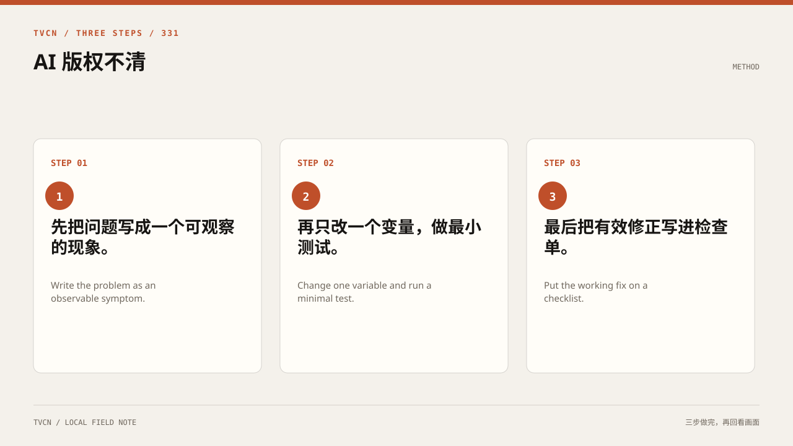

AI 版权不清，先查训练来源、商用条款和人物授权；不清楚就不要交付。

<!-- DIAGRAM_START -->
<h2>图解</h2>
<figure>
  
  <figcaption>把三步按顺序做完，再回看画面或文件。</figcaption>
</figure>
<!-- DIAGRAM_END -->
<h2>现场</h2>

查训练来源、商用条款、人物授权；不清楚不交付。

<h2>怎么做</h2>

AI 版权不清，先查训练来源、商用条款和人物授权；不清楚就不要交付。
<ol><li>查模型服务条款：商用、修改、署名和禁止用途。</li><li>如果生成真人、名人或品牌，拿书面授权。</li><li>保存提示词、参考图、生成记录和授权文件，交付时附 AI 标注。</li></ol>
<h2>别踩</h2>

别用“没人会告”赌；版权问题会跟作品走。

<h2>验收</h2>
<ul><li>模型的商用、修改、署名和禁止用途查过。</li><li>真人、名人或品牌有书面授权。</li><li>提示词、参考图、生成记录和授权文件都保存，交付有 AI 标注。</li></ul>
