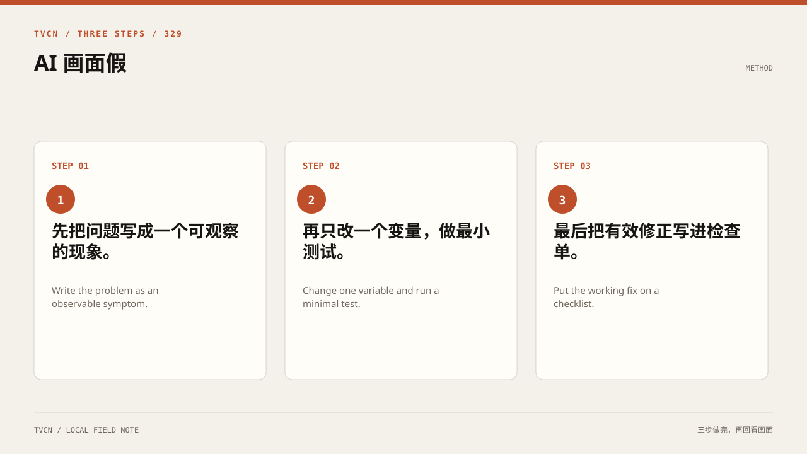

AI 画面假，先查眼睛、手、口型和运动；这四处一崩，观众立刻出戏。

<!-- DIAGRAM_START -->
<h2>图解</h2>
<figure>
  
  <figcaption>把三步按顺序做完，再回看画面或文件。</figcaption>
</figure>
<!-- DIAGRAM_END -->
<h2>现场</h2>

查眼睛、手、口型、运动；四处一崩就重生成或换镜头。

<h2>怎么做</h2>

AI 画面假，先查眼睛、手、口型和运动；这四处一崩，观众立刻出戏。
<ol><li>放大看眼睛高光、手指关节、牙齿和耳朵。</li><li>检查口型闭合和运动方向，尤其是转头和走路。</li><li>崩的地方改构图：手出画、脸转侧、缩短镜头。</li></ol>
<h2>别踩</h2>

别靠加滤镜或磨皮掩盖；越磨越假。

<h2>验收</h2>
<ul><li>眼睛高光、手指关节、牙齿和耳朵逐项放大看过。</li><li>口型闭合和运动方向检查过。</li><li>崩的地方改了构图：手出画、侧脸或短镜头。</li></ul>
