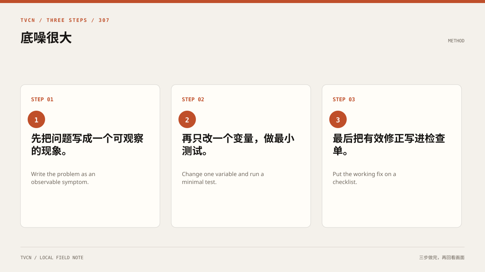

针对“底噪很大”，先按三个方向排查；每次只改一个变量，改完录 30 秒对比，看变化跟着哪个环节走。

<!-- DIAGRAM_START -->
<h2>图解</h2>
<figure>
  
  <figcaption>看“关空调、冰箱和灯，录三十秒静音，听底…”和“换插座、换线，把增益放在录音机而不是…”两处，判断症状能不能被复述成一句可观察的话。</figcaption>
</figure>
<!-- DIAGRAM_END -->
<section><h2 id="section-1">现场</h2>
关空调、换线、把增益降到 -12 dB；麦克风最后换。
</section><section><h2 id="section-2">怎么做</h2><ol><li>关空调、冰箱和灯，录三十秒静音，听底噪从哪里来。</li><li>换插座、换线，把增益放在录音机而不是麦克风。</li><li>让人物靠近麦，另录一条环境声做后期铺底。</li></ol></section><section><h2 id="section-3">别踩</h2>
别一上来买新麦；噪声可能来自房间。
</section><section><h2 id="section-4">三种原因</h2>
<table class="data-table"><thead><tr><th>原因</th><th>现场信号</th><th>5 分钟验证</th></tr></thead><tbody><tr><td>增益结构不对</td><td>麦克风增益拉得很高，底噪跟着上来</td><td>把增益降到峰值 -12dBFS 再听</td></tr><tr><td>房间反射</td><td>空房间有持续嗡嗡声，换位置也不消失</td><td>录 30 秒房间声，移动麦克风</td></tr><tr><td>线材或接口</td><td>换一根线底噪就变，接口松动有咔哒</td><td>换线、换输入、换电池逐项试</td></tr></tbody></table>
</section><section><h2 id="section-5">现场诊断</h2><ol><li>先录 30 秒安静房间声，不要说话，单独听底噪。</li><li>把对白轨 solo，听噪声是持续嘶声、低频嗡声还是间歇咔哒。</li><li>换线材、换输入口、换供电各做一次，确认噪声跟着哪个环节走。</li></ol></section><section><h2 id="section-6">修法</h2>
底噪不是靠后期一键降噪解决的。先把麦克风靠近、把增益分两级、把房间里的持续噪声源关掉。
<ol><li>麦克风离嘴 15–20 厘米；领夹固定在衣领内侧，避开摩擦。</li><li>增益分两级：录音机输入先到 -18dBFS，再微调；对白峰值控制在 -12dBFS 左右。</li><li>关空调、冰箱、投影风扇；关不掉的，录一条房间声留作匹配。</li><li>线材绕开电源适配器；无线接收机与发射机保持视线。</li><li>后期降噪只做到“听不出处理”，不要追求绝对安静。</li></ol></section><section><h2 id="section-7">失败案例</h2>
处理“底噪很大”时，下面三种做法会更糟；先选一个替换动作，别同时改三个变量。

<table class="data-table"><thead><tr><th>失败做法</th><th>为什么会更糟</th><th>替换动作</th></tr></thead><tbody><tr><td>降噪拉满</td><td>对白变得空洞，齿音和尾音被吃掉</td><td>降噪控制在 6–10dB，保留房间感</td></tr><tr><td>开自动增益</td><td>句间底噪忽大忽小，剪辑时跳</td><td>手动增益，拍前锁死</td></tr><tr><td>只换麦克风</td><td>噪声源在房间或线材，换麦无效</td><td>按房间、线材、接口顺序排查</td></tr></tbody></table>
</section><section><h2 id="section-8">验收表</h2>
验收不是“感觉好了”，是这四项都能指认、能回放、能记录。

<table class="data-table"><thead><tr><th>验收项</th><th>通过线</th><th>记录</th></tr></thead><tbody><tr><td>房间声</td><td>30 秒 room tone 可循环，没有突然的空调声</td><td>保存原始文件</td></tr><tr><td>对白峰值</td><td>正常说话峰值约 -12dBFS，不削波</td><td>录音机表头</td></tr><tr><td>底噪</td><td>安静段噪声稳定，不随句子起伏</td><td>solo 对白轨</td></tr><tr><td>可懂度</td><td>每个词清楚，不需要靠字幕猜</td><td>戴耳机听一遍</td></tr></tbody></table>
</section><section><h2>边界</h2>
它不保证故事成立；模板只管结构顺序，人物、障碍和代价仍要单独写。
</section><section><h2>替代</h2>
如果“关空调、冰箱和灯，录三十秒静音，听底…”不是你的主问题，先用“换插座、换线，把增益放在录音机而不是…”对应的基础做法；两项都成立再考虑升级。
</section><section><h2>60 秒自测</h2>
用现有器材按“关空调、冰箱和灯，录三十秒静音，听底…”做一次 60 秒测试，记下一个数字；数字没有变化，就不要加预算。
</section><section><h2>什么时候不该用</h2>
当“关空调、冰箱和灯，录三十秒静音，听底…”还没写清，或“换插座、换线，把增益放在录音机而不是…”只是凑数时，不要套模板；先回到人物和问题。
</section><section><h2>三个失败</h2><ul><li>模板每段都有，但人物没有决定。</li><li>中段只换场景，没有新信息。</li><li>结尾靠旁白总结，画面没有变化。</li></ul></section>
<h2>验收</h2><ul><li>关掉空调、冰箱和灯后录过三十秒静音。</li><li>换过插座和线，增益放在录音机。</li><li>人物靠近麦，对白清楚，另有一条环境声。</li></ul>
