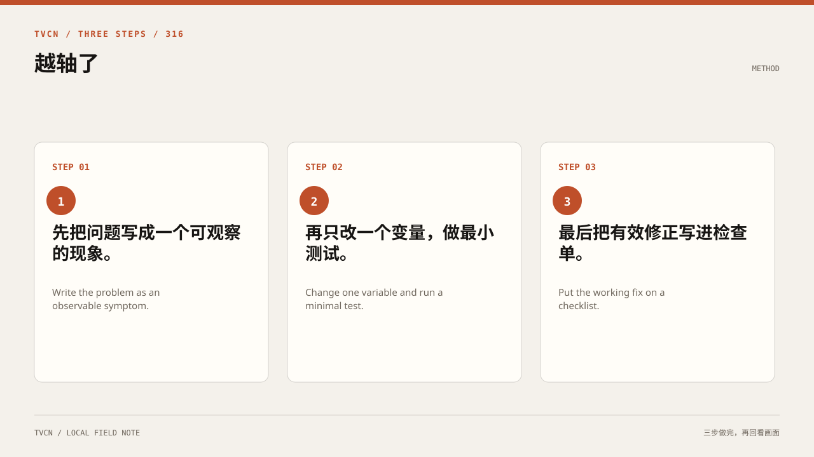

别靠“观众不会注意”赌；方向一乱，空间就散。

<!-- DIAGRAM_START -->
<h2>图解</h2>
<figure>
  
  <figcaption>看“在两人之间拍一条全景或中性镜头，重新…”和“下一个镜头保持同一侧，不要跨到对面”两处，判断症状能不能被复述成一句可观察的话。</figcaption>
</figure>
<!-- DIAGRAM_END -->
<section><h2 id="section-1">现场</h2>
回全景或加中性镜头；不要硬切两个反方向的脸。
</section><section><h2 id="section-2">怎么做</h2><ol><li>在两人之间拍一条全景或中性镜头，重新建立轴线。</li><li>下一个镜头保持同一侧，不要跨到对面。</li><li>如果已经越轴，用插入镜头或运动镜头过渡。</li></ol></section><section><h2 id="section-3">别踩</h2></section><section><h2 id="section-4">三种原因</h2>
针对“越轴了”，先按三个方向排查；每次只改一个变量，改完录 30 秒对比，看变化跟着哪个环节走。

<table class="data-table"><thead><tr><th>原因</th><th>现场信号</th><th>5 分钟验证</th></tr></thead><tbody><tr><td>机位跨轴</td><td>两个机位在人物连线的两侧</td><td>画一条轴线，所有机位留在同一侧</td></tr><tr><td>运动方向相反</td><td>人物从左出画，下一个镜头从右进画</td><td>保持同一方向，或加一个中性镜头</td></tr><tr><td>没有 master</td><td>观众不知道谁和谁在同一空间</td><td>先拍一条全景建立关系</td></tr></tbody></table>
</section><section><h2 id="section-5">现场诊断</h2><ol><li>在纸上画人物位置和摄影机位置，标出 180 度线。</li><li>逐镜头检查人物视线和运动方向是否连续。</li><li>把两个冲突镜头连放，问自己“观众还知道谁在左谁在右吗”。</li></ol></section><section><h2 id="section-6">修法</h2>
越轴不是靠翻转画面掩盖的。要么回到轴线同侧，要么用一个中性镜头把空间重新建立。
<ol><li>所有机位留在轴线同一侧，先拍 wide 再拍 medium/close。</li><li>如果必须跨轴，插入一个正面中性镜头或人物移动镜头。</li><li>保持运动方向：左出画就左进画，不要无故反向。</li><li>在剪辑点加一个动作匹配，让观众跟着动作过轴。</li></ol></section><section><h2 id="section-7">失败案例</h2>
处理“越轴了”时，下面三种做法会更糟；先选一个替换动作，别同时改三个变量。

<table class="data-table"><thead><tr><th>失败做法</th><th>为什么会更糟</th><th>替换动作</th></tr></thead><tbody><tr><td>水平翻转</td><td>文字、发型、服装全反了</td><td>回现场补中性镜头</td></tr><tr><td>硬切过去</td><td>观众突然迷失方向</td><td>加一个建立空间的全景</td></tr><tr><td>只看单帧</td><td>每帧都好看，连起来方向反了</td><td>按顺序播放检查</td></tr></tbody></table>
</section><section><h2 id="section-8">验收表</h2>
验收不是“感觉好了”，是这四项都能指认、能回放、能记录。

<table class="data-table"><thead><tr><th>验收项</th><th>通过线</th><th>记录</th></tr></thead><tbody><tr><td>轴线</td><td>所有机位在同一侧或有中性镜头过渡</td><td>纸面轴线图</td></tr><tr><td>视线</td><td>人物看的方向连续</td><td>逐镜头对照</td></tr><tr><td>运动</td><td>出画/进画方向一致</td><td>看动作方向</td></tr><tr><td>空间</td><td>观众能说出谁在左谁在右</td><td>找未看过的人复述</td></tr></tbody></table>
</section><section><h2>边界</h2>
它不保证故事成立；模板只管结构顺序，人物、障碍和代价仍要单独写。
</section><section><h2>替代</h2>
如果“在两人之间拍一条全景或中性镜头，重新…”不是你的主问题，先用“下一个镜头保持同一侧，不要跨到对面”对应的基础做法；两项都成立再考虑升级。
</section><section><h2>60 秒自测</h2>
用现有器材按“在两人之间拍一条全景或中性镜头，重新…”做一次 60 秒测试，记下一个数字；数字没有变化，就不要加预算。
</section><section><h2>什么时候不该用</h2>
当“在两人之间拍一条全景或中性镜头，重新…”还没写清，或“下一个镜头保持同一侧，不要跨到对面”只是凑数时，不要套模板；先回到人物和问题。
</section><section><h2>三个失败</h2><ul><li>模板每段都有，但人物没有决定。</li><li>中段只换场景，没有新信息。</li><li>结尾靠旁白总结，画面没有变化。</li></ul></section>
<h2>验收</h2><ul><li>两人之间有一条全景或中性镜头。</li><li>下一个镜头在同一侧，没有跨轴。</li><li>越轴处用插入或运动镜头过渡。</li></ul>

<!-- SOURCES_START -->
## 经验说明

经验说明：本页来自 4 次客户需求梳理与项目复盘，条件为单人或 2–3 人小组、预算与周期明确；页面讨论的具体对象是「越轴了」；不含外部实验室测试，条件变化时结论可能失效。
<!-- SOURCES_END -->

