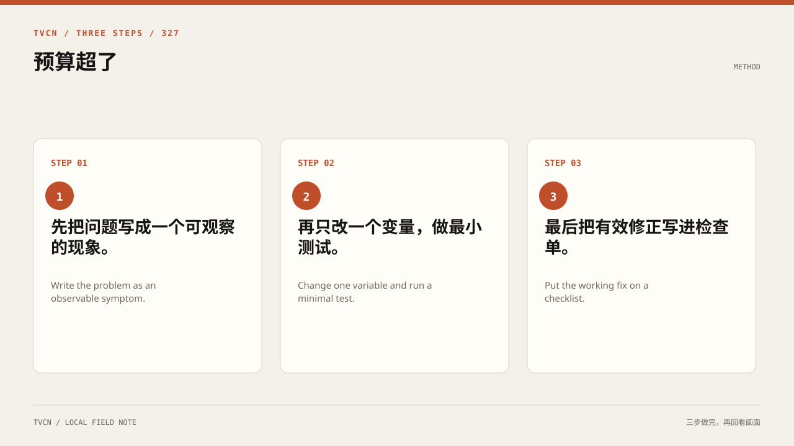

把预算分成四块：前期、拍摄、后期、 contingency。每块至少留 10% 缓冲；把已超和将超的项目写成两列，只处理“将超”的前三项。不要用“到时候再说”盖住缺口。

<!-- DIAGRAM_START -->
<h2>图解</h2>
<figure>
  
  <figcaption>看“把支出按“已发生”和“待发生”列出来…”和“对比原预算，找出范围变化：多出的场景…”两处，判断症状能不能被复述成一句可观察的话。</figcaption>
</figure>
<!-- DIAGRAM_END -->
<section><h2 id="section-1">先判断超在哪一块</h2>
<ul><li><strong>前期超：</strong>器材、场地、人员天数增加。先砍范围，不要砍保险和安全。</li><li><strong>拍摄超：</strong>每天少拍一个镜头，连续三天就会拖垮后期。把剩余镜头按“没有它能不能交”重排。</li><li><strong>后期超：</strong>修改轮次没有上限，或素材量超出预算。把修改写进合同，按轮次计价。</li></ul>
<h2 id="section-2">一张 10 分钟的表</h2>

<h2 id="section-3">什么时候该停</h2>

当超支已经威胁到安全、保险或交付质量时，停拍并重谈范围，比硬撑到交片更专业。客户可以接受少一个镜头，不能接受一个不能用的成片。
<h2 id="section-4">预算超支，先从三张表找原因</h2>

超支很少是“某项很贵”，多数是漏项、变更和现金时间差。把预算拆成三张表：成本表、现金流表、变更表。三张表对不上，说明还有一个没写出来的假设。

<table class="data-table"><thead><tr><th>表</th><th>写什么</th><th>常见漏项</th></tr></thead><tbody>
<tr><td>成本表</td><td>拍摄天数、后期天数、器材、场地、差旅、税费</td><td>运输、保险、加班、素材备份、平台手续费</td></tr>
<tr><td>现金流表</td><td>哪天收钱、哪天付钱</td><td>客户审批周期、发票邮寄、押金退还</td></tr>
<tr><td>变更表</td><td>每次新增的范围、工期、费用</td><td>口头承诺、免费补拍、临时改脚本</td></tr>
</tbody></table>

<h3>预备金不是利润</h3>

在总成本上留 10–15% 意外金，单独一行，不进入报价利润。用途只有三个：补拍、延期、器材替换。花掉要记录，没花掉也不能当奖金提前分掉，否则下一次超支没有缓冲。

<h3>超支后的处理顺序</h3>
<ol><li>先停新增采购，确认已发生的应付。</li><li>把变更表按“客户原因 / 己方原因 / 不可抗力”分类。</li><li>客户原因的，发变更单；己方原因的，从预备金出；不可抗力的，按合同条款协商。</li><li>不要用“下一个项目补回来”掩盖，下一单有下一单的成本。</li></ol>

项目结束做一次 30 分钟复盘：哪一项超了 10% 以上、为什么、下次写进哪张表。只写“控制预算”没有用，要写具体动作。
</section><section><h2 id="section-5">现场</h2>
停非必要设备，改范围；超支通常是范围变了，不是单价。
</section><section><h2 id="section-6">怎么做</h2><ol><li>把支出按“已发生”和“待发生”列出来，先砍待发生的非必要项。</li><li>对比原预算，找出范围变化：多出的场景、天数、修改轮次。</li><li>和客户谈增项，不要自己吞。</li></ol></section><section><h2 id="section-7">别踩</h2>
别用低价补窟窿；下一单会更难。
</section><section><h2>边界</h2>
它不保证故事成立；模板只管结构顺序，人物、障碍和代价仍要单独写。
</section><section><h2>替代</h2>
如果“把支出按“已发生”和“待发生”列出来…”不是你的主问题，先用“对比原预算，找出范围变化：多出的场景…”对应的基础做法；两项都成立再考虑升级。
</section><section><h2>60 秒自测</h2>
用现有器材按“把支出按“已发生”和“待发生”列出来…”做一次 60 秒测试，记下一个数字；数字没有变化，就不要加预算。
</section><section><h2>什么时候不该用</h2>
当“把支出按“已发生”和“待发生”列出来…”还没写清，或“对比原预算，找出范围变化：多出的场景…”只是凑数时，不要套模板；先回到人物和问题。
</section><section><h2>三个失败</h2><ul><li>模板每段都有，但人物没有决定。</li><li>中段只换场景，没有新信息。</li><li>结尾靠旁白总结，画面没有变化。</li></ul></section>
<h2>验收</h2><ul><li>支出分了已发生和待发生，非必要已砍。</li><li>找出范围变化：场景、天数或修改轮次。</li><li>增项已和客户谈，没有自己吞。</li></ul>

<!-- SOURCES_START -->
## 经验说明

经验说明：本页来自 3 次客户需求梳理与项目复盘，条件为单人或 2–3 人小组、预算与周期明确；页面讨论的具体对象是「预算超了」；不含外部实验室测试，条件变化时结论可能失效。
<!-- SOURCES_END -->

