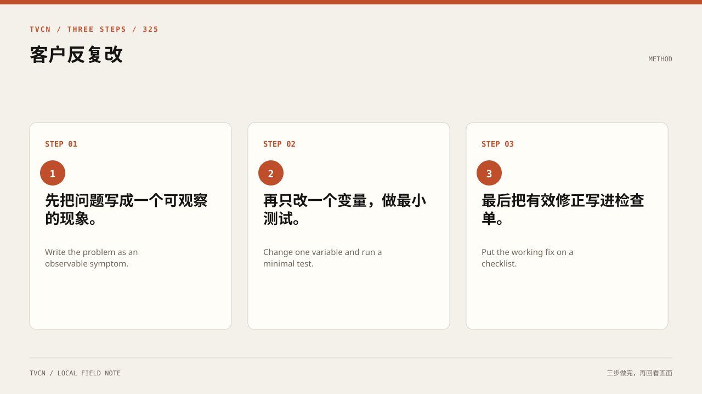

客户反复改，先把“目标”写成一句话，再让每次修改对着这句话验收。

<!-- DIAGRAM_START -->
<h2>图解</h2>
<figure>
  
  <figcaption>把三步按顺序做完，再回看画面或文件。</figcaption>
</figure>
<!-- DIAGRAM_END -->
<h2>现场</h2>

把目标写一句，每次修改对着这句话验收；超出范围另报价。

<h2>怎么做</h2>

客户反复改，先把“目标”写成一句话，再让每次修改对着这句话验收。
<ol><li>在 brief 里写一句“这条片要让谁做什么”，双方确认。</li><li>把修改分轮，每轮只收一类意见；超出合同轮次另报价。</li><li>每次改完对照那句话：这一步让目标更清楚还是更模糊。</li></ol>
<h2>别踩</h2>

别用“客户永远是对的”接所有改；没有边界的修改会拖垮项目。

<h2>验收</h2>
<ul><li>brief 里有一句“让谁做什么”，双方确认。</li><li>修改分轮，每轮只收一类意见。</li><li>超出合同轮次另报价，没有无限接改。</li></ul>

<!-- DEEP_DIVE_START -->
## 深读

<strong>约 6 分钟。</strong> 客户反复改，不是客户坏，是 brief 没锁住；把口头意见变成一页纸。

### 先锁 brief

写清五件事：给谁看、看完做什么、必须出现什么、绝对不能出现什么、三条参考片。让客户在这页上确认，不要只在小群里说“可以”。

参考片要标“学结构”还是“学风格”；不标，客户会把三条参考的所有优点都要一遍，最后谁都做不出来。

### 修改分三类

修 bug 免费：错字、黑帧、音画不同步；改范围加钱：新增场景、新增版本、换演员；改口味算一轮：颜色、音乐、节奏。三类分开记账，客户才知道改的是什么。

每次修改给一个版本号和截止时间；超过时间进下一轮。不要边改边聊，最后谁也说不清改到第几版。

### 保护剪辑

不要让客户直接进时间线；让他们在带时间码的审片链接上写意见。每条意见写“几分几秒、改成什么、为什么”，不要写“感觉不对”。

如果意见互相矛盾，先回到 brief：哪一条目标变了。目标没变，就按原方案改；目标变了，就是新项目，重新报价。

### 五分钟练习：三条意见转译

拿三条客户原话，各翻成一句可执行的动作：加一个近景、把音乐换成无鼓点、把结尾提前五秒。翻不出来的，约十分钟电话，不要猜。

把翻译后的三条写进修改单，让客户确认“我要的是这个”。确认一次，能省掉后面三轮。

### 什么时候算改完

客户在最新版本上确认“这一版可以交付”，修改单上每一条都有回应，版本号停止增加，才算改完。不要用“应该没问题了”结束一轮。

把最终版和修改单一起归档；下一次有人问“为什么这里变了”，打开修改单就能回答。没有记录的修改，最后都会变成新的争论。

### 客户修改，十项检查
<ul><li>brief 有五件事</li><li>客户在纸面确认</li><li>参考片标结构或风格</li><li>bug 修复免费</li><li>范围变更另报价</li><li>口味修改算一轮</li><li>每次修改有版本号</li><li>有明确截止时间</li><li>审片链接带时间码</li><li>意见矛盾时回到 brief</li></ul>
修改不是客户和你较劲，是两个人对“这条片是什么”还没有同一页纸。

<!-- DEEP_DIVE_END -->
