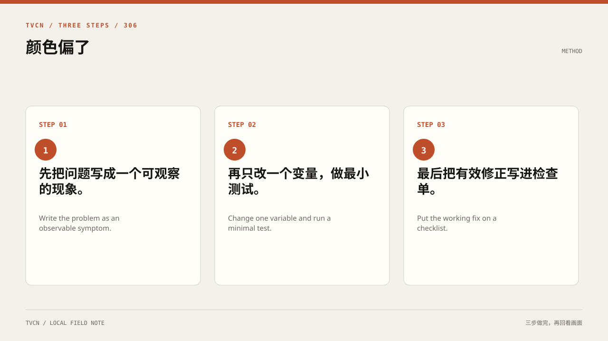

让一个人拿灰卡站在主体位置，拍一张；再把灰卡放到背景，拍一张。两张都按同一白平衡。如果灰卡在两张里不一致，先处理光源，不要先调色。

<!-- DIAGRAM_START -->
<h2>图解</h2>
<figure>
  
  <figcaption>看“用灰卡或白纸在每个光位拍一条，确认白…”和“关掉或统一混合光：窗光加 CTO/C…”两处，判断症状能不能被复述成一句可观察的话。</figcaption>
</figure>
<!-- DIAGRAM_END -->
<section><h2 id="section-1">先判断偏色来自哪里</h2>
<ul><li><strong>白平衡：</strong>同一场景里白纸不白，先拍灰卡，再统一相机和灯。</li><li><strong>混合光：</strong>窗光偏蓝、实用灯偏黄，脸一半冷一半暖。先决定以哪一边为主，再用色纸或黑旗处理另一边。</li><li><strong>Log/监看：</strong>监看 LUT 和输出 LUT 不一致，现场看着对，导出偏绿。用同一套色彩管理，别在监看和输出之间换 LUT。</li></ul>
<h2 id="section-2">一个 30 秒测试</h2>

<h2 id="section-3">什么时候不要用 LUT 掩盖</h2>

偏色来自光源或白平衡时，套 LUT 只会让肤色更脏。先把拍摄端统一，再在后期做风格。肤色不对，不要用“电影感”解释。
</section><section><h2 id="section-4">现场</h2>
先查白平衡和混合光；用灰卡对中性，再调色轮。
</section><section><h2 id="section-5">怎么做</h2><ol><li>用灰卡或白纸在每个光位拍一条，确认白平衡。</li><li>关掉或统一混合光：窗光加 CTO/CTB，别让冷暖打架。</li><li>后期先对灰卡，再动色轮；只改偏色，不改风格。</li></ol></section><section><h2 id="section-6">别踩</h2>
别用调色掩盖现场混合光；脸会一块青一块黄。
</section><section><h2>边界</h2>
它不保证故事成立；模板只管结构顺序，人物、障碍和代价仍要单独写。
</section><section><h2>替代</h2>
如果“用灰卡或白纸在每个光位拍一条，确认白…”不是你的主问题，先用“关掉或统一混合光：窗光加 CTO/C…”对应的基础做法；两项都成立再考虑升级。
</section><section><h2>60 秒自测</h2>
用现有器材按“用灰卡或白纸在每个光位拍一条，确认白…”做一次 60 秒测试，记下一个数字；数字没有变化，就不要加预算。
</section><section><h2>什么时候不该用</h2>
当“用灰卡或白纸在每个光位拍一条，确认白…”还没写清，或“关掉或统一混合光：窗光加 CTO/C…”只是凑数时，不要套模板；先回到人物和问题。
</section><section><h2>三个失败</h2><ul><li>模板每段都有，但人物没有决定。</li><li>中段只换场景，没有新信息。</li><li>结尾靠旁白总结，画面没有变化。</li></ul></section>
<h2>验收</h2><ul><li>每个光位都拍了灰卡或白纸。</li><li>混合光已统一或关掉，冷暖不再打架。</li><li>后期对灰卡，肤色没有一块青一块黄。</li></ul>
