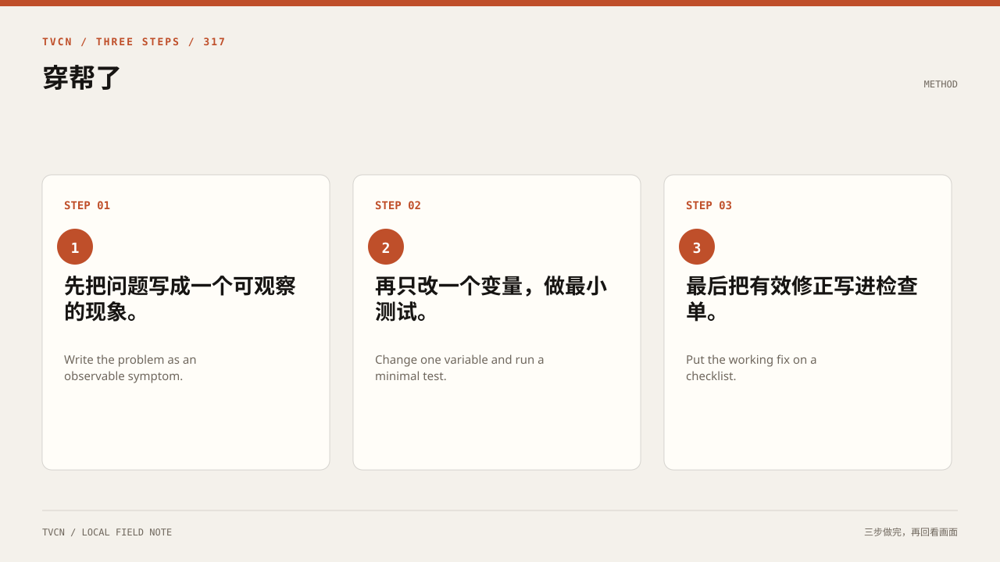

每个机位切换前，让场记拍三张：全景、道具特写、演员手部。下一场开机前对照上一场的最后一张，再决定是否重拍。

<!-- DIAGRAM_START -->
<h2>图解</h2>
<figure>
  
  <figcaption>看“每换一次机位或服装，拍一张全景和细节…”和“指定一个人做连续性记录：道具位置、衣…”两处，判断症状能不能被复述成一句可观察的话。</figcaption>
</figure>
<!-- DIAGRAM_END -->
<section><h2 id="section-1">先查四类穿帮</h2>
<ul><li><strong>道具：</strong>杯子位置、烟头长度、手机屏幕内容。每个镜头前后各拍一张道具位置照。</li><li><strong>服装：</strong>领口、袖口、汗渍、纽扣。连续拍摄时让演员穿同一件，不要靠后期。</li><li><strong>走位：</strong>人物从画面左边出，下一个镜头从右边进。用地标和站位胶带固定。</li><li><strong>光线：</strong>窗外从白天变晚上，影子方向变了。先拍覆盖，再拍特写。</li></ul>
<h2 id="section-2">一个 1 分钟检查</h2>

<h2 id="section-3">什么时候不要补拍</h2>

如果穿帮在画面边缘且不影响信息，先用插入镜头或声音转移注意力；不要为一个杯子重拍整场。主角脸上的穿帮，必须重拍。
</section><section><h2 id="section-4">现场</h2>
开机前拍现场照：桌面、手、衣服；收工前对一遍。
</section><section><h2 id="section-5">怎么做</h2><ol><li>每换一次机位或服装，拍一张全景和细节照。</li><li>指定一个人做连续性记录：道具位置、衣领、手表、饮料余量。</li><li>剪辑前按场次对照片，发现穿帮先补拍或换插入。</li></ol></section><section><h2 id="section-6">别踩</h2>
别凭记忆接戏；记忆只记得大体，记不住细节。
</section><section><h2>边界</h2>
它不保证故事成立；模板只管结构顺序，人物、障碍和代价仍要单独写。
</section><section><h2>替代</h2>
如果“每换一次机位或服装，拍一张全景和细节…”不是你的主问题，先用“指定一个人做连续性记录：道具位置、衣…”对应的基础做法；两项都成立再考虑升级。
</section><section><h2>60 秒自测</h2>
用现有器材按“每换一次机位或服装，拍一张全景和细节…”做一次 60 秒测试，记下一个数字；数字没有变化，就不要加预算。
</section><section><h2>什么时候不该用</h2>
当“每换一次机位或服装，拍一张全景和细节…”还没写清，或“指定一个人做连续性记录：道具位置、衣…”只是凑数时，不要套模板；先回到人物和问题。
</section><section><h2>三个失败</h2><ul><li>模板每段都有，但人物没有决定。</li><li>中段只换场景，没有新信息。</li><li>结尾靠旁白总结，画面没有变化。</li></ul></section>
<h2>验收</h2><ul><li>每次换机位或服装都拍了全景和细节照。</li><li>有人记录道具、衣领、手表和饮料余量。</li><li>剪辑前按场次对照片，穿帮已补拍或换插入。</li></ul>
