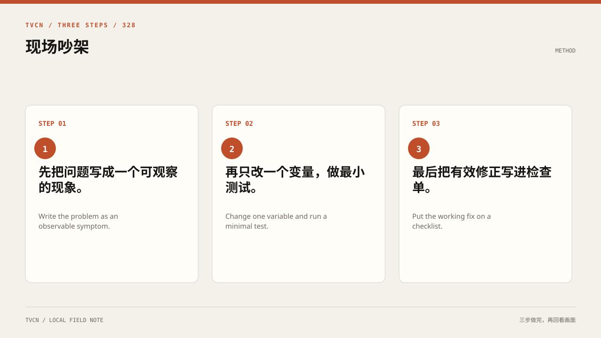

现场吵架先停十分钟，把问题写成“谁在等谁”；不要在人前面分对错。

<!-- DIAGRAM_START -->
<h2>图解</h2>
<figure>
  
  <figcaption>把三步按顺序做完，再回看画面或文件。</figcaption>
</figure>
<!-- DIAGRAM_END -->
<h2>现场</h2>

停十分钟，把问题写成谁在等谁；不在人前分对错。

<h2>怎么做</h2>

现场吵架先停十分钟，把问题写成“谁在等谁”；不要在人前面分对错。
<ol><li>让双方各写一句“我在等什么、我卡在哪”。</li><li>把问题改成任务和顺序：谁先做、谁后做、几点要。</li><li>指定一个决策人，其他人执行；收工后复盘，不现场审判。</li></ol>
<h2>别踩</h2>

别用“都是为片子好”压人；不解决等待，还会再吵。

<h2>验收</h2>
<ul><li>双方各写了“我在等什么、我卡在哪”。</li><li>问题改成了任务和顺序。</li><li>有一个决策人，收工后复盘。</li></ul>
