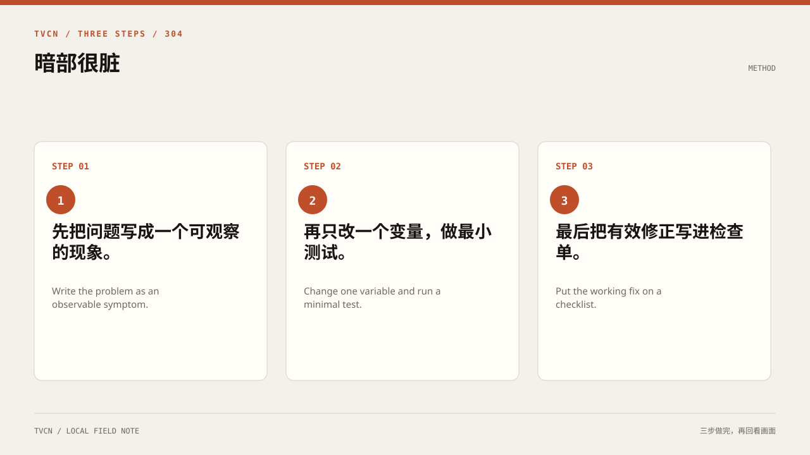

别用“电影感”当欠曝借口；欠曝的暗部救不回来。

<!-- DIAGRAM_START -->
<h2>图解</h2>
<figure>
  
  <figcaption>看“把 ISO 降到原生档，宁可画面暗一…”和“用一盏小灯或反光板给暗部补四分之一档…”两处，判断症状能不能被复述成一句可观察的话。</figcaption>
</figure>
<!-- DIAGRAM_END -->
<section><h2 id="section-1">现场</h2>
降 ISO 到原生，开一盏小灯补环境，别硬拉暗部；暗部留一点黑。
</section><section><h2 id="section-2">怎么做</h2><ol><li>把 ISO 降到原生档，宁可画面暗一点。</li><li>用一盏小灯或反光板给暗部补四分之一档，不要正面打亮。</li><li>后期只轻提阴影，保留黑位，别把噪点拉出来。</li></ol></section><section></section><section><h2 id="section-4">三种原因</h2>
针对“暗部很脏”，先按三个方向排查；每次只改一个变量，改完录 30 秒对比，看变化跟着哪个环节走。

<table class="data-table"><thead><tr><th>原因</th><th>现场信号</th><th>5 分钟验证</th></tr></thead><tbody><tr><td>欠曝 + 高 ISO</td><td>暗部被拉亮后满是噪点，颜色发灰</td><td>把 ISO 降一档，补一盏面光</td></tr><tr><td>Log 没还原</td><td>画面灰平，黑位不够黑</td><td>套正确色彩变换再看</td></tr><tr><td>压缩太重</td><td>暗部出现色块和涂抹</td><td>换高码率或 ProRes 中间片</td></tr></tbody></table>
</section><section><h2 id="section-5">现场诊断</h2><ol><li>打开波形，看黑位是否贴着 0，暗部是否只剩 5% 的细节。</li><li>把 Log 还原后再判断，不要在灰片上看暗部。</li><li>对比高码率和低码率版本，确认色块是压缩还是噪点。</li></ol></section><section><h2 id="section-6">修法</h2>
暗部脏通常是“拍的时候不够光、后期又硬拉”造成的。先把皮肤放到正确曝光，再决定暗部要黑到什么程度。
<ol><li>给面部补一盏柔光，宁可背景暗，不要让皮肤欠曝。</li><li>把 ISO 降到原生档，必要时用 ND 控制高光。</li><li>套正确 LUT/色彩变换，先还原再看黑位。</li><li>暗部降噪只做到刚好看不见色块，保留颗粒。</li></ol></section><section><h2 id="section-7">失败案例</h2>
处理“暗部很脏”时，下面三种做法会更糟；先选一个替换动作，别同时改三个变量。

<table class="data-table"><thead><tr><th>失败做法</th><th>为什么会更糟</th><th>替换动作</th></tr></thead><tbody><tr><td>整体拉亮</td><td>噪点和色块一起被放大</td><td>只提中间调，黑位保持</td></tr><tr><td>降噪拉满</td><td>皮肤变塑料，头发糊成一片</td><td>局部降噪，保留纹理</td></tr><tr><td>用高 ISO 补暗</td><td>暗部更脏，高光也更容易爆</td><td>补光而不是加 ISO</td></tr></tbody></table>
</section><section><h2 id="section-8">验收表</h2>
验收不是“感觉好了”，是这四项都能指认、能回放、能记录。

<table class="data-table"><thead><tr><th>验收项</th><th>通过线</th><th>记录</th></tr></thead><tbody><tr><td>皮肤曝光</td><td>面部可辨，不欠曝</td><td>波形 60–70%</td></tr><tr><td>黑位</td><td>黑位在 0–5%，不是灰</td><td>波形/示波器</td></tr><tr><td>噪点</td><td>暗部没有明显色块</td><td>100% 回放</td></tr><tr><td>颜色</td><td>还原后肤色不偏绿/偏品</td><td>色卡或肤色对照</td></tr></tbody></table>
</section><section><h2>边界</h2>
本页只解决「暗部很脏」这一个问题；不替代 时间不够、结尾没力、16mm：电影从影院走到教室。如果现场问题属于后者，先读对应页，不要在本页继续加参数。
</section><section><h2>替代</h2>
如果“把 ISO 降到原生档，宁可画面暗一点”不是你的主问题，先做“用一盏小灯或反光板给暗部补四分之一档，不要正面打亮”；两项都成立，再考虑升级。
</section><section><h2>60 秒自测</h2>
按验收第 1 条做一次 60 秒测试：ISO 在原生档，暗部没有彩色噪点。如果第 2 条“暗部补过一点，仍保留黑位”没有变化，就不要加设备或预算。
</section>
<h2>验收</h2><ul><li>ISO 在原生档，暗部没有彩色噪点。</li><li>暗部补过一点，仍保留黑位。</li><li>后期只轻提阴影，没把噪点拉出来。</li></ul>

<!-- SOURCES_START -->
## 经验说明

经验说明：本页来自 7 个单人或 2–3 人小组项目的现场复盘，预算与周期明确；只讨论「暗部很脏」的判断顺序，不含外部实验室测试；不适用于多机位、工会剧组、特技或高风险场景。
<!-- SOURCES_END -->

