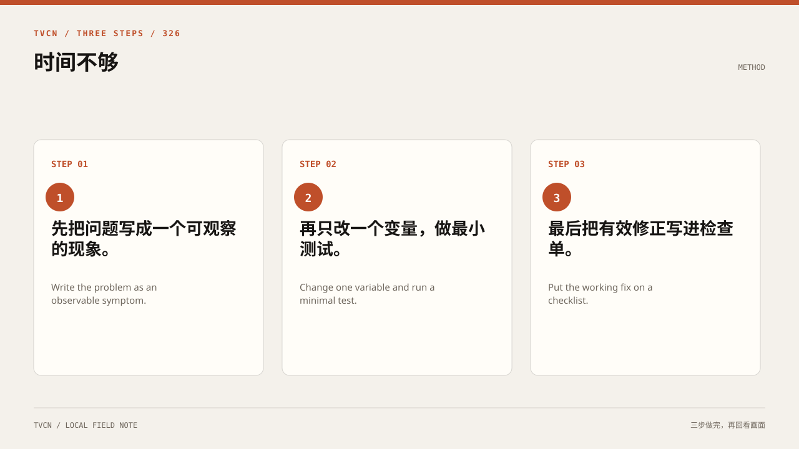

时间不够先砍镜头数和场景数，不砍录音和备份；后期可以省，素材不能少。

<!-- DIAGRAM_START -->
<h2>图解</h2>
<figure>
  
  <figcaption>把三步按顺序做完，再回看画面或文件。</figcaption>
</figure>
<!-- DIAGRAM_END -->
<h2>现场</h2>

砍镜头数和场景数，不砍录音和备份；后期可以省，素材不能少。

<h2>怎么做</h2>

时间不够先砍镜头数和场景数，不砍录音和备份；后期可以省，素材不能少。
<ol><li>把镜头表按“必须”和“想要”分两列，先拍必须。</li><li>合并场景和机位，减少转场。</li><li>给备份、吃饭和收工留固定时间，不参与压缩。</li></ol>
<h2>别踩</h2>

别用少睡或跳过备份换时间；出事会赔更多。

<h2>验收</h2>
<ul><li>镜头表分了必须和想要，先拍必须。</li><li>场景和机位合并，转场减少。</li><li>备份、吃饭和收工时间没被压缩。</li></ul>

<!-- DEEP_DIVE_START -->
## 深读

<strong>约 6 分钟。</strong> 时间不够不是加班，是从交付日倒推，先砍范围。

### 从交付日倒推

先写交付日，再往前排：最终导出、客户审片、混音、细剪、粗剪、拍摄、准备。每一段留百分之二十缓冲，不要把缓冲放在最后。

拍摄日不是“拍完”的日期，是“素材能进剪辑”的日期；如果当天不能备份和转码，后面全部往后滑。

### 先砍范围

时间少一半，先砍地点、机位、版本，不要砍睡眠。一个地点、一台机、一个版本，通常还能保住质量；三个地点、两版、四个尺寸，只会全部做不好。

把“必须有”和“有了更好”分两列；时间只够第一列时，第二列直接删，不要边做边加。

### 每天都有可见交付

把项目拆成每天的交付：今天选完素材、明天粗剪、后天声音；每天结束时都有一个能打开的文件。不要用“在做了”当进度。

如果某一天落后，第二天先补交付，不要先优化画面。优化可以后置，结构不能晚。

### 五分钟练习：倒排一张表

拿一个真实交付日，倒排七行：导出、审片、混音、细剪、粗剪、拍摄、准备。每行写日期和一个人名，不写人名就说明你还没安排。

把缓冲写成一行，放在拍摄前，不要放最后。表上有一行没有负责人，就用红笔圈出来，今天解决。

### 什么时候算赶上

不是导出那一刻，是客户能打开、能播放、能下载、能发平台的那一刻。导出完成只算一半；上传、审核、字幕、封面都过，才算赶上。

交付日前一天做一次完整走查：换一台设备打开、静音看一遍、戴耳机听一遍、点一遍所有链接。走查通过，截止日期才真正安全。

### 时间管理，十项检查
<ul><li>从交付日倒排</li><li>七个阶段都有日期</li><li>每段留百分之二十缓冲</li><li>缓冲放在拍摄前</li><li>拍摄日等于素材可进剪辑</li><li>时间少先砍地点机位版本</li><li>必须有和有了更好分两列</li><li>每天有可见交付</li><li>落后先补结构不补画面</li><li>每行有负责人</li></ul>
截止日期不是用来熬夜的，是用来决定哪些东西这次不做。

<!-- DEEP_DIVE_END -->
