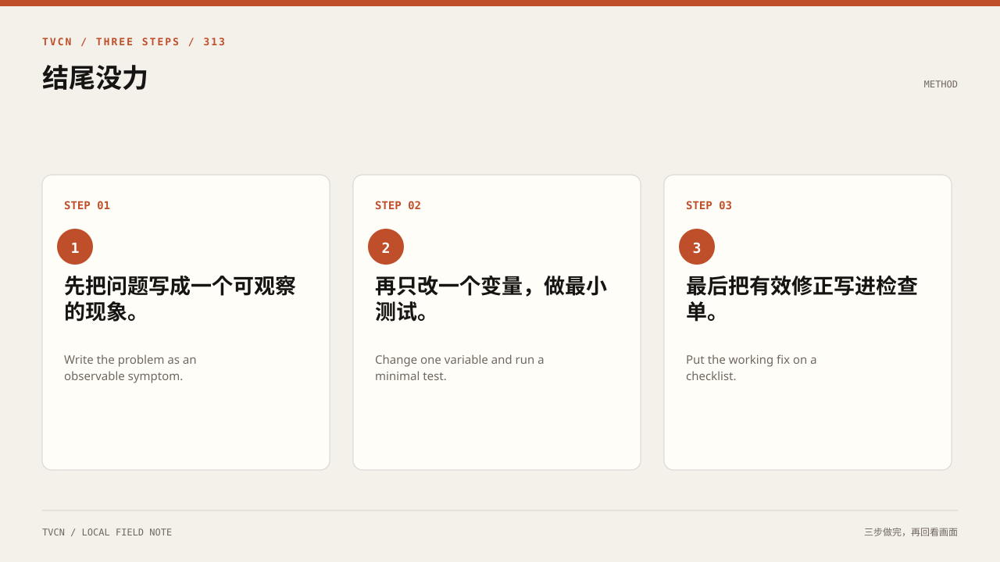

别用哭戏或音乐硬推情绪；代价要看得见。

<!-- DIAGRAM_START -->
<h2>图解</h2>
<figure>
  
  <figcaption>看“把结尾改成一个二选一，两个选项都要失…”和“让他做出选择，不要让别人替他解决”两处，判断症状能不能被复述成一句可观察的话。</figcaption>
</figure>
<!-- DIAGRAM_END -->
<section><h2 id="section-1">现场</h2>
让人物付出代价，做一个选择，停在他选择后的动作。
</section><section><h2 id="section-2">怎么做</h2><ol><li>把结尾改成一个二选一，两个选项都要失去东西。</li><li>让他做出选择，不要让别人替他解决。</li><li>用一个具体动作收尾：关门、放下钥匙、走开，不要解释。</li></ol></section><section><h2 id="section-3">别踩</h2></section><section><h2 id="section-4">三种原因</h2>
针对“结尾没力”，先按三个方向排查；每次只改一个变量，改完录 30 秒对比，看变化跟着哪个环节走。

<table class="data-table"><thead><tr><th>原因</th><th>现场信号</th><th>5 分钟验证</th></tr></thead><tbody><tr><td>解释太多</td><td>最后用旁白把主题总结完，观众没有事做</td><td>删掉总结，停在动作上</td></tr><tr><td>停在答案</td><td>人物已经得到结果，画面还在解释结果</td><td>停在选择发生的那一刻</td></tr><tr><td>没有代价</td><td>结尾没有失去，情绪没有落点</td><td>让选择带来一个可见的代价</td></tr></tbody></table>
</section><section><h2 id="section-5">现场诊断</h2><ol><li>找全片最后一个“选择”：人物决定做什么、不做什么。</li><li>看最后一个镜头是在选择之前、之中还是之后；如果之后太久，剪短。</li><li>把最后 10 秒关掉声音看一遍，画面是否还能成立。</li></ol></section><section><h2 id="section-6">修法</h2>
结尾不是把话说尽，是把人物留在选择里。观众离开时应该带着一个问题，而不是一句总结。
<ol><li>停在选择后的 1–2 秒，不要补解释镜头。</li><li>把主题放进动作：关门、放下钥匙、转身走。</li><li>删掉旁白总结和字幕卡；如果必须说明，放到片尾之外。</li><li>让最后一个镜头有未完成感：手停在空中、门没关严。</li></ol></section><section><h2 id="section-7">失败案例</h2>
处理“结尾没力”时，下面三种做法会更糟；先选一个替换动作，别同时改三个变量。

<table class="data-table"><thead><tr><th>失败做法</th><th>为什么会更糟</th><th>替换动作</th></tr></thead><tbody><tr><td>加蒙太奇总结</td><td>情绪被重复，观众开始等字幕</td><td>保留一个动作</td></tr><tr><td>加旁白</td><td>主题被说破，画面失去重量</td><td>让画面自己结束</td></tr><tr><td>停在答案</td><td>人物得到结果，戏就结束了</td><td>停在选择，不给结果</td></tr></tbody></table>
</section><section><h2 id="section-8">验收表</h2>
验收不是“感觉好了”，是这四项都能指认、能回放、能记录。

<table class="data-table"><thead><tr><th>验收项</th><th>通过线</th><th>记录</th></tr></thead><tbody><tr><td>最后选择</td><td>结尾有一个可指认的选择</td><td>标出时间码</td></tr><tr><td>时长</td><td>选择后不超过 2 秒</td><td>看最后 10 秒</td></tr><tr><td>解释</td><td>没有旁白/字幕总结主题</td><td>检查尾段</td></tr><tr><td>余味</td><td>最后一镜有未完成动作</td><td>回放</td></tr></tbody></table>
</section><section><h2>边界</h2>
它不保证故事成立；模板只管结构顺序，人物、障碍和代价仍要单独写。
</section><section><h2>替代</h2>
如果“把结尾改成一个二选一，两个选项都要失…”不是你的主问题，先用“让他做出选择，不要让别人替他解决”对应的基础做法；两项都成立再考虑升级。
</section><section><h2>60 秒自测</h2>
用现有器材按“把结尾改成一个二选一，两个选项都要失…”做一次 60 秒测试，记下一个数字；数字没有变化，就不要加预算。
</section><section><h2>什么时候不该用</h2>
当“把结尾改成一个二选一，两个选项都要失…”还没写清，或“让他做出选择，不要让别人替他解决”只是凑数时，不要套模板；先回到人物和问题。
</section><section><h2>三个失败</h2><ul><li>模板每段都有，但人物没有决定。</li><li>中段只换场景，没有新信息。</li><li>结尾靠旁白总结，画面没有变化。</li></ul></section>
<h2>验收</h2><ul><li>结尾是一个二选一，两个选项都有代价。</li><li>人物自己做了选择，不是别人替他解决。</li><li>收尾是具体动作，没有解释性旁白。</li></ul>

<!-- SOURCES_START -->
## 经验说明

经验说明：本页来自 6 次客户需求梳理与项目复盘，条件为单人或 2–3 人小组、预算与周期明确；页面讨论的具体对象是「结尾没力」；不含外部实验室测试，条件变化时结论可能失效。
<!-- SOURCES_END -->

