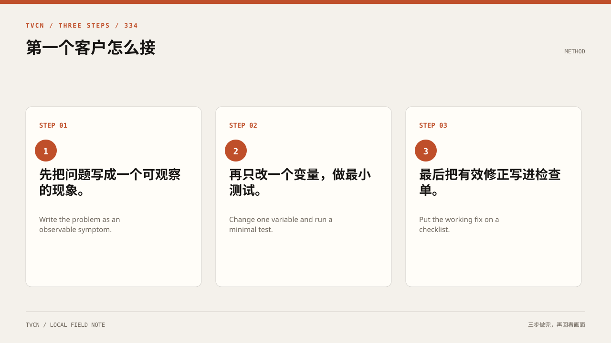

第一个客户从熟人、社区和小商家开始；先给一个具体方案，不要发作品集大海报。

<!-- DIAGRAM_START -->
<h2>图解</h2>
<figure>
  
  <figcaption>把三步按顺序做完，再回看画面或文件。</figcaption>
</figure>
<!-- DIAGRAM_END -->
<h2>现场</h2>

从熟人、社区、小商家开始；给一个具体方案，不发大海报。

<h2>怎么做</h2>

第一个客户从熟人、社区和小商家开始；先给一个具体方案，不要发作品集大海报。
<ol><li>列十个可能认识的人或店，选一个真有拍摄需求的。</li><li>给对方一页方案：拍什么、多久、交什么、多少钱。</li><li>先做一个小单，按时交付，再要一句评价或转介绍。</li></ol>
<h2>别踩</h2>

别群发“我会拍视频”；具体方案比自我介绍有用。

<h2>验收</h2>
<ul><li>列了十个可能认识的人或店，选了一个真有需求的。</li><li>给了一页方案：拍什么、多久、交什么、多少钱。</li><li>小单按时交付，拿到一句评价或转介绍。</li></ul>

<!-- DEEP_DIVE_START -->
## 深读

<strong>约 7 分钟。</strong> 第一个客户不是等你作品集完美，是先把范围、价格、交付写清，用一个小项目换信任。

### 先卖一个小明确

第一单不要报品牌片，报一条三十或六十秒的单品视频：一个地点、一个人物、一个交付物。范围越小，你越能按时交，客户越敢试。

先问三个问题：给谁看、看完做什么、什么时候要。三个答案不清，先别报价；否则后面所有的修改都来自这三个空白。

### 报价写四行

范围、交付物、修改次数、版权与付款节点；四行写进一页纸。定金至少一半，尾款在交付源文件前结清；不写“看着给”。

报价按时间和使用范围算，不按“片子长短”算。三十秒不一定比三分钟便宜；拍摄天数、机位、演员、后期决定成本。

### 交付与关系

只给一轮包含在报价里的修改，超出按小时或按版本另算；反馈要在一个链接里一次提完，不要微信语音轰炸。

交付时给三种文件：平台压缩版、高质量母版、封面图；附一页说明。项目结束一周后写一条案例，比请客户吃饭更有用。

### 五分钟练习：一页报价

拿一个真实的小需求，写一页报价：范围、交付、修改、版权、付款、时间表。不要写公司介绍，不要写“我们很专业”。

把这一页发给一个同行，让他指出哪一句会让客户误解；改掉那一句，再发客户。第一单的目标不是赚最多，是交付一次不用返工的完整项目。

### 什么时候算交付完成

客户拿到三种文件、确认播放正常、尾款到账、授权范围写清，才算交付完成；不是文件发出去就算完。发出去之后留一个二十四小时的确认窗口，避免一周后才发现打不开。

交付邮件里写清：哪一版是最终版、哪些文件给平台、哪些文件留档、下一次修改怎么计费。四句话写完，后面少十封解释邮件。

### 第一个客户，十项检查
<ul><li>第一单只卖一个小范围</li><li>一个地点一个人物一个交付</li><li>先问给谁看和看完做什么</li><li>交付日期写清</li><li>报价四行写进一页纸</li><li>定金至少一半</li><li>尾款在源文件前结清</li><li>只含一轮修改</li><li>反馈一次提完</li><li>交付三种文件加一页说明</li></ul>
第一个客户买的不是你的才华，是你能不能把一件小事按时、按范围、按价格交完。

<!-- DEEP_DIVE_END -->
