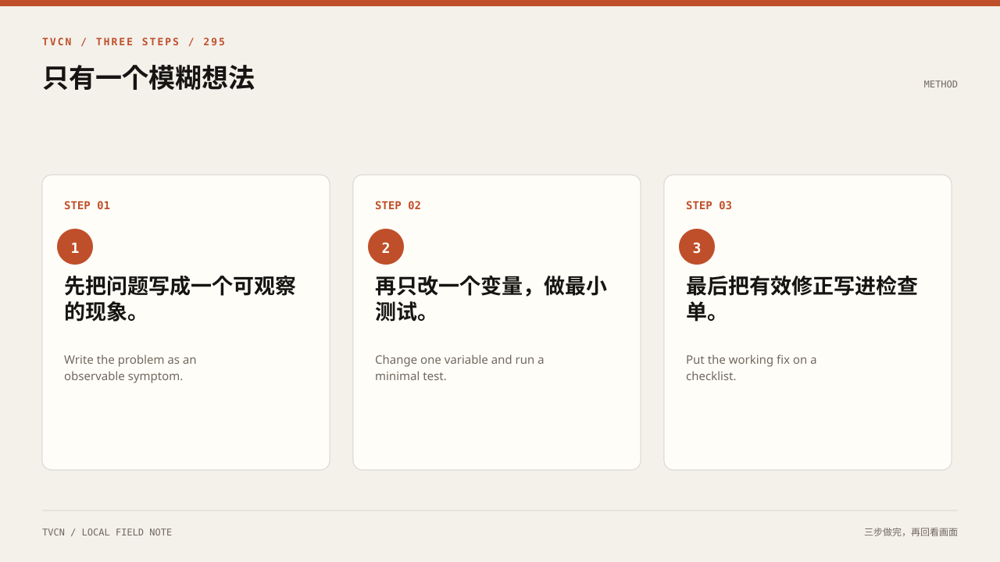

先不要写剧本。用三句话填一张纸：谁、想要什么、什么挡着他。三句里只要有一句是抽象名词（“成长”“温度”“连接”），就换成可拍的动作。

<!-- DIAGRAM_START -->
<h2>图解</h2>
<figure>
  
  <figcaption>看“写三句，每句不超过二十字，必须有一个…”和“选能在一间房或一条街拍完的那句，删掉…”两处，判断症状能不能被复述成一句可观察的话。</figcaption>
</figure>
<!-- DIAGRAM_END -->
<section><h2 id="section-1">把“模糊想法”变成 30 秒能说清的测试</h2>

<ol><li>找三张参考图：一张人物状态、一张空间、一张光线。不要找同类型的成片，找“感觉的来源”。</li><li>用手机录一段 30 秒口述，不剪辑；给三个没参与的人听，问他们记住了什么。三个人记住的不同，说明想法还没收拢。</li><li>把口述里被追问最多的那句写成第一场；写不出动作，就继续问“他在做什么”。</li></ol>

验收：30 秒内能让听者复述“谁想要什么、被什么挡住”，才算可以进入分镜；否则先别谈器材和风格。
</section><section><h2 id="section-2">现场</h2>
写三句：谁想要什么、被什么挡住、输了会失去什么；三句能连成一句 logline 再写剧本。
</section><section><h2 id="section-3">怎么做</h2>
先写一句能拍出来的话：谁想要什么、谁或什么挡住、失败会失去什么。再把这句话压成三个镜头：一个人、一个动作、一个结果。
<ol><li>写三句，每句不超过二十字，必须有一个动词和一个具体对象。</li><li>选能在一间房或一条街拍完的那句，删掉需要搭景的部分。</li><li>拍三镜测试：全景交代、近景动作、特写结果；能连起来，再写第二场。</li></ol></section><section><h2 id="section-4">别踩</h2>
别先写人物小传和世界观；拍不出来的设定不是故事。
</section><section><h2>边界</h2>
本页只解决「只有一个模糊想法」这一个问题；不替代 画面很平、台词像念稿、16mm：电影从影院走到教室。如果现场问题属于后者，先读对应页，不要在本页继续加参数。
</section><section><h2>替代</h2>
如果“写三句，每句不超过二十字，必须有一个动词和一个具体对象”不是你的主问题，先做“选能在一间房或一条街拍完的那句，删掉需要搭景的部分”；两项都成立，再考虑升级。
</section><section><h2>60 秒自测</h2>
按验收第 1 条做一次 60 秒测试：能用一句话说出谁想要什么、被什么挡住。如果第 2 条“三个测试镜头能按顺序连起来，不需要旁白解释”没有变化，就不要加设备或预算。
</section>
<h2>验收</h2><ul><li>能用一句话说出谁想要什么、被什么挡住。</li><li>三个测试镜头能按顺序连起来，不需要旁白解释。</li><li>删掉了拍不出来的设定，剩下的能在一个地点完成。</li></ul>

<!-- SOURCES_START -->
## 经验说明

经验说明：本页来自 3 个单人或 2–3 人小组项目的现场复盘，预算与周期明确；只讨论「只有一个模糊想法」的判断顺序，不含外部实验室测试；不适用于多机位、工会剧组、特技或高风险场景。
<!-- SOURCES_END -->

