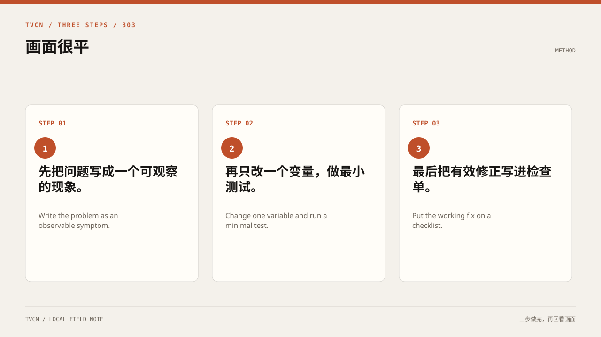

画面平通常不是机器问题，是光没有方向、前后景没有分开。

<!-- DIAGRAM_START -->
<h2>图解</h2>
<figure>
  
  <figcaption>把三步按顺序做完，再回看画面或文件。</figcaption>
</figure>
<!-- DIAGRAM_END -->
<h2>现场</h2>

加侧光、前景、背景层次；让人物离墙 1 米，画面立刻有纵深。

<h2>怎么做</h2>

画面平不是机器问题，是光没有方向、前后景没有分开。先加侧光，再放前景。
<ol><li>把主光从正面移到侧面四十五度，让鼻子有影子。</li><li>在镜头前放一个虚化的前景：杯子、门框、肩膀。</li><li>让人物离背景至少一点五米，背景自然虚掉。</li></ol>
<h2>别踩</h2>

别靠加对比度和锐化解决；平是空间问题。

<h2>验收</h2>
<ul><li>主光在侧面，鼻子有影子。</li><li>前景有虚化物件，人物和背景分开。</li><li>人物离背景至少一点五米，背景不再贴脸。</li></ul>
