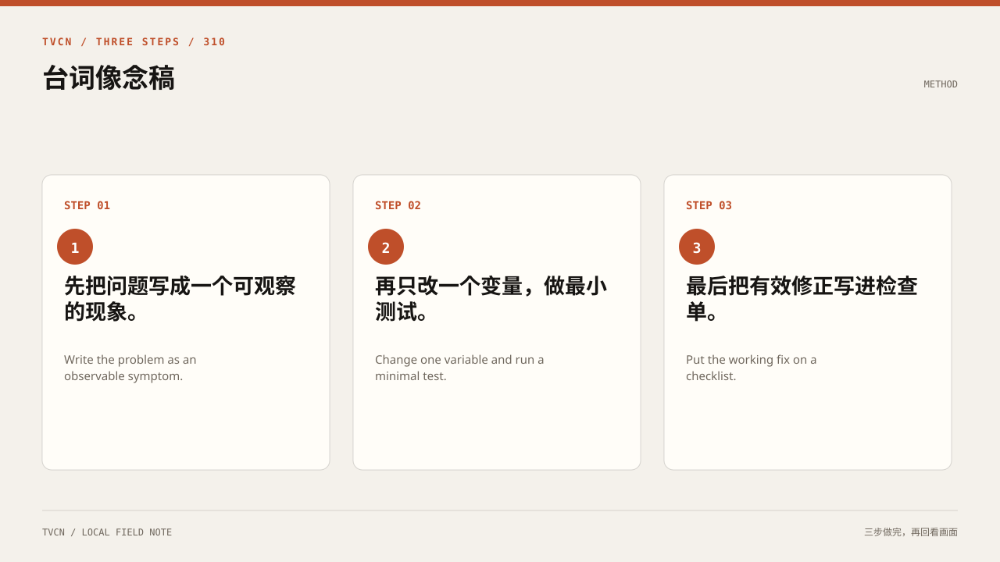

针对“台词像念稿”，先按三个方向排查；每次只改一个变量，改完录 30 秒对比，看变化跟着哪个环节走。

<!-- DIAGRAM_START -->
<h2>图解</h2>
<figure>
  
  <figcaption>看“把解释性台词删掉，只留欲望和阻力”和“给每句台词配一个动作或对象：看谁、拿…”两处，判断症状能不能被复述成一句可观察的话。</figcaption>
</figure>
<!-- DIAGRAM_END -->
<section><h2 id="section-1">现场</h2>
删解释，加动作，让演员看着一个人说；不要加形容词。
</section><section><h2 id="section-2">怎么做</h2><ol><li>把解释性台词删掉，只留欲望和阻力。</li><li>给每句台词配一个动作或对象：看谁、拿什么、走到哪。</li><li>让演员对着一个真人说，不要对空气或镜头说。</li></ol></section><section><h2 id="section-3">别踩</h2>
别用提高音量或哭腔代替潜台词。
</section><section><h2 id="section-4">三种原因</h2>
<table class="data-table"><thead><tr><th>原因</th><th>现场信号</th><th>5 分钟验证</th></tr></thead><tbody><tr><td>台词是书面语</td><td>句子完整、信息太满，听起来像念文章</td><td>改成短句和口语，允许说半句</td></tr><tr><td>演员不知道意图</td><td>每个字都对，但不知道这句话想改变对方什么</td><td>给一句潜台词：他想让对方留下/走/承认</td></tr><tr><td>没有障碍</td><td>对方马上同意，台词没有用力点</td><td>让对方拒绝、沉默或反问</td></tr></tbody></table>
</section><section><h2 id="section-5">现场诊断</h2><ol><li>让演员用自己的话说一遍台词，看意思是否还在。</li><li>问演员“这句话你想让对方做什么”，如果答不出，意图没建立。</li><li>把台词去掉，只演动作；如果动作成立，再把台词接回来。</li></ol></section><section><h2 id="section-6">修法</h2>
台词像念稿，通常不是发音问题，是台词没有任务。先让每句话想改变对方，再处理节奏和重音。
<ol><li>把长句拆成短句，删掉解释性的从句。</li><li>给每句台词一个动作：请求、试探、威胁、掩饰。</li><li>让对手戏演员给出真实阻力，不要提前接台词。</li><li>允许停顿和抢话；不要每句都等对方说完。</li></ol></section><section><h2 id="section-7">失败案例</h2>
处理“台词像念稿”时，下面三种做法会更糟；先选一个替换动作，别同时改三个变量。

<table class="data-table"><thead><tr><th>失败做法</th><th>为什么会更糟</th><th>替换动作</th></tr></thead><tbody><tr><td>加更多语气</td><td>每句都用力，听起来更假</td><td>先给意图，再决定语气</td></tr><tr><td>让演员“自然”</td><td>演员不知道自然是对谁自然</td><td>给动作和对象</td></tr><tr><td>逐字改稿</td><td>句子顺了，意图还是空的</td><td>先写每句想改变什么</td></tr></tbody></table>
</section><section><h2 id="section-8">验收表</h2>
验收不是“感觉好了”，是这四项都能指认、能回放、能记录。

<table class="data-table"><thead><tr><th>验收项</th><th>通过线</th><th>记录</th></tr></thead><tbody><tr><td>口语</td><td>台词能一口气说顺，不像文章</td><td>演员复述</td></tr><tr><td>意图</td><td>每句能说出想改变对方什么</td><td>逐句标注</td></tr><tr><td>阻力</td><td>对手有反应，不是等着被说</td><td>看对手戏</td></tr><tr><td>停顿</td><td>至少有一处真实停顿或抢话</td><td>回放对话</td></tr></tbody></table>
</section><section><h2>边界</h2>
它不保证故事成立；模板只管结构顺序，人物、障碍和代价仍要单独写。
</section><section><h2>替代</h2>
如果“把解释性台词删掉，只留欲望和阻力”不是你的主问题，先用“给每句台词配一个动作或对象：看谁、拿…”对应的基础做法；两项都成立再考虑升级。
</section><section><h2>60 秒自测</h2>
用现有器材按“把解释性台词删掉，只留欲望和阻力”做一次 60 秒测试，记下一个数字；数字没有变化，就不要加预算。
</section><section><h2>什么时候不该用</h2>
当“把解释性台词删掉，只留欲望和阻力”还没写清，或“给每句台词配一个动作或对象：看谁、拿…”只是凑数时，不要套模板；先回到人物和问题。
</section><section><h2>三个失败</h2><ul><li>模板每段都有，但人物没有决定。</li><li>中段只换场景，没有新信息。</li><li>结尾靠旁白总结，画面没有变化。</li></ul></section>
<h2>验收</h2><ul><li>解释性台词删了，只留欲望和阻力。</li><li>每句台词有动作或对象。</li><li>演员对着真人说，不对空气或镜头。</li></ul>
