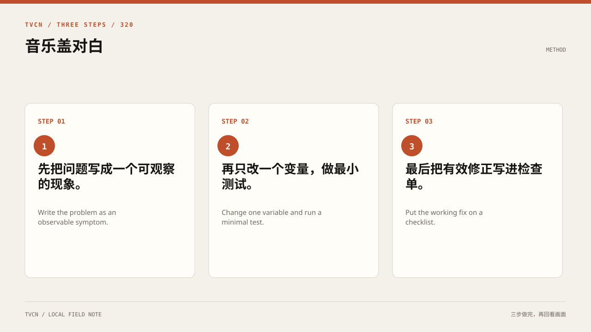

音乐盖对白，先把音乐降 6 dB，再检查是不是根本不需要。

<!-- DIAGRAM_START -->
<h2>图解</h2>
<figure>
  
  <figcaption>把三步按顺序做完，再回看画面或文件。</figcaption>
</figure>
<!-- DIAGRAM_END -->
<h2>现场</h2>

音乐降 6 dB，检查是否根本不需要；对白优先。

<h2>怎么做</h2>

音乐盖对白，先把音乐降六分贝，再检查是不是根本不需要。
<ol><li>独奏对白，确认每个字都能听清。</li><li>音乐在对白段落降六到十分贝，或加侧链和自动化。</li><li>如果降了还盖，删掉音乐，用环境声托底。</li></ol>
<h2>别踩</h2>

别用音乐填满所有空白；安静也是节奏。

<h2>验收</h2>
<ul><li>独奏对白，每个字都听清。</li><li>对白段音乐降了六到十分贝。</li><li>降了还盖就删音乐，用环境声托底。</li></ul>
