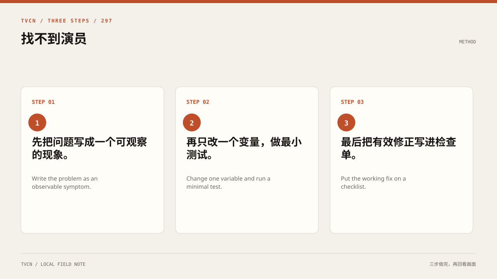

找不到演员就先拍手、背影、物件和声音；不露脸也能讲一个完整的人。

<!-- DIAGRAM_START -->
<h2>图解</h2>
<figure>
  
  <figcaption>把三步按顺序做完，再回看画面或文件。</figcaption>
</figure>
<!-- DIAGRAM_END -->
<h2>现场</h2>

拍手、背影、物件、声音四组镜头；用画外音或字幕补信息，不露脸也能有人物。

<h2>怎么做</h2>

找不到演员就拍手、背影、物件和声音；让一个人做真事，而不是演情绪。
<ol><li>把角色拆成手、背影、侧脸、影子四个可拍部分。</li><li>找一个愿意做真事的人：做饭、修东西、走路，给他一个具体任务。</li><li>录下他做事时的呼吸、脚步和环境声，用声音补人物。</li></ol>
<h2>别踩</h2>

别让素人“演悲伤”；让他找钥匙、等水开，情绪会自己出来。

<h2>验收</h2>
<ul><li>手、背影、侧脸、影子四类镜头都拍到了。</li><li>素人在做具体任务，不是对着镜头演。</li><li>呼吸、脚步和环境声能补出人物。</li></ul>
