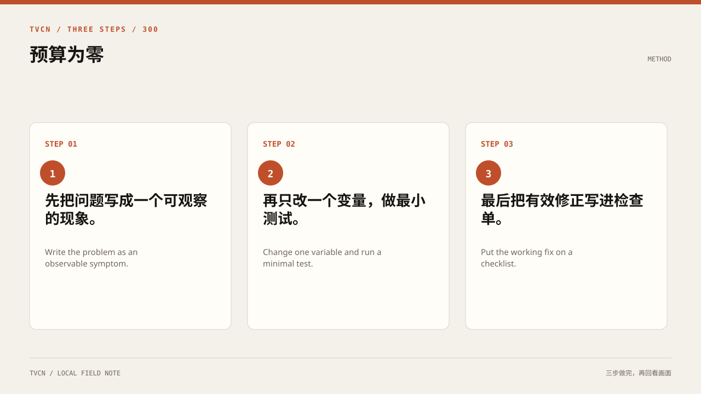

零预算能拍的是小空间、少角色、自然光、短时长。把剧本压到一个房间、两个人、一个下午；不要用“低成本”当借口保留五个场景。

<!-- DIAGRAM_START -->
<h2>图解</h2>
<figure>
  
  <figcaption>看“把剧本的场景数压到一到两个，人物压到…”和“用自然光、现有房间、手机或借来的机器…”两处，判断症状能不能被复述成一句可观察的话。</figcaption>
</figure>
<!-- DIAGRAM_END -->
<section><h2 id="section-1">没钱时先换“规模”，不换“标准”</h2>
把钱花在观众最能感到的地方：声音、演员、一个关键道具。别平均撒在器材上。
<h2 id="section-2">边界</h2>
低成本不等于粗糙。画面可以简单，声音不能听不清，故事不能没有变化；这三样是底线，不是预算项。
<h2 id="section-3">零预算项目，先定“不能做什么”</h2>

零预算不是“免费拍片”，是用现有资源换一个可展示的结果。开始前先写三条边界：不租器材、不请演员、不出外景；或只保留一条。边界越清楚，项目越可能完成。

<table class="data-table"><thead><tr><th>资源</th><th>能换什么</th><th>代价</th></tr></thead><tbody>
<tr><td>你的技能</td><td>为对方拍一条 30 秒片</td><td>时间，不是现金</td></tr>
<tr><td>对方的场地/产品</td><td>免费拍摄场景与道具</td><td>要给对方可用成片</td></tr>
<tr><td>平台/社群</td><td>曝光、互推、反馈</td><td>不一定带来客户</td></tr>
</tbody></table>

<h3>零预算的正确目标</h3>

不是“做一个大片”，是“完成一次完整流程”。把范围压到 1 个场景、1 个机位、1 个成片、1 轮修改。用手机或现有相机，不追求参数；把时间花在脚本、现场声和剪辑节奏上。

<h3>三种不要接的零预算</h3>
<ul><li>要求“先看效果再谈钱”的商业品牌；这是比稿，不是合作。</li><li>需要垫付场地、器材、演员的项目；零预算不等于零成本。</li><li>版权归客户、还要你承担无限修改的项目；没有预算，更要把范围写死。</li></ul>

若决定做，签一页备忘录：双方各自出什么、成片用在哪、署名怎么写、什么时候结束。零预算项目也要有交付日，否则它会无限延长。
</section><section><h2 id="section-4">现场</h2>
砍场面：人群、夜景、车辆；用一间房、两个人、一个道具重写。
</section><section><h2 id="section-5">怎么做</h2>
零预算先砍场面，不砍结构；一个能拍完的简单故事，比拍不起的好故事强。
<ol><li>把剧本的场景数压到一到两个，人物压到一到两个。</li><li>用自然光、现有房间、手机或借来的机器拍。</li><li>把省下的钱放在声音和一顿饭上，保证能拍完。</li></ol></section><section><h2 id="section-6">别踩</h2>
别用“等有钱再拍”当借口；先拍一个能交的版本。
</section><section><h2>替代</h2>
如果“把剧本的场景数压到一到两个，人物压到一到两个”不是你的主问题，先做“用自然光、现有房间、手机或借来的机器拍”；两项都成立，再考虑升级。
</section><section><h2>60 秒自测</h2>
按验收第 1 条做一次 60 秒测试：场景和人物都压到一到两个。如果第 2 条“全片用自然光、现有房间、手机或借来的机器拍完”没有变化，就不要加设备或预算。
</section><section><h2>什么时候不该用</h2>
本页只解决「预算为零」这一个问题；不替代 镜头不够剪、没有灯怎么拍、16mm：电影从影院走到教室。如果现场问题属于后者，先读对应页，不要在本页继续加参数。
</section>
<h2>验收</h2><ul><li>场景和人物都压到一到两个。</li><li>全片用自然光、现有房间、手机或借来的机器拍完。</li><li>声音清楚，剧组吃上饭，片子能交付。</li></ul>

<!-- DEEP_DIVE_START -->
## 深读

<strong>约 6 分钟。</strong> 零预算不是等有钱再拍，是先把约束写成规则，让片子在没有器材时也能成立。

### 先删拍不起的

先列三样拍不起的东西：轨道、灯光、演员、场地；把它们从剧本里删掉，不要用假镜头替代。删不掉的，就换成同一个空间里能完成的行为。

留下三样不要钱的：一扇窗、一面墙、一个人、一个动作；所有场景围着这三样写。每场戏只问：这个空间里，他现在能做什么。

### 用现有光和时间

白天用窗光，晚上用一盏 practical；把拍摄安排在光线稳定的两小时。不要买灯，先学会挡光和反光：黑布挡窗、白墙反光、一张纸柔光。

用手机或现有相机，固定白平衡，手动曝光；录音用有线耳机麦，或者让手机贴近人物。先保证声音能听清，再谈画面风格。

### 让限制变成形式

一个房间拍三天，用三个时间段、三件衣服、三个动作区分；黑白、固定机位、重复构图都可以成为风格。限制越清楚，片子越不像“穷”。

零预算片子最怕装富；承认空间小、人少、光硬，观众反而信。把省下来的钱放在一个能被看见的地方：一个道具、一顿饭、一个声音细节。

### 五分钟练习：二十四小时一条片

定一个地点、一个人、一个动作，二十四小时内拍完三十秒。不许买器材，不许加旁白，只许用现有光和现场声。

拍完问自己：删掉哪三样拍不起的东西之后，故事反而更清楚了。把答案写进下一条片的规则里。

### 零预算，十项检查
<ul><li>先删掉三样拍不起的东西</li><li>场景围绕现有空间写</li><li>只用一扇窗或一盏 practical</li><li>拍摄安排在光线稳定时段</li><li>会挡光和反光</li><li>白平衡和曝光手动锁定</li><li>声音用有线麦或贴近人物</li><li>用三个时间段区分空间</li><li>限制变成可见风格</li><li>省下的钱花在一个可见细节</li></ul>
零预算不是没有条件，是把条件写进剧本，让片子从第一秒就承认自己是什么。

<!-- DEEP_DIVE_END -->

<!-- SOURCES_START -->
## 参考与延伸阅读

- [S19] [GAN 原始论文（2014）](https://arxiv.org/abs/1406.2661) — 2026-11-26 访问。用于核对「没钱时先换“规模”，不换“标准”」一节的术语/方法/规则（GAN 原始论文，不是产品评测）；不核对其中由本页经验得出的数字、型号与现场结论，也不替代测试。
- [S20] [DDPM 原始论文（2020）](https://arxiv.org/abs/2006.11239) — 2026-11-26 访问。用于核对「零预算项目，先定“不能做什么”」一节的术语/方法/规则（DDPM 原始论文，不是产品评测）；不核对其中由本页经验得出的数字、型号与现场结论，也不替代测试。
- [S04] [国家网信办：《生成式人工智能服务管理暂行办法》](https://www.cac.gov.cn/2023-07/13/c_1690898327029107.htm) — 2026-11-26 访问。用于核对「现场」一节的术语/方法/规则（生成式 AI 服务管理规则，不是技术实现）；不核对其中由本页经验得出的数字、型号与现场结论，也不替代测试。
<!-- SOURCES_END -->

