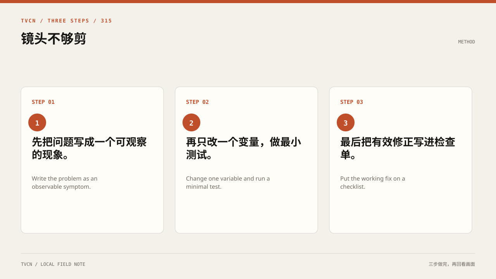

别一个长镜头拍完就收工；剪辑时没有替代。

<!-- DIAGRAM_START -->
<h2>图解</h2>
<figure>
  
  <figcaption>看“每个动作至少拍全景、中景、特写各一条”和“加插入镜头：手、脚、道具、门缝”两处，判断症状能不能被复述成一句可观察的话。</figcaption>
</figure>
<!-- DIAGRAM_END -->
<section><h2 id="section-1">现场</h2>
补全景、近景、插入、反打；每个景别至少两条。
</section><section><h2 id="section-2">怎么做</h2><ol><li>每个动作至少拍全景、中景、特写各一条。</li><li>加插入镜头：手、脚、道具、门缝。</li><li>每条多留三秒头尾，给剪辑留余地。</li></ol></section><section></section><section><h2 id="section-4">三种原因</h2>
针对“镜头不够剪”，先按三个方向排查；每次只改一个变量，改完录 30 秒对比，看变化跟着哪个环节走。

<table class="data-table"><thead><tr><th>原因</th><th>现场信号</th><th>5 分钟验证</th></tr></thead><tbody><tr><td>只拍 master</td><td>一条全景从头到尾，剪到第二句就没有画面</td><td>把每个台词段拆成两个角度</td></tr><tr><td>没有 insert</td><td>动作细节全靠演员表演，剪不进去</td><td>补手、门、杯子、手机屏幕</td></tr><tr><td>没有 reaction</td><td>对话只有说话的人，没有听话的人</td><td>每个回合补一个反应镜头</td></tr></tbody></table>
</section><section><h2 id="section-5">现场诊断</h2><ol><li>把剧本按句列成剪辑点，每句标“谁说、谁听、手上做什么”。</li><li>在时间线上放一遍，数每个台词段有几个可用角度。</li><li>把缺口写成拍摄清单：缺 wide、缺 insert、缺 reaction，分开补。</li></ol></section><section><h2 id="section-6">修法</h2>
覆盖不是多拍，是把剪辑需要的“关系、动作、反应”各拍一条。先保证每个台词段有两个角度，再谈美感。
<ol><li>每个场景先拍 1 条 wide，保人物位置和空间关系。</li><li>每个台词段拍 2 个 medium：一个偏向说话者，一个偏向听者。</li><li>补 3 个 inserts：手、道具、环境；每个只拍一个动作。</li><li>每个回合补 1 个 reaction，留 2 秒开机前和关机后。</li><li>转场拍 2 秒干净的 tail 和 head，给剪辑留把手。</li></ol></section><section><h2 id="section-7">失败案例</h2>
处理“镜头不够剪”时，下面三种做法会更糟；先选一个替换动作，别同时改三个变量。

<table class="data-table"><thead><tr><th>失败做法</th><th>为什么会更糟</th><th>替换动作</th></tr></thead><tbody><tr><td>全景重复剪</td><td>观众看不出时间推进，只看到同一张脸</td><td>用 inserts 和 reaction 切信息</td></tr><tr><td>越轴补角度</td><td>机位跨轴，空间突然反了</td><td>先在纸上画轴线再补</td></tr><tr><td>只拍漂亮空镜</td><td>空镜没有动作，剪进去像停顿</td><td>空镜里放一个可辨认的动作</td></tr></tbody></table>
</section><section><h2 id="section-8">验收表</h2>
验收不是“感觉好了”，是这四项都能指认、能回放、能记录。

<table class="data-table"><thead><tr><th>验收项</th><th>通过线</th><th>记录</th></tr></thead><tbody><tr><td>台词段角度</td><td>每段至少有 wide + medium 两个可用角度</td><td>时间线标记</td></tr><tr><td> inserts</td><td>每个动作细节有独立镜头</td><td>拍摄清单</td></tr><tr><td>Reaction</td><td>每个回合有听者的反应</td><td>回放对话段</td></tr><tr><td>转场把手</td><td>每个转场前后有 2 秒干净画面</td><td>检查 tail/head</td></tr></tbody></table>
</section><section><h2>边界</h2>
本页只解决「镜头不够剪」这一个问题；不替代 没有灯怎么拍、不会写剧本、16mm：电影从影院走到教室。如果现场问题属于后者，先读对应页，不要在本页继续加参数。
</section><section><h2>替代</h2>
如果“每个动作至少拍全景、中景、特写各一条”不是你的主问题，先做“加插入镜头：手、脚、道具、门缝”；两项都成立，再考虑升级。
</section><section><h2>60 秒自测</h2>
按验收第 1 条做一次 60 秒测试：每个动作有全景、中景、特写各一条。如果第 2 条“有手、脚、道具、门缝等插入镜头”没有变化，就不要加设备或预算。
</section>
<h2>验收</h2><ul><li>每个动作有全景、中景、特写各一条。</li><li>有手、脚、道具、门缝等插入镜头。</li><li>每条有三秒头尾，剪辑有替代。</li></ul>

<!-- DEEP_DIVE_START -->
## 深读

<strong>约 8 分钟。</strong> 这一节不重复前面的做法，只补三个东西：两种条件、一个反例、一个可复用模型；读完能判断什么时候换做法。

### 条件 A：叙事场景

叙事场景的覆盖不是“每个角度都拍”，是“每个信息都有替代”。先按剪辑点列：谁说话、谁听、手上做什么、环境给什么。每个剪辑点至少两个选择：一个 master，一个 reaction 或 insert。没有 reaction 的场景，剪到第二句就会断。

覆盖要在拍摄前画成一张表，不要现场凭记忆补。表上写镜号、景别、动作、时长、是否隔轴；拍完打勾。表越具体，补拍越少。

### 条件 B：动作/群戏

动作场景的覆盖要按“方向”和“后果”拍：谁从哪来、去哪、撞到什么。每个动作至少拍三样：全景关系、身体细节、结果反应。只拍漂亮的角度，剪起来会失去空间；观众不知道谁打了谁。

群戏还要加“分配”：每个人都有一个小动作，不是都站着看主角。覆盖时给每个人一个 reaction，剪辑才有选择。人越多，越要先拍 master，再拍局部；局部拍完，master 可能已经变光。

### 反例：五个角度，没有反应

一场对话拍了五个角度：全景、过肩、特写、低角、俯拍。剪辑时发现每个角度都在拍说话的人，没有一个人在听。五个角度听起来很多，实际只有一个信息：谁在说。剪到第三句，只能重复用同一个特写。

修法不是再补一个角度，而是补“听的人”：每个回合拍一条听者的脸，留 2 秒开机前和关机后。反应镜头不需要漂亮，只需要有变化。

### 可复用模型

<strong>剪辑点 → 信息 → 替代 → 打勾。</strong> 先列剪辑点，再写每个点要传的信息，再决定替代镜头，最后现场打勾。覆盖不是数量，是每个点都有退路。

拍完当天做一次“空时间线测试”：把可用镜头按剪辑点放一遍，缺哪个点，第二天补哪个；不要等粗剪才发现。

<!-- DEEP_DIVE_END -->

<!-- SOURCES_START -->
## 经验说明

经验说明：本页来自 3 个单人或 2–3 人小组项目的现场复盘，预算与周期明确；只讨论「镜头不够剪」的判断顺序，不含外部实验室测试；不适用于多机位、工会剧组、特技或高风险场景。
<!-- SOURCES_END -->

