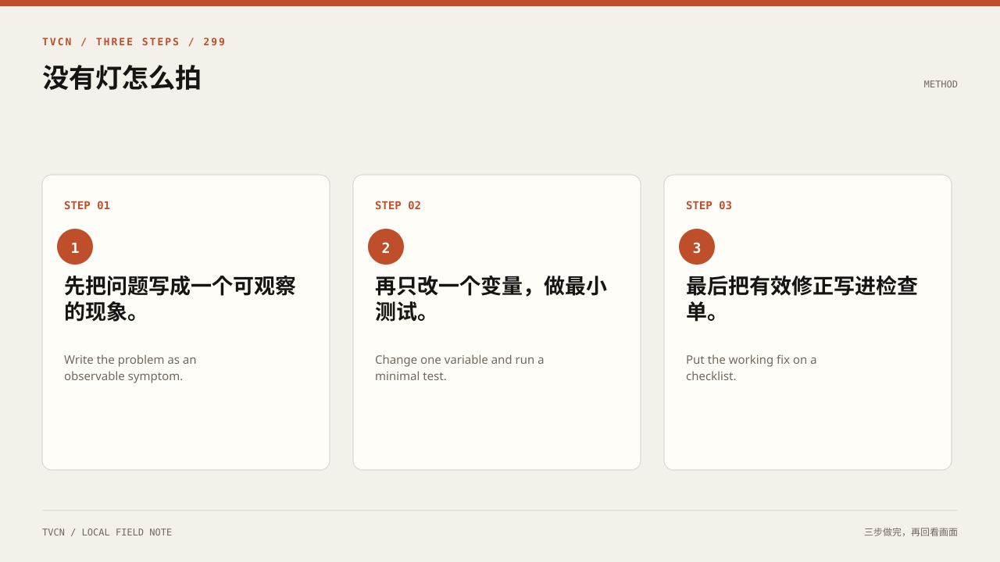

没有灯先用窗、白墙、反光板和手机手电；先找方向，再谈亮度。

<!-- DIAGRAM_START -->
<h2>图解</h2>
<figure>
  
  <figcaption>把三步按顺序做完，再回看画面或文件。</figcaption>
</figure>
<!-- DIAGRAM_END -->
<h2>现场</h2>

找窗边 45 度，白墙当反光板，手机手电加纸巾柔光；先拍半身，再拍全景。

<h2>怎么做</h2>

没有灯先找方向：窗、白墙、反光板、手机手电；先有明暗，再谈亮度。
<ol><li>让人物侧对窗户四十五度，背景压暗一档。</li><li>用白墙或白纸当反光板，把暗部补一点，不要补平。</li><li>手机手电加纸巾柔光，只做眼神光或轮廓，不要正面直打。</li></ol>
<h2>别踩</h2>

别把房间所有灯都打开；四面八方都亮，脸会平。

<h2>验收</h2>
<ul><li>人物侧对窗，鼻侧有影子，背景比脸暗一档。</li><li>暗部补了一点，但仍能看见布料纹理。</li><li>手机光只做眼神光或轮廓，脸上没有正面亮斑。</li></ul>
