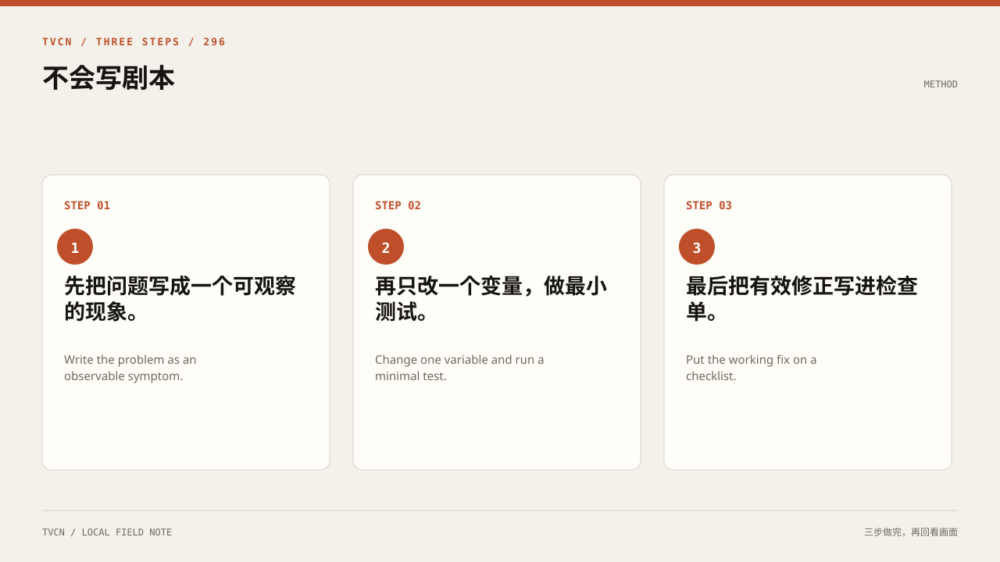

把这三行写成开头、冲突、结尾三个 beat，每个 beat 只写一个动作。读给一个没看过的人，问他能不能复述。不能复述，不是演员问题，是结构还没写清。

<!-- DIAGRAM_START -->
<h2>图解</h2>
<figure>
  
  <figcaption>看“八格分别写“谁做什么”，不写情绪和解…”和“给每格标一个能拍的地点、道具和时间”两处，判断症状能不能被复述成一句可观察的话。</figcaption>
</figure>
<!-- DIAGRAM_END -->
<section><h2 id="section-1">先写三行，不写十页</h2>
<ul><li><strong>谁：</strong>一个具体的人，带职业、年龄或一个正在做的动作。</li><li><strong>想要什么：</strong>一个今天能完成、能被看见的目标。</li><li><strong>被什么挡住：</strong>一个具体的人、规则、时间或自己的恐惧。</li></ul>
<h2 id="section-2">一个一页纸测试</h2>

<h2 id="section-3">什么时候不要即兴</h2>

没有终点就不要即兴。即兴适合在清晰的目标和障碍之间找细节，不适合替代结构。先写一页，再让演员在页内自由。
</section><section><h2 id="section-4">现场</h2>
画 8 格：每格一个动作，不许写对白；画完按顺序讲，讲不顺就改格。
</section><section><h2 id="section-5">怎么做</h2>
不会写剧本就先写八格分镜，每格只写一个动作；动作会逼出对白，而不是反过来。
<ol><li>八格分别写“谁做什么”，不写情绪和解释。</li><li>给每格标一个能拍的地点、道具和时间。</li><li>把八格连起来读，删掉重复信息；缺因果的地方补一个动作。</li></ol></section><section><h2 id="section-6">别踩</h2>
别先写大段对白；没有动作支撑的台词，现场会像朗读。
</section><section><h2>边界</h2>
它不保证故事成立；模板只管结构顺序，人物、障碍和代价仍要单独写。
</section><section><h2>替代</h2>
如果“八格分别写“谁做什么”，不写情绪和解…”不是你的主问题，先用“给每格标一个能拍的地点、道具和时间”对应的基础做法；两项都成立再考虑升级。
</section><section><h2>60 秒自测</h2>
用现有器材按“八格分别写“谁做什么”，不写情绪和解…”做一次 60 秒测试，记下一个数字；数字没有变化，就不要加预算。
</section><section><h2>什么时候不该用</h2>
当“八格分别写“谁做什么”，不写情绪和解…”还没写清，或“给每格标一个能拍的地点、道具和时间”只是凑数时，不要套模板；先回到人物和问题。
</section><section><h2>三个失败</h2><ul><li>模板每段都有，但人物没有决定。</li><li>中段只换场景，没有新信息。</li><li>结尾靠旁白总结，画面没有变化。</li></ul></section>
<h2>验收</h2><ul><li>八格每格只有一个动作，没有情绪形容词。</li><li>每格都有可拍的地点、道具和时间。</li><li>按顺序读能看出因果，重复信息已删。</li></ul>
