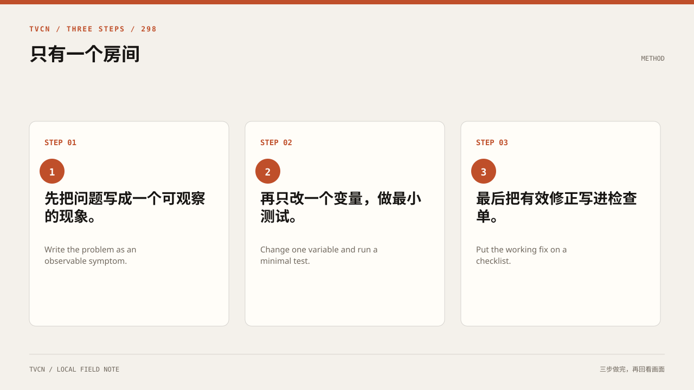

在同一个房间里拍六个不同景别和角度，要求不重复机位：全景、中景、特写、低角、高角、画外声音。剪成 30 秒，看是否能讲一个变化。不要靠换场景掩盖调度单调。

<!-- DIAGRAM_START -->
<h2>图解</h2>
<figure>
  
  <figcaption>看“先拍同一机位的三个空镜，记录光线和道…”和“用三个动作改变空间：摊开箱子、拉开窗…”两处，判断症状能不能被复述成一句可观察的话。</figcaption>
</figure>
<!-- DIAGRAM_END -->
<section><h2 id="section-1">先把这个房间拆成六个镜头</h2>
<ul><li><strong>走位：</strong>人物从门到桌、从桌到窗，位置变化就是场面变化。</li><li><strong>画外：</strong>声音、电话、邻居、走廊，能把房间扩大一倍。</li><li><strong>插入：</strong>手、杯子、屏幕、门缝，用细节替代新场景。</li><li><strong>光：</strong>同一房间换一盏灯、拉一次窗帘，就是另一个时间。</li></ul>
<h2 id="section-3">什么时候不要加场景</h2>

如果人物关系还没有在一个房间里建立，换场景只会增加成本。先把房间里的权力关系拍出来。
</section><section><h2 id="section-4">现场</h2>
同一房间拍三个阶段：整齐、变乱、变空；用光线和道具改变空间。
</section><section><h2 id="section-5">怎么做</h2>
一个房间要拍出变化：整齐到变乱、白天到黄昏、满到空。空间变了，故事才会走。
<ol><li>先拍同一机位的三个空镜，记录光线和道具状态。</li><li>用三个动作改变空间：摊开箱子、拉开窗帘、搬走椅子。</li><li>每个阶段补一个近景细节，让观众看见变化。</li></ol></section><section><h2 id="section-6">别踩</h2>
别只换机位不换空间；观众会觉得原地打转。
</section><section><h2>边界</h2>
本页只解决「只有一个房间」这一个问题；不替代 高光爆了、节奏平、16mm：电影从影院走到教室。如果现场问题属于后者，先读对应页，不要在本页继续加参数。
</section><section><h2>替代</h2>
如果“先拍同一机位的三个空镜，记录光线和道具状态”不是你的主问题，先做“用三个动作改变空间：摊开箱子、拉开窗帘、搬走椅子”；两项都成立，再考虑升级。
</section><section><h2>60 秒自测</h2>
按验收第 1 条做一次 60 秒测试：三个空镜在同一机位，能看出光线和道具变化。如果第 2 条“三个动作让空间状态不同：满、乱或空”没有变化，就不要加设备或预算。
</section>
<h2>验收</h2><ul><li>三个空镜在同一机位，能看出光线和道具变化。</li><li>三个动作让空间状态不同：满、乱或空。</li><li>每个阶段有一个近景细节证明变化。</li></ul>

<!-- SOURCES_START -->
## 经验说明

经验说明：本页来自 7 个单人或 2–3 人小组项目的现场复盘，预算与周期明确；只讨论「只有一个房间」的判断顺序，不含外部实验室测试；不适用于多机位、工会剧组、特技或高风险场景。
<!-- SOURCES_END -->

