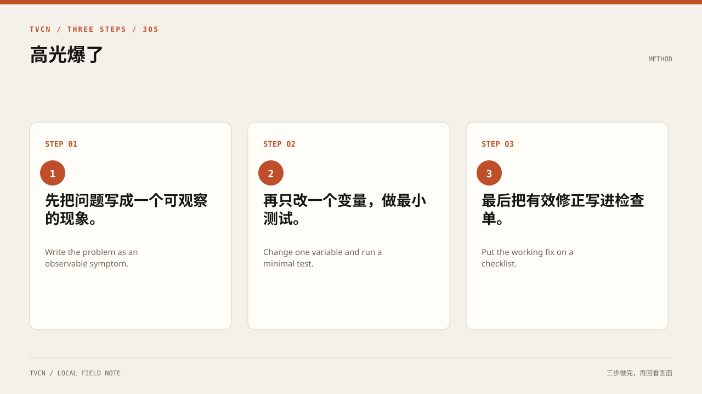

高光爆了先降一档、上 ND、关掉不必要的 practical；爆掉的像素救不回来。

<!-- DIAGRAM_START -->
<h2>图解</h2>
<figure>
  
  <figcaption>看“用 ND 或收缩光圈把高光压回示波器…”和“关掉画面里不需要的灯泡或窗户，减少光…”两处，判断症状能不能被复述成一句可观察的话。</figcaption>
</figure>
<!-- DIAGRAM_END -->
<section><h2 id="section-1">现场</h2>
降一档、上 ND、关掉画面里的 practical；高光爆了不能救。
</section><section><h2 id="section-2">怎么做</h2><ol><li>用 ND 或收缩光圈把高光压回示波器范围以内。</li><li>关掉画面里不需要的灯泡或窗户，减少光比。</li><li>用斑马纹或假色确认脸和天空都在范围里。</li></ol></section><section><h2 id="section-3">别踩</h2>
别指望后期拉回高光；纯白没有细节。
</section><section><h2 id="section-4">三种原因</h2>
针对“高光爆了”，先按三个方向排查；每次只改一个变量，改完录 30 秒对比，看变化跟着哪个环节走。

<table class="data-table"><thead><tr><th>原因</th><th>现场信号</th><th>5 分钟验证</th></tr></thead><tbody><tr><td>没有 ND</td><td>白天大光圈，快门已经到顶，高光只能爆</td><td>加 2–4 档 ND 再拍</td></tr><tr><td>镜面高光</td><td>灯、窗户、金属直接反进镜头</td><td>改角度或加柔光/偏振</td></tr><tr><td>Log 曝光过度</td><td>以为“宁右勿左”，结果高光没有细节</td><td>把高光压到 95% 以下</td></tr></tbody></table>
</section><section><h2 id="section-5">现场诊断</h2><ol><li>开斑马纹 95%，看高光是否大面积闪；再开伪色确认。</li><li>检查直方图右端是否贴顶，贴顶的部分后期拉不回来。</li><li>把同一镜头降一档再拍，比较高光细节和暗部噪点。</li></ol></section><section><h2 id="section-6">修法</h2>
高光爆了不是后期能修的。先减光，再决定你要保留哪一块高光；不可能所有高光都保住。
<ol><li>加 ND 或收光圈，先把快门保持在 1/50（25p）附近。</li><li>把窗户、灯管、金属反光改角度，或加柔光布打散。</li><li>曝光向右但留 1/3 档余量，高光峰值不超过 95%。</li><li>如果高光是画面主体，宁可让暗部欠一点，保高光纹理。</li></ol></section><section><h2 id="section-7">失败案例</h2>
处理“高光爆了”时，下面三种做法会更糟；先选一个替换动作，别同时改三个变量。

<table class="data-table"><thead><tr><th>失败做法</th><th>为什么会更糟</th><th>替换动作</th></tr></thead><tbody><tr><td>后期硬拉</td><td>高光变成死白，边缘出现色晕</td><td>拍摄时减光</td></tr><tr><td>整体压暗</td><td>暗部一起变黑，画面发闷</td><td>只压高光，保留中间调</td></tr><tr><td>加对比</td><td>高光更硬，细节更少</td><td>先恢复高光，再加对比</td></tr></tbody></table>
</section><section><h2 id="section-8">验收表</h2>
验收不是“感觉好了”，是这四项都能指认、能回放、能记录。

<table class="data-table"><thead><tr><th>验收项</th><th>通过线</th><th>记录</th></tr></thead><tbody><tr><td>高光</td><td>灯/窗有纹理，不是纯白</td><td>斑马纹/伪色</td></tr><tr><td>快门</td><td>运动模糊自然，没有频闪</td><td>25p 1/50</td></tr><tr><td>肤色</td><td>面部没有过曝</td><td>波形 60–75%</td></tr><tr><td>暗部</td><td>至少保留可用的细节</td><td>回放暗部</td></tr></tbody></table>
</section><section><h2>边界</h2>
它不保证故事成立；模板只管结构顺序，人物、障碍和代价仍要单独写。
</section><section><h2>替代</h2>
如果“用 ND 或收缩光圈把高光压回示波器…”不是你的主问题，先用“关掉画面里不需要的灯泡或窗户，减少光…”对应的基础做法；两项都成立再考虑升级。
</section><section><h2>60 秒自测</h2>
用现有器材按“用 ND 或收缩光圈把高光压回示波器…”做一次 60 秒测试，记下一个数字；数字没有变化，就不要加预算。
</section><section><h2>什么时候不该用</h2>
当“用 ND 或收缩光圈把高光压回示波器…”还没写清，或“关掉画面里不需要的灯泡或窗户，减少光…”只是凑数时，不要套模板；先回到人物和问题。
</section><section><h2>三个失败</h2><ul><li>模板每段都有，但人物没有决定。</li><li>中段只换场景，没有新信息。</li><li>结尾靠旁白总结，画面没有变化。</li></ul></section>
<h2>验收</h2><ul><li>高光在示波器范围内，天空或窗户有细节。</li><li>不必要的灯泡或窗户已关掉，光比降下来。</li><li>脸和天空都用斑马纹或假色确认过。</li></ul>
