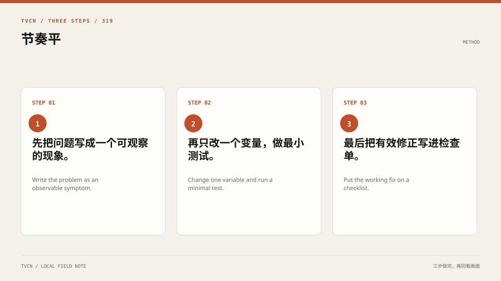

针对“节奏平”，先按三个方向排查；每次只改一个变量，改完录 30 秒对比，看变化跟着哪个环节走。

<!-- DIAGRAM_START -->
<h2>图解</h2>
<figure>
  
  <figcaption>看“把一场戏的镜头长度列出来，避免连续三…”和“在信息点前缩短，在反应点后留长”两处，判断症状能不能被复述成一句可观察的话。</figcaption>
</figure>
<!-- DIAGRAM_END -->
<section><h2 id="section-1">现场</h2>
连续三个同长度镜头就改一个：长、短、长；让观众有呼吸。
</section><section><h2 id="section-2">怎么做</h2><ol><li>把一场戏的镜头长度列出来，避免连续三个一样长。</li><li>在信息点前缩短，在反应点后留长。</li><li>用动作和声音做节拍，不要每刀都卡音乐。</li></ol></section><section><h2 id="section-3">别踩</h2>
别靠全程快剪；没有呼吸，观众会累。
</section><section><h2 id="section-4">三种原因</h2>
<table class="data-table"><thead><tr><th>原因</th><th>现场信号</th><th>5 分钟验证</th></tr></thead><tbody><tr><td>每个镜头一样长</td><td>观众感觉像在看幻灯片</td><td>把每 10 秒的信息变化标出来</td></tr><tr><td>没有反应镜头</td><td>只有动作，没有人物对动作的态度</td><td>在每个动作后补一个反应</td></tr><tr><td>音乐匀速</td><td>音乐从头到尾一个强度，画面没有呼吸</td><td>让音乐在转折点进退</td></tr></tbody></table>
</section><section><h2 id="section-5">现场诊断</h2><ol><li>关掉音乐看一遍，标出每 10 秒观众知道了什么新信息。</li><li>数每个场景的镜头数和平均时长；如果都一样，节奏一定平。</li><li>找三个可以停 1 秒的地方：动作完成、台词落地、反应出现。</li></ol></section><section><h2 id="section-6">修法</h2>
节奏不是把镜头剪短，而是让信息有增有减。先让动作切，再让停顿承担压力。
<ol><li>用动作切：开门、放杯、转身，动作完成点就是切点。</li><li>把空镜缩短到只保留信息的一秒；不要用空镜填时长。</li><li>在每个转折前留一个停顿，让观众预期下一句。</li><li>音乐只在转折点进入或退出，不要全程铺满。</li></ol></section><section><h2 id="section-7">失败案例</h2>
处理“节奏平”时，下面三种做法会更糟；先选一个替换动作，别同时改三个变量。

<table class="data-table"><thead><tr><th>失败做法</th><th>为什么会更糟</th><th>替换动作</th></tr></thead><tbody><tr><td>全部加速</td><td>观众来不及读画面，只剩晕</td><td>只缩短没有信息的镜头</td></tr><tr><td>每句都切</td><td>切点太密，表演被切碎</td><td>让一个动作跨两个镜头</td></tr><tr><td>用音乐硬推</td><td>音乐到了，画面没有变化</td><td>先改画面信息，再加音乐</td></tr></tbody></table>
</section><section><h2 id="section-8">验收表</h2>
验收不是“感觉好了”，是这四项都能指认、能回放、能记录。

<table class="data-table"><thead><tr><th>验收项</th><th>通过线</th><th>记录</th></tr></thead><tbody><tr><td>前 30 秒</td><td>至少有 3 个信息变化点</td><td>逐段标记</td></tr><tr><td>镜头长度</td><td>不是每个镜头同一长度</td><td>统计时间线</td></tr><tr><td>停顿</td><td>至少有一个 1 秒停顿承担压力</td><td>回放转折段</td></tr><tr><td>音乐</td><td>音乐有进入和退出，不全程满</td><td>solo 音乐轨</td></tr></tbody></table>
</section><section><h2>边界</h2>
它不保证故事成立；模板只管结构顺序，人物、障碍和代价仍要单独写。
</section><section><h2>替代</h2>
如果“把一场戏的镜头长度列出来，避免连续三…”不是你的主问题，先用“在信息点前缩短，在反应点后留长”对应的基础做法；两项都成立再考虑升级。
</section><section><h2>60 秒自测</h2>
用现有器材按“把一场戏的镜头长度列出来，避免连续三…”做一次 60 秒测试，记下一个数字；数字没有变化，就不要加预算。
</section><section><h2>什么时候不该用</h2>
当“把一场戏的镜头长度列出来，避免连续三…”还没写清，或“在信息点前缩短，在反应点后留长”只是凑数时，不要套模板；先回到人物和问题。
</section><section><h2>三个失败</h2><ul><li>模板每段都有，但人物没有决定。</li><li>中段只换场景，没有新信息。</li><li>结尾靠旁白总结，画面没有变化。</li></ul></section>
<h2>验收</h2><ul><li>镜头长度没有连续三个一样。</li><li>信息点前短、反应点后长。</li><li>节拍来自动作和声音，不是每刀卡音乐。</li></ul>
