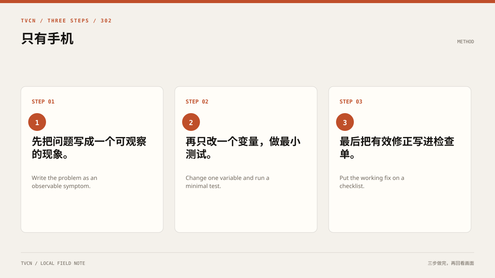

手机拍片先锁曝光和白平衡，再配一个能固定的东西；稳定和收音比镜头重要。

<!-- DIAGRAM_START -->
<h2>图解</h2>
<figure>
  
  <figcaption>把三步按顺序做完，再回看画面或文件。</figcaption>
</figure>
<!-- DIAGRAM_END -->
<h2>现场</h2>

锁曝光和白平衡，用三脚架或靠墙；外接领夹麦，先保声音。

<h2>怎么做</h2>

手机拍片先锁曝光和白平衡，再配一个能固定的东西；稳定和收音比镜头重要。
<ol><li>长按屏幕锁自动曝光和对焦，手动拉低曝光保护高光。</li><li>用三脚架、靠墙或书包固定，关掉会裁切的电子防抖。</li><li>外接领夹麦或录音机，离嘴十五到二十厘米，另录一条环境声。</li></ol>
<h2>别踩</h2>

别边走边手持；手机一抖，观众先晕。

<h2>验收</h2>
<ul><li>曝光和白平衡锁定，高光没有大面积死白。</li><li>画面稳定，没有边走边抖。</li><li>对白干净，另有一条环境声。</li></ul>
