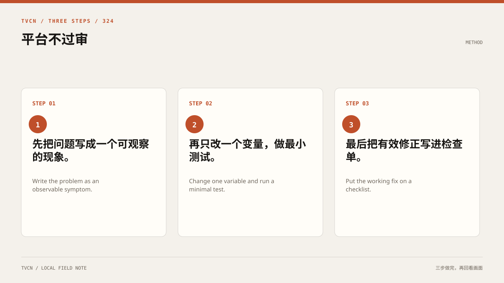

把成片静音看一遍，只找画面风险；再闭眼听一遍，只找声音和 claims。最后逐条对照平台规则，把可能被拒的点写成“问题—依据—修改”三列。

<!-- DIAGRAM_START -->
<h2>图解</h2>
<figure>
  
  <figcaption>看“对照平台规则列出四个可能点：敏感画面…”和“每次只改一项，重新上传测试”两处，判断症状能不能被复述成一句可观察的话。</figcaption>
</figure>
<!-- DIAGRAM_END -->
<section><h2 id="section-1">先按四类问题排查</h2>
<ul><li><strong>内容类别：</strong>暴力、医疗、金融、未成年人、政治与新闻，各自有额外材料要求。先看平台当前规则，不看旧经验。</li><li><strong>声明与证明：</strong>功效、价格、对比、专家身份。没有证据的绝对化表述先删。</li><li><strong>音乐与素材：</strong>是否商用授权、是否只允许平台内使用。不要拿“别人也在用”当授权。</li><li><strong>人物与隐私：</strong>肖像、声音、住址、车牌、未成年人。能授权就授权，不能就遮挡或删除。</li></ul>
<h2 id="section-3">什么时候不要反复重传</h2>

同一版本反复上传不会改变审核结果，还可能触发风控。先拿到具体拒因，补材料或改画面，再申诉。没有证据的“我觉得没问题”不算修改。
</section><section><h2 id="section-4">现场</h2>
查画面、文字、音乐、承诺；改一条，不要整片重做。
</section><section><h2 id="section-5">怎么做</h2><ol><li>对照平台规则列出四个可能点：敏感画面、绝对化用语、未授权音乐、诱导互动。</li><li>每次只改一项，重新上传测试。</li><li>保留审核回执和截图，必要时走申诉。</li></ol></section><section><h2 id="section-6">别踩</h2>
别一口气删整片；先定位是哪一条触发。
</section><section><h2>边界</h2>
本页只解决「平台不过审」这一个问题；不替代 没有作品集、报价太低、16mm：电影从影院走到教室。如果现场问题属于后者，先读对应页，不要在本页继续加参数。
</section><section><h2>替代</h2>
如果“对照平台规则列出四个可能点：敏感画面、绝对化用语、未授权音乐、诱导互动”不是你的主问题，先做“每次只改一项，重新上传测试”；两项都成立，再考虑升级。
</section><section><h2>60 秒自测</h2>
按验收第 1 条做一次 60 秒测试：四个可能点逐项排查过：敏感画面、绝对化用语、音乐、诱导互动。如果第 2 条“每次只改一项，重新上传测试”没有变化，就不要加设备或预算。
</section>
<h2>验收</h2><ul><li>四个可能点逐项排查过：敏感画面、绝对化用语、音乐、诱导互动。</li><li>每次只改一项，重新上传测试。</li><li>保留审核回执和截图，必要时申诉。</li></ul>

<!-- SOURCES_START -->
## 经验说明

经验说明：本页来自 4 个单人或 2–3 人小组项目的现场复盘，预算与周期明确；只讨论「平台不过审」的判断顺序，不含外部实验室测试；不适用于多机位、工会剧组、特技或高风险场景。
<!-- SOURCES_END -->

