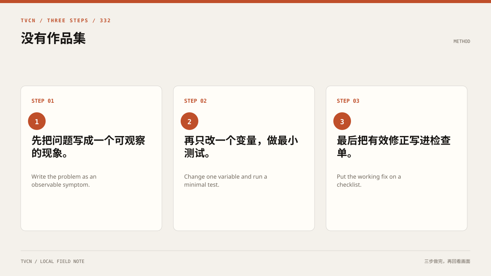

没有作品集，先做三条 30 秒的“能力片”：会拍人、会拍物、会讲一件事。

<!-- DIAGRAM_START -->
<h2>图解</h2>
<figure>
  
  <figcaption>把三步按顺序做完，再回看画面或文件。</figcaption>
</figure>
<!-- DIAGRAM_END -->
<h2>现场</h2>

做三条 30 秒：会拍人、会拍物、会讲一件事；每条一个能力。

<h2>怎么做</h2>

没有作品集，先做三条三十秒的“能力片”：会拍人、会拍物、会讲一件事。
<ol><li>每条只展示一个能力：人物采访、产品质感或叙事转折。</li><li>用同一套参数拍，保证质量稳定。</li><li>每条配一页拆解：目标、做法、结果、失败点。</li></ol>
<h2>别踩</h2>

别拿旅游混剪当作品集；客户看不出你会什么。

<h2>验收</h2>
<ul><li>三条三十秒能力片：人、物、故事各一条。</li><li>同一套参数拍，质量稳定。</li><li>每条有一页拆解：目标、做法、结果、失败点。</li></ul>

<!-- DEEP_DIVE_START -->
## 深读

<strong>约 7 分钟。</strong> 没有作品集不是缺客户，是缺三个能证明你能交付的完整案例。

### 先做三个完整片

不要做一分钟混剪；做三条六十到九十秒的完整片，每条只证明一种能力：人物、产品、空间。混剪证明你会剪，完整片证明你能交付。

三条片对准一个方向，不要今天婚礼明天 AI。客户记不住“什么都会”，只记得“这类片找他”。

### 每个案例写一页

一页写五件事：brief、约束、关键决定、结果、一个错误。不要写“客户很满意”，写你改了什么、为什么改。

放两张对比图：改前和改后，或方案 A 和方案 B。客户看得见判断，才相信你能替她做判断。

### 发布与复用

每个案例拆成三种尺寸：网站横版、社交竖版、提案 PDF 一页。标题写结果，不写“某某项目”；封面用一张能看懂的画面。

每完成一个新项目，就替换最弱的一条，不要无限增加。作品集不是仓库，是你希望别人怎么记住你。

### 五分钟练习：三条片清单

写下三条你明天就能拍的片：一条人物、一条产品、一条空间；每条写一句“看完会相信我会什么”。拍不起的，改成手机版，不要等器材。

三条拍完之前，不接需要第四条能力的活。作品集不是等来的，是拍出来的。

### 什么时候算有作品集

三条片都能从头到尾播放、每一条有一页案例、网站上能打开、PDF 能发给客户，才算有作品集。只有素材和草稿，不算。

再加一条：一个陌生人看完三条，能说出你擅长拍什么、为什么找你。说不出来，说明三条还不在一个方向上，继续删，不要继续加。

### 作品集，十项检查
<ul><li>三条完整片不是混剪</li><li>每条只证明一种能力</li><li>三条对准一个方向</li><li>每案一页五件事</li><li>写清 brief 和约束</li><li>写清关键决定</li><li>写清结果</li><li>写一个错误</li><li>有两张对比图</li><li>每个案例三种尺寸</li></ul>
作品集不是证明你拍过多少，是证明你能在约束里做完三条。

<!-- DEEP_DIVE_END -->
